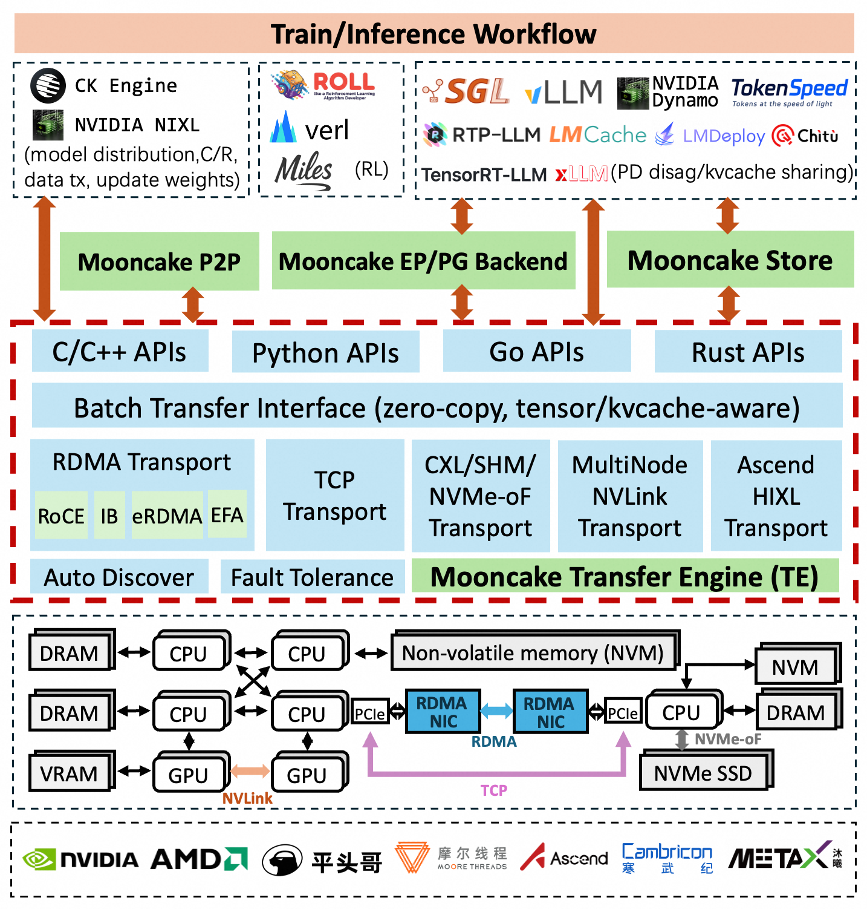
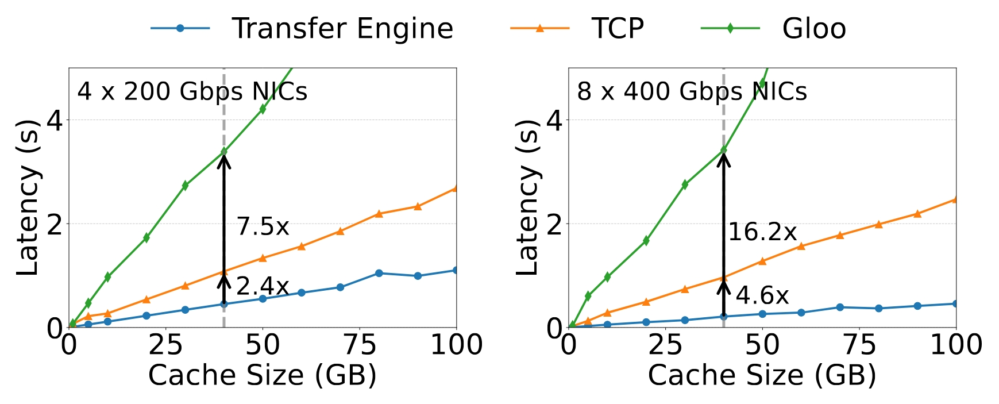
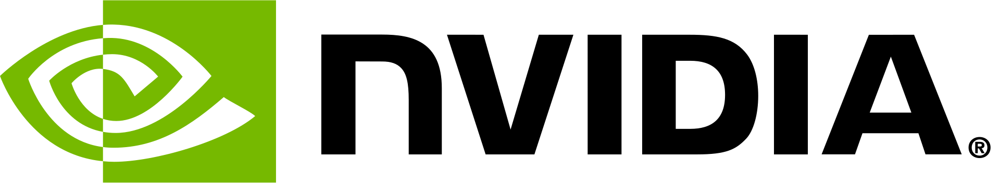
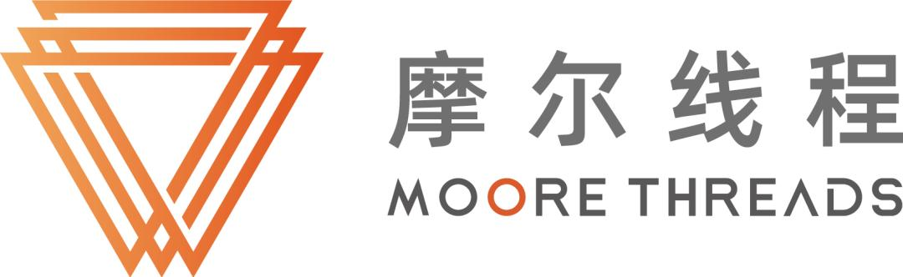
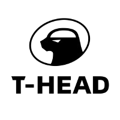
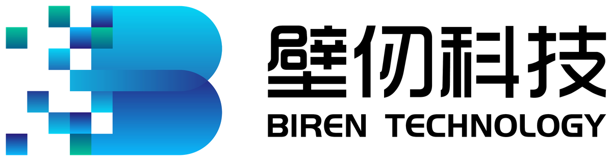

<div align="center">
  
  <h2 align="center">
      A KVCache-centric Disaggregated Architecture for LLM Serving
  </h2>
  <a href="https://www.usenix.org/system/files/fast25-qin.pdf" target="_blank"><strong>Paper</strong></a>
  | <a href="https://www.usenix.org/system/files/fast25_slides-qin.pdf" target="_blank"><strong>Slides</strong></a>
  | <a href="FAST25-release/traces" target="_blank"><strong>Traces</strong></a>
  | <a href="https://kvcache-ai.github.io/Mooncake/" target="_blank"><strong>Documentation</strong></a>
  | <a href="https://kvcache.ai/" target="_blank"><strong>Blog</strong></a>
  | <a href="https://join.slack.com/t/mooncake-project/shared_invite/zt-3qx4x35ea-zSSTqTHItHJs9SCoXLOSPA" target="_blank"><strong>Slack</strong></a>
  <br />
  <br />

  [](https://pypi.org/project/mooncake-transfer-engine)
  [](https://github.com/kvcache-ai/Mooncake/graphs/commit-activity)
  [](https://github.com/kvcache-ai/Mooncake/blob/main/LICENSE-APACHE)
  [](https://hub.docker.com/r/kvcacheai/mooncake)
  <br />

  [](https://pypi.org/project/mooncake-transfer-engine)
  [](https://pypi.org/project/mooncake-transfer-engine-cuda13)
  [](https://pypi.org/project/mooncake-transfer-engine-non-cuda/)
  [](https://pypi.org/project/mooncake-transfer-engine-npu/)
  [](https://pypi.org/project/mooncake-transfer-engine-musa/)
  [](https://pypi.org/project/mooncake-transfer-engine-efa/)
  [](https://pypi.org/project/mooncake-transfer-engine-rocm/)
</div>
<br/>

Mooncake is the serving platform for  <a href="https://kimi.ai/"> Kimi</a>, a leading LLM service provided by <a href="https://www.moonshot.cn/"> Moonshot AI</a>.
Under real workloads, Mooncake’s innovative architecture enables Kimi to handle 75% more requests while adhering to SLOs.

<h2 id="updates">🔄 Updates</h2>

<!-- Keep the seven most recent updates visible; archive older entries below. New PR/release dates use Asia/Shanghai (UTC+8). -->

- **Oct 10, 2026**: TensorRT-LLM merged a native [Mooncake Store connector](https://github.com/NVIDIA/TensorRT-LLM/pull/19171) into KVCMv2, enabling content-addressed KV cache pooling and prefix reuse across serving instances.
- **Oct 6, 2026**: [TokenSpeed v0.1.1](https://github.com/lightseekorg/tokenspeed/releases/tag/v0.1.1) includes Mooncake Store as an L3 KV cache backend beneath its host cache, alongside Mooncake Transfer Engine support for PD and EPD disaggregation.
- **Sept 17, 2026**: vLLM added [cross-encoder embedding reuse](https://github.com/vllm-project/vllm/pull/56242) through Mooncake Store, complementing its [encoder-cache transfer connector](https://github.com/vllm-project/vllm/pull/41567) for multimodal disaggregated serving. Both capabilities are included in [vLLM v0.31.0](https://github.com/vllm-project/vllm/releases/tag/v0.31.0).
- **Aug 28, 2026**: LMDeploy merged [Mooncake Store support](https://github.com/InternLM/lmdeploy/pull/4903), enabling shared KV cache pooling and prefix reuse across PyTorch inference instances. Included in [LMDeploy v0.18.0](https://github.com/InternLM/lmdeploy/releases/tag/v0.18.0).
- **Aug 24, 2026**: [AgentX / InferenceX v3](https://newsletter.semianalysis.com/p/agentx-inferencexv3-does-cuda-moat) highlights Mooncake's contributions to agentic inference workloads, including ROCm wheels, CI, and packaging improvements. [Mooncake optimization details](https://inferencex.semianalysis.com/agentx/optimizations/mooncake).

<details>
<summary>More</summary>

- **Aug 20, 2026**: Mooncake is integrated into [Miles](https://github.com/radixark/miles) as a rollout data-transfer backend for the fragmented, heterogeneous data moving between rollout and training in disaggregated RL. Blogs: [KVCache.AI](https://kvcache.ai/blog/mooncake-rl-rollout-data-transfer/), [lmsys](https://www.lmsys.org/blog/2026-08-20-miles-mooncake-rollout-data-transfer).
- **Aug 17, 2026**: Mooncake is integrated into [Speculators](https://github.com/vllm-project/speculators) as a distributed backend for multi-node online training, efficiently moves hidden-state between vLLM inference workers and Speculators trainers through RDMA, eliminating the need for massive hidden-state storage in offline training. [Benchmark on GB300 NVL72](https://x.com/mgoin_/status/2072785822231728363).
- **Aug 5, 2026**: llm-d added a [Mooncake PD deployment guide](https://github.com/llm-d/llm-d/pull/1511), complementing its [Mooncake Store tiered offloading integration](https://github.com/llm-d/llm-d/pull/1826) for vLLM serving on Kubernetes.
- **Aug 1, 2026**: Dynamo merged an [event-driven Mooncake shared-cache index](https://github.com/ai-dynamo/dynamo/pull/11239) for SGLang HiCache routing, using Mooncake object events to track reusable KV pages in the shared pool.
- **Jul 24, 2026**: FlexKV added [Mooncake Store as a distributed REMOTE-tier backend](https://github.com/taco-project/FlexKV/pull/231), enabling content-addressed KV cache sharing alongside its existing Mooncake Transfer Engine integration.
- **Jul 12, 2026**: TransferQueue added [GPUDirect RDMA support for its Mooncake Store backend](https://github.com/Ascend/TransferQueue/pull/131), enabling GPU clients to exchange RL tensors with the host-memory store through GDR.
- **May 7, 2026**: 🚀 [vLLM officially features Mooncake Store](https://vllm.ai/blog/mooncake-store) — a deep dive into how Mooncake's distributed KVCache engine supercharges vLLM inference with high-throughput, memory-efficient, cross-instance KV cache sharing!
- **Apr 29, 2026**: SGLang introduces [RDMA-based P2P weight transfer for large-scale distributed RL](https://lmsys.org/blog/2026-04-29-p2p-update/) using Mooncake TransferEngine, achieving 7x faster weight updates for the 1T-parameter Kimi-K2 model (53s → 7.2s) with zero-copy RDMA transfer across thousands of GPUs.
- **Apr 3, 2026**: LMCache introduced a native [Mooncake Store L2 adapter for multiprocess mode](https://github.com/LMCache/LMCache/pull/2911), connecting the LMCache MP server to the distributed KV cache pool.
- **Apr 1, 2026**: The [TENT technical report](https://arxiv.org/abs/2604.00368) introduces declarative data-movement orchestration for heterogeneous interconnects, with evaluations in SGLang HiCache and checkpoint-engine workloads.
- **Mar 19, 2026**: [TorchSpec: Speculative Decoding Training at Scale](https://pytorch.org/blog/torchspec-speculative-decoding-training-at-scale) is [open sourced](https://github.com/torchspec-project/TorchSpec), using Mooncake to decouple inference and training via efficient hidden states management.
- **Mar 16, 2026**: FastDeploy added [Mooncake Store cache read/write support to its PD pipeline](https://github.com/PaddlePaddle/FastDeploy/pull/6768), complementing its [global KV cache pooling](https://github.com/PaddlePaddle/FastDeploy/blob/develop/docs/features/global_cache_pooling.md) across inference instances.
- **Mar 5, 2026**: [LightX2V](https://github.com/ModelTC/LightX2V/pull/893) now supports disaggregated deployment based on Mooncake, enabling encoder/transformer service decoupling with Mooncake Transfer Engine for high-performance cross-device and cross-machine data transfer. Details in [blog](https://light-ai.top/LightX2V-BLOG/posts/Disaggregation/).
- **Mar 3, 2026**: verl added a [Mooncake checkpoint-engine backend](https://github.com/verl-project/verl/pull/5176) for peer-to-peer weight synchronization between training and rollout workers.
- **Feb 25, 2026**: [SGLang](https://github.com/sgl-project/sglang) merged [Encoder Global Cache Manager](https://github.com/sgl-project/sglang/pull/16137), introducing a Mooncake-powered global multimodal embedding cache that enables cross-instance sharing of ViT embeddings to avoid redundant GPU computation.
- **Feb 24, 2026**: [vLLM-Omni](https://docs.vllm.ai/projects/vllm-omni/en/latest/design/feature/disaggregated_inference/) introduces disaggregated inference connectors with support for both `MooncakeStoreConnector` and `MooncakeTransferEngineConnector` for multi-node omni-modality pipelines.
- **Feb 12, 2026**: [Mooncake Joins PyTorch Ecosystem](https://pytorch.org/blog/mooncake-joins-pytorch-ecosystem/) We are thrilled to announce that Mooncake has officially joined the PyTorch Ecosystem!
- **Jan 28, 2026**: [FlexKV](https://github.com/taco-project/FlexKV), a distributed KV store and cache system from Tencent and NVIDIA in collaboration with the community, now supports [distributed KVCache reuse](https://github.com/taco-project/FlexKV/blob/main/docs/dist_reuse/README_en.md) with the Mooncake Transfer Engine.
- **Dec 27, 2025**: Collaboration with [ROLL](https://github.com/alibaba/ROLL)! Check out the paper [here](https://arxiv.org/abs/2512.22560).
- **Dec 23, 2025**: SGLang introduces [Encode-Prefill-Decode (EPD) Disaggregation](https://lmsys.org/blog/2026-01-12-epd/) with Mooncake as a transfer backend. This integration allows decoupling compute-intensive multimodal encoders (e.g., Vision Transformers) from language model nodes, utilizing Mooncake's RDMA engine for zero-copy transfer of large multimodal embeddings.
- **Dec 19, 2025**: Mooncake Transfer Engine has been [integrated into TensorRT LLM](https://github.com/NVIDIA/TensorRT-LLM/tree/main/cpp/tensorrt_llm/executor/cache_transmission/mooncake_utils) for KVCache transfer in PD-disaggregated inference.
- **Dec 19, 2025**: Mooncake Transfer Engine has been directly integrated into vLLM v1 as a [KV Connector](https://docs.vllm.ai/en/latest/features/mooncake_connector_usage/) in PD-disaggregated setups.
- **Nov 07, 2025**: [RBG + SGLang HiCache + Mooncake](https://github.com/sgl-project/rbg/blob/main/keps/74-mooncake-integration/README.md), a role-based out-of-the-box solution for cloud native deployment, which is elastic, scalable, and high-performance.
- **Oct 15, 2025**: SGLang introduced [Mooncake EP and a collective communication backend](https://github.com/sgl-project/sglang/pull/10423) as the foundation for fault-tolerant Elastic Expert Parallel inference.
- **Sept 18, 2025**: Mooncake Store empowers vLLM Ascend by serving as [the distributed KV cache pool backend](https://github.com/vllm-project/vllm-ascend/blob/main/docs/source/user_guide/feature_guide/kv_cache_pool_ascend_store.md).
- **Sept 10, 2025**: SGLang officially supports Mooncake Store as a [hierarchical KV caching storage backend](https://lmsys.org/blog/2025-09-10-sglang-hicache/). The integration extends RadixAttention with multi-tier KV cache storage across device, host, and remote storage layers.
- **Sept 10, 2025**: The official & high-performance version of Mooncake P2P Store is open-sourced as [checkpoint-engine](https://github.com/MoonshotAI/checkpoint-engine/). It has been successfully applied in K1.5 and K2 production training, updating Kimi-K2 model (1T parameters) across thousands of GPUs in ~20s.
- **Aug 23, 2025**: [xLLM](https://github.com/jd-opensource/xllm) high-performance inference engine builds hybrid KV cache management based on Mooncake, supporting global KV cache management with intelligent offloading and prefetching.
- **Aug 18, 2025**: vLLM-Ascend [integrates Mooncake Transfer Engine](https://github.com/vllm-project/vllm-ascend/blob/main/docs/source/tutorials/features/pd_disaggregation_mooncake_multi_node.md) for KV cache register and disaggregate prefill, enabling efficient distributed inference on Ascend NPUs.
- **Jul 20, 2025**: Mooncake powers [the deployment of Kimi K2](https://lmsys.org/blog/2025-07-20-k2-large-scale-ep/) on 128 H200 GPUs with PD disaggregation and large-scale expert parallelism, achieving 224k tokens/sec prefill throughput and 288k tokens/sec decode throughput.
- **Jun 20, 2025**: Mooncake becomes a PD disaggregation [backend](https://kvcache-ai.github.io/Mooncake/deployment/integrations/lmdeploy.html) for LMDeploy.
- **May 9, 2025**: NIXL officially supports Mooncake Transfer Engine as [a backend plugin](https://github.com/ai-dynamo/nixl/blob/main/src/plugins/mooncake/README.md).
- **May 8, 2025**: [Mooncake x LMCache](https://kvcache-ai.github.io/Mooncake/deployment/integrations/lmcache/index.html) unite to pioneer KVCache-centric LLM serving system.
- **May 5, 2025**: Supported by Mooncake Team, SGLang release <a href="https://lmsys.org/blog/2025-05-05-large-scale-ep/" target="_blank">guidance</a> to deploy DeepSeek with PD Disaggregation on 96 H100 GPUs.
- **Apr 22, 2025**: LMCache officially supports Mooncake Store as a <a href="https://blog.lmcache.ai/2025-04-22-tencent/" target="_blank">remote connector</a>.
- **Apr 10, 2025**: SGLang officially supports Mooncake Transfer Engine for disaggregated prefilling and KV cache transfer.
- **Mar 7, 2025**: We open-sourced the Mooncake Store, a distributed KVCache based on Transfer Engine. vLLM's xPyD disaggregated prefilling & decoding based on Mooncake Store will be released soon.
- **Feb 25, 2025**: Mooncake receives the **Best Paper Award** at **FAST 2025**!
- **Feb 21, 2025**: The updated <a href="FAST25-release/traces" target="_blank">traces</a> used in our FAST'25 paper have been released.
- **Dec 16, 2024**: vLLM officially supports Mooncake Transfer Engine for disaggregated prefilling and KV cache transfer.
- **Nov 28, 2024**: We open-sourced the Transfer Engine, the central component of Mooncake. We also provide two demonstrations of Transfer Engine: a P2P Store and vLLM integration.
- **July 9, 2024**: We open-sourced the trace as a <a href="https://github.com/kvcache-ai/Mooncake/blob/main/FAST25-release/arxiv-trace/mooncake_trace.jsonl" target="_blank">JSONL file</a>.
- **June 27, 2024**: We present a series of Chinese blogs with more discussions on <a href="https://zhuanlan.zhihu.com/p/705754254">zhihu 1</a>, <a href="https://zhuanlan.zhihu.com/p/705910725">2</a>, <a href="https://zhuanlan.zhihu.com/p/706204757">3</a>, <a href="https://zhuanlan.zhihu.com/p/707997501">4</a>, <a href="https://zhuanlan.zhihu.com/p/9461861451">5</a>, <a href="https://zhuanlan.zhihu.com/p/1939988652114580803">6</a>, <a href="https://zhuanlan.zhihu.com/p/1959366095443064318">7</a>.
- **June 26, 2024**: Initial technical report release.

</details>

<h2 id="overview">🎉 Overview</h2>

<!--  -->
<div align="center">
  
</div>

Mooncake is an infrastructure project for large-scale LLM inference and training. It features a KV cache-centric disaggregated architecture that separates prefill and decode clusters, while leveraging otherwise underutilized CPU, DRAM, and SSD resources in GPU clusters to build a disaggregated KV cache pool.

Mooncake includes a high-performance Transfer Engine for low-latency data movement across heterogeneous networks and accelerators; Mooncake Store for distributed KV cache and model-weight management; and Mooncake EP & PG for elastic MoE serving. Deeply integrated with ecosystems such as SGLang and vLLM, Mooncake helps LLM systems improve cache reuse, reduce serving latency, and scale efficiently across multi-node clusters.

<h2 id="show-cases">🔥 Show Cases</h2>

### Transfer Engine (TE)

The core of Mooncake is the Transfer Engine (TE), a high-performance data transfer framework. TE offers a unified interface for batched data movement across diverse storage, network, and accelerator environments. By supporting multiple transport protocols, topology-aware routing, multi-NIC bandwidth aggregation, and automatic failover, TE delivers low-latency, scalable, and robust data transmission for distributed AI workloads. See the [Transfer Engine guide](https://kvcache-ai.github.io/Mooncake/design/transfer-engine/index.html) for details.

<details>
<summary>Highlights</summary>

- **Efficient use of multiple RDMA NIC devices.** Transfer Engine supports the use of multiple RDMA NIC devices to achieve the *aggregation of transfer bandwidth*.

- **Topology-aware path selection.** Transfer Engine can *select optimal devices* based on the location (NUMA affinity, etc.) of both source and destination.

- **Robust against temporary network errors.** Once transmission fails, Transfer Engine will try to use alternative paths for data delivery automatically.

- **Superior performance at scale.** With 40 GB of data (equivalent to the size of the KVCache generated by 128k tokens in the LLaMA3-70B model), Mooncake Transfer Engine delivers up to **87 GB/s** and **190 GB/s** of bandwidth in 4×200 Gbps and 8×400 Gbps RoCE networks respectively, which are about **2.4x and 4.6x faster** than the TCP protocol.

<!--  -->


- **Broad support for heterogeneous transports and accelerators.** Transfer Engine provides unified data transfer across diverse protocols, including TCP, RDMA, AWS EFA, NVMe-oF, NVLink, HIP, Barex, CXL, and Ascend-family transports. When built with the corresponding runtime, Transfer Engine can detect accelerator memory and select suitable transport paths for efficient data movement across CUDA, MUSA, HIP, MACA, Cambricon MLU, and Ascend-enabled environments, as well as Intel XPU through TENT. For a complete list of supported protocols and configuration guide, see the [Supported Protocols Documentation](https://kvcache-ai.github.io/Mooncake/getting_started/supported-protocols.html).

- **Widely adopted across the LLM ecosystem.** TE is used in production inference stacks such as [SGLang](https://github.com/sgl-project/sglang), [vLLM](https://github.com/vllm-project/vllm), [TensorRT-LLM](https://github.com/NVIDIA/TensorRT-LLM), [vLLM-Ascend](https://github.com/vllm-project/vllm-ascend), [checkpoint-engine](https://github.com/MoonshotAI/checkpoint-engine), and [NIXL](https://github.com/ai-dynamo/nixl), among others, to efficiently transfer KV cache, embeddings, model weights, and other data.

</details>

### Mooncake Store

Mooncake Store is a high-performance distributed key-value cache storage engine designed for LLM inference. Built on the Transfer Engine, it stores and manages reusable KV caches and model weights across inference clusters, with support for efficient object storage, replication, eviction, and high-bandwidth data transfer. See the [Mooncake Store guide](https://kvcache-ai.github.io/Mooncake/design/mooncake-store.html) for details.

<details>
<summary>Highlights</summary>

- **High bandwidth utilization.** Mooncake Store supports large-object striping, parallel I/O, and end-to-end zero-copy data transfer, fully utilizing aggregated bandwidth across multiple NICs.

- **Multi-tier cache hierarchy**. Mooncake Store supports a multi-level cache design across DRAM and SSD/NVMe, enabling larger cache capacity.

- **Elastic and disaggregated storage.** Mooncake Store decouples KVCache storage from inference engines, allowing storage nodes to be dynamically added or removed while keeping cached data independent from engine restarts, upgrades, and scheduling decisions.

- **Programmatic object management.** Mooncake Store allows applications to control object placement and lifecycle through per-object policies, including replica counts, preferred segments, soft pin, and hard pin. These controls help inference systems protect important KV caches and model weights while guiding replication, placement, and eviction behavior.

- **Broad ecosystem adoption.** Mooncake Store is used across the LLM systems ecosystem as a high-performance distributed storage backend for KV caches, hidden states, and model weights. It supports integrations with [SGLang's Hierarchical KV Caching](https://lmsys.org/blog/2025-09-10-sglang-hicache/), [vLLM's prefill serving](https://docs.vllm.ai/en/latest/features/disagg_prefill.html), and [LMCache](https://kvcache-ai.github.io/Mooncake/deployment/integrations/lmcache/index.html), and has been adopted by systems such as [TorchSpec](https://pytorch.org/blog/torchspec-speculative-decoding-training-at-scale/) and [TransferQueue](https://github.com/Ascend/TransferQueue) to decouple inference, training, and reinforcement-learning workloads through efficient state management and asynchronous data movement.

</details>

### Mooncake EP and Process Group (PG)

Mooncake EP and Mooncake PG extend Mooncake from high-performance data movement to fault-tolerant distributed execution for large-scale MoE inference. Mooncake EP adapts DeepEP-style expert-parallel dispatch and combine operations with rank activeness awareness, while Mooncake PG provides a PyTorch distributed process-group backend with collective communication primitives that can detect failed ranks, report failures to upper layers, and recover ranks without restarting the entire inference service. See the [Mooncake EP & Backend guide](https://kvcache-ai.github.io/Mooncake/api-reference/python/ep-backend.html) for details.

<details>
<summary>Highlights</summary>

- **Fault-tolerant expert parallelism.** Mooncake EP adds `active_ranks` awareness to expert-parallel dispatch and combine APIs, allowing MoE inference systems to route around failed ranks and continue serving with healthy experts.

- **DeepEP-compatible programming model.** Mooncake EP keeps the API largely consistent with DeepEP's low-latency mode, making it easier for inference engines to adopt fault-tolerant expert parallelism without rewriting their MoE communication stack.

- **PyTorch ProcessGroup integration.** Mooncake PG can be registered as a `torch.distributed` backend, enabling standard collective APIs such as `all_gather` while using Mooncake's communication and failure-reporting mechanisms underneath.

- **Elastic rank recovery.** Mooncake PG exposes recovery-oriented primitives such as peer-state polling and rank recovery, allowing replacement processes to rejoin existing process groups and helping inference services recover from partial failures.

- **SGLang integration for production MoE serving.** Mooncake's collective backend and expert-parallel kernels are integrated into SGLang to support fault-tolerant expert-parallel inference for large MoE models, including Elastic Expert Parallel serving scenarios.

</details>

### Tensor-Centric Ecosystem

Mooncake establishes a full-stack, Tensor-oriented AI infrastructure where Tensors serve as the fundamental data carrier. The ecosystem spans from the Transfer Engine, which accelerates Tensor data movement across heterogeneous storage (DRAM/VRAM/NVMe), to Mooncake Store for distributed management of Tensor objects (e.g., KVCache and model weight), up to the Mooncake Backend enabling Tensor-based elastic distributed computing. This architecture is designed to maximize Tensor processing efficiency for large-scale model inference and training.

### SGLang Integration ([Guide](https://kvcache-ai.github.io/Mooncake/deployment/integrations/sglang/index.html))

Mooncake is deeply integrated into [SGLang](https://github.com/sgl-project/sglang/) as a high-performance communication and storage backend. These integrations enable efficient KV cache transfer in PD-disaggregated serving, scalable multi-level KV caching through HiCache, fault-tolerant expert-parallel inference, high-performance multimodal pipeline data movement, and fast RDMA-based weight synchronization for large-scale RL training. Together, Mooncake and SGLang provide a production-oriented foundation for building elastic, high-throughput, and resource-efficient LLM and multimodal serving systems.

<details>
<summary>Details</summary>

- **PD Disaggregated Serving:** SGLang officially supports Mooncake Transfer Engine as a backend for disaggregated serving and KV cache transfer, enabling prefill and decode workers to exchange KV cache data efficiently across devices and machines.

- **Hierarchical KV Caching**: Mooncake Store serves as an external storage backend in SGLang's HiCache system, extending RadixAttention with multi-level KV cache storage across device, host, and remote storage layers.

- **Elastic Expert Parallel**: Mooncake's collective communication backend and expert parallel kernels are integrated into SGLang to enable fault-tolerant expert parallel inference ([Elastic EP](https://www.lmsys.org/blog/2026-03-25-eep-partial-failure-tolerance/)).

- **Cloud-Native SGLang HiCache Deployment with RBG**: The [RBG](https://github.com/sgl-project/rbg) + SGLang HiCache + Mooncake integration provides a role-based, out-of-the-box cloud-native deployment solution that is elastic, scalable, and optimized for high-performance inference workloads.

- **Encode-Prefill-Decode Disaggregation for Multimodal Serving**: SGLang introduces Encode-Prefill-Decode disaggregation with Mooncake as a transfer backend. This enables compute-intensive multimodal encoders, such as Vision Transformers, to be decoupled from language model workers while transferring large embeddings efficiently through Mooncake’s RDMA-based engine.

- **SGLang-Omni Multi-Stage Pipeline Data Transfer**: [SGLang-Omni](https://github.com/sgl-project/sglang-omni) integrates Mooncake as a relay backend for efficient cross-stage tensor and blob transfer in multimodal serving pipelines. This enables high-performance data movement between heterogeneous components such as thinker, talker, codec, and vocoder stages.

- **RDMA-Based P2P Weight Transfer for Distributed RL**: SGLang adopts Mooncake TransferEngine for RDMA-based peer-to-peer weight transfer in large-scale distributed reinforcement learning. This enables zero-copy weight updates across thousands of GPUs and significantly accelerates synchronization for trillion-parameter models.

</details>

### vLLM Integration ([Guide](https://kvcache-ai.github.io/Mooncake/deployment/integrations/vllm/index.html))

Mooncake integrates with [vLLM](https://github.com/vllm-project/vllm) to accelerate large language model serving through high-performance KV cache transfer and distributed KV cache storage. The integration supports both disaggregated prefill-decode serving and cross-instance KV cache sharing, helping vLLM deployments reduce TTFT, improve cache reuse, and scale more efficiently across multi-node inference clusters.

<details>
<summary>Details</summary>

- **Disaggregated prefill-decode serving**: Mooncake enables vLLM to split prefill and decode workloads across different nodes. Through MooncakeConnector, vLLM transfers KV cache blocks from prefill workers to decode workers using Mooncake’s high-performance transfer engine, allowing prefill and decode resources to scale independently while keeping cross-node KV transfer overhead low.

- **Distributed KV cache pooling and sharing**: [Mooncake Store extends vLLM](https://vllm.ai/blog/2026-05-06-mooncake-store) from isolated per-instance KV caches to a shared, cluster-level KV cache pool. Through MooncakeStoreConnector, multiple vLLM instances can store, retrieve, and reuse KV cache blocks based on hash-based prefix caching, reducing redundant prefill computation and improving cache efficiency for workloads with repeated prefixes, especially agentic and multi-turn serving scenarios.

- **vLLM-Omni stage communication**: Mooncake also integrates with [vLLM-Omni](https://github.com/vllm-project/vllm-omni) through `MooncakeTransferEngineConnector` and `MooncakeStoreConnector`, enabling efficient cross-node data exchange between vLLM-Omni stages.

</details>

<h2 id="ecosystem-integrations">🌐 Ecosystem Integrations</h2>

Mooncake connects inference engines, cache middleware, RL systems, and deployment tools. The directory below links to upstream guides and implementations for each integration, checked on Oct 15, 2026.

<details>
<summary>Integration directory</summary>

**TE** = Transfer Engine; **Store** = Mooncake Store; **EP/PG** = expert-parallel and process-group backends. Capabilities depend on the upstream version and configuration; consult the linked guide or implementation when deploying.

| Project | Mooncake components | Integration use cases | Guide or implementation |
| --- | --- | --- | --- |
| SGLang | TE, Store, EP/PG | PD/EPD transfer, HiCache, multimodal embedding caching, weight synchronization, and Elastic EP | [Integration guide](https://kvcache-ai.github.io/Mooncake/deployment/integrations/sglang/index.html), [Elastic EP](https://github.com/sgl-project/sglang/pull/10423) |
| vLLM | TE, Store | PD transfer, shared KV pooling, encoder-cache transfer, and cross-encoder embedding reuse | [PD connector](https://docs.vllm.ai/en/latest/features/mooncake_connector_usage/), [Store connector](https://docs.vllm.ai/en/latest/features/mooncake_store_connector_usage/), [encoder connector](https://docs.vllm.ai/en/latest/features/mooncake_ec_connector_usage/) |
| TokenSpeed | TE, Store | PD/EPD transfer and Store-backed L3 beneath the host KV cache | [Server configuration](https://github.com/lightseekorg/tokenspeed/blob/main/docs/configuration/server.md) |
| TensorRT-LLM | TE, Store | PD transfer and shared KV pooling through the KVCMv2 Store connector merged into main | [TE implementation](https://github.com/NVIDIA/TensorRT-LLM/tree/main/cpp/tensorrt_llm/executor/cache_transmission/mooncake_utils), [Store connector](https://github.com/NVIDIA/TensorRT-LLM/pull/19171) |
| LMDeploy | TE, Store | PD transfer and cross-instance KV prefix reuse | [TE guide](https://kvcache-ai.github.io/Mooncake/deployment/integrations/lmdeploy.html), [Store connector](https://github.com/InternLM/lmdeploy/pull/4903) |
| vLLM-Ascend | TE, Store | NPU PD transfer and KV pooling through AscendStoreConnector | [PD deployment](https://github.com/vllm-project/vllm-ascend/blob/main/docs/source/tutorials/features/pd_disaggregation_mooncake_multi_node.md), [KV pool](https://github.com/vllm-project/vllm-ascend/blob/main/docs/source/user_guide/feature_guide/kv_cache_pool_ascend_store.md) |
| FastDeploy | Store | Global KV pooling and cache reuse in PD serving | [Global cache pooling](https://github.com/PaddlePaddle/FastDeploy/blob/develop/docs/features/global_cache_pooling.md) |
| xLLM | TE, Store | KV transfer and distributed cache management | [KV transfer backends](https://github.com/jd-opensource/xllm/tree/main/xllm/core/kv_cache/transfer) |
| Chitu | TE | Multi-prefill/multi-decode KV transfer over RDMA | [PD disaggregation](https://github.com/thu-pacman/chitu/blob/public-main/chitu/distributed/pd_disaggregation/README.md) |
| LMCache | TE, Store | Remote KV storage, a native MP L2 adapter, and P2P cache sharing | [Store guide](https://docs.lmcache.ai/kv_cache/storage_backends/mooncake.html), [MP adapter](https://docs.lmcache.ai/mp/l2_storage.html#mooncake-store-mooncake-store-native-connector), [P2P backend](https://github.com/LMCache/LMCache/pull/4182) |
| FlexKV | TE, Store | Distributed cache reuse and a content-addressed REMOTE tier | [Distributed reuse](https://github.com/taco-project/FlexKV/blob/main/docs/dist_reuse/README_en.md), [Store backend](https://github.com/taco-project/FlexKV/pull/231) |
| NIXL | TE | Mooncake transport plugin for NIXL data movement | [Plugin guide](https://github.com/ai-dynamo/nixl/blob/main/src/plugins/mooncake/README.md) |
| Dynamo | Store via SGLang HiCache | Shared-pool awareness and event-driven KV cache routing | [HiCache integration](https://github.com/ai-dynamo/dynamo/blob/main/docs/fern/pages/developer-guide/knowledge-base/modular-components/backends/sglang/hicache.md) |
| llm-d | TE, Store via vLLM | Kubernetes PD serving and tiered KV cache offloading | [PD integration](https://github.com/llm-d/llm-d/pull/1511), [Tiered prefix cache](https://github.com/llm-d/llm-d/tree/main/guides/tiered-prefix-cache) |
| RBG | TE, Store via inference engines | Role-based orchestration of Store, PD transfer, and cache reuse | [Deployment examples](https://github.com/sgl-project/rbg/tree/main/examples/inference/ecosystem/mooncake) |
| srt-slurm | TE, Store via inference engines | Slurm deployment and Mooncake service configuration | [Mooncake services](https://github.com/NVIDIA/srt-slurm/blob/main/docs/mooncake-kv-store.md) |
| NeMo RL | Store via TransferQueue | Rollout-to-training data exchange with optional GDR client transfers | [Data plane](https://github.com/NVIDIA-NeMo/RL/blob/main/nemo_rl/data_plane/README.md), [GDR support](https://github.com/NVIDIA-NeMo/RL/pull/3501) |
| TransferQueue | Store | RL tensor/object storage, GDR transfers, and SSD offloading | [Store client](https://github.com/Ascend/TransferQueue/blob/main/transfer_queue/storage/clients/mooncake_client.py), [GDR guide](https://github.com/Ascend/TransferQueue/blob/main/docs/storage_backends/mooncake_gdr.md) |
| verl | TE | Checkpoint-engine backend for trainer-to-rollout weight synchronization | [Mooncake backend](https://github.com/verl-project/verl/blob/main/verl/checkpoint_engine/mooncake_checkpoint_engine.py) |
| checkpoint-engine | TE | Peer-to-peer model-weight distribution and updates | [P2P backend](https://github.com/MoonshotAI/checkpoint-engine) |
| Miles | Store | Rollout-to-training data transfer | [Rollout transfer guide](https://github.com/radixark/miles/blob/main/docs/advanced/mooncake-rollout-transfer.md) |
| TorchSpec | Store | Hidden-state exchange between inference and draft-model training | [Training architecture](https://github.com/torchspec-project/TorchSpec) |
| Speculators | Store | Hidden-state exchange for distributed online draft-model training | [Hidden-state connectors](https://github.com/vllm-project/speculators/tree/main/hs_connectors) |
| vLLM-Omni | TE, Store | Data exchange between multimodal pipeline stages | [Omni connectors](https://github.com/vllm-project/vllm-omni/tree/main/vllm_omni/distributed/omni_connectors/connectors) |
| LightX2V | TE | Encoder/transformer disaggregation for video generation | [Transfer backend](https://github.com/ModelTC/LightX2V/blob/main/lightx2v/disagg/mooncake.py) |
| slime | TE via SGLang | PD-disaggregated rollout serving | [RL serving architecture](https://github.com/THUDM/slime/blob/main/docs/en/advanced/rl-systems.md) |

The Dynamo entry describes SGLang HiCache shared-cache routing. Its separate [KVBM G4 Store adapter proposal](https://github.com/ai-dynamo/dynamo/pull/9786) is still unmerged. NeMo RL's GDR path changes client-side tensor transfers; queued objects remain in Mooncake-managed host memory.

</details>

<h2 id="supported-hardware">🖥️ Supported Hardware</h2>

Mooncake supports hardware backends across accelerator vendors, cloud fabrics, and standard datacenter interconnects, as listed below. See the [supported protocols](https://kvcache-ai.github.io/Mooncake/getting_started/supported-protocols.html) and [Transfer Engine design docs](https://kvcache-ai.github.io/Mooncake/design/transfer-engine/index.html) for details.

|  |  |  |  |  |  |
| --- | --- | --- | --- | --- | --- |
|  |  |  |  |  |  |

<h2 id="quick-start">🚀 Getting Started</h2>

Install Mooncake using `pip`. The `mooncake-transfer-engine` package includes Mooncake Transfer Engine, Mooncake Store, Mooncake EP and PG:

- CUDA < 13.0
```bash
pip install mooncake-transfer-engine
```
- CUDA >= 13.0
```bash
pip install mooncake-transfer-engine-cuda13
```

In addition to CUDA, Mooncake also supports other accelerator backends, along with flexible installation and deployment options. See the guides below for details:

- [Quick Start](https://kvcache-ai.github.io/Mooncake/getting_started/quick-start.html)
- [Build from Source](https://kvcache-ai.github.io/Mooncake/getting_started/build.html)
- [Deployment Guide](https://kvcache-ai.github.io/Mooncake/deployment/mooncake-store-deployment-guide.html)


### Skills for AI Assistants

Mooncake ships a set of **built-in skills** under [`.claude/skills`](.claude/skills) — reusable, task-focused playbooks that an AI coding assistant (such as Claude Code) invokes automatically when your request matches, or that you can run as a slash command.

<details>
<summary>Details</summary>

| Skill | Description |
|-------|-------------|
| `/mooncake-troubleshoot` | Diagnose Mooncake deployment and runtime issues (services, RDMA, env vars, logs). |
| `/mooncake-ci-local` | Run pre-PR local validation via `scripts/run_ci_test.sh`. |
| `/mooncake-api` | Work with the Mooncake Store, Transfer Engine, and EP/Backend Python APIs. |

Install them without cloning the repository via the [Claude Code plugin marketplace](https://code.claude.com/docs/en/plugin-marketplaces):

```text
/plugin marketplace add kvcache-ai/Mooncake --sparse .claude-plugin
/plugin install mooncake-troubleshoot@mooncake
/plugin install mooncake-ci-local@mooncake
/plugin install mooncake-api@mooncake
```

The `--sparse .claude-plugin` flag fetches only the marketplace catalog, and each plugin is published as a `git-subdir` source, so installing one fetches only that single skill directory — never the whole repo. If you are already working inside a Mooncake checkout, the skills under `.claude/skills/` load automatically with no setup.

</details>

<h2 id="trace">📦 Open Source Traces and Tools </h2>

We open-source anonymized request traces containing request arrival times, input and output token counts, and remapped block hashes. These traces are designed to support reproducible simulation and evaluation of caching behavior while preserving user privacy. The released traces and related details are available in [FAST25-release](FAST25-release).

Together with the released traces, we also provide two KV cache analysis tools: a [KV Cache Size Calculator](https://kvcache.ai/tools/kv-cache-size-calculator/) for calculating cache capacity across popular LLM model families, and a [KV Cache Hit Rate Simulator](https://kvcache.ai/tools/kv-cache-hit-rate-simulator/) for analyzing KV cache hit rates and planning cache capacity under different workloads and models. These tools help users better understand KV cache storage costs and caching effectiveness when analyzing or reproducing serving workloads. The tools are open-sourced [here](https://github.com/kvcache-ai/kvcache-blog).

<h2 id="citation">📑 Citation</h2>
Please kindly cite our papers if you find the papers or the traces are useful:

```bibtex
@inproceedings{qin2025mooncake,
  author    = {Ruoyu Qin and Zheming Li and Weiran He and Jialei Cui and Feng Ren and Mingxing Zhang and Yongwei Wu and Weimin Zheng and Xinran Xu},
  title     = {Mooncake: Trading More Storage for Less Computation {\textemdash} A {KVCache-centric} Architecture for Serving {LLM} Chatbot},
  booktitle = {23rd USENIX Conference on File and Storage Technologies (FAST 25)},
  year      = {2025},
  isbn      = {978-1-939133-45-8},
  address   = {Santa Clara, CA},
  pages     = {155--170},
  url       = {https://www.usenix.org/conference/fast25/presentation/qin},
  publisher = {USENIX Association},
  month     = {feb},
}
```

<details>
<summary>More</summary>

```bibtex
@misc{ren2026tentdeclarativeslicespraying,
  title     = {TENT: A Declarative Slice Spraying Engine for Performant and Resilient Data Movement in Disaggregated LLM Serving},
  author    = {Feng Ren and Ruoyu Qin and Teng Ma and Shangming Cai and Zheng Liu and Chao Lei and Dejiang Zhu and Ke Yang and Zheming Li and Jialei Cui and Weixiao Huang and Yikai Zhao and Yineng Zhang and Hao Wu and Xiang Gao and Yuhao Fu and Jinlei Jiang and Yongwei Wu and Mingxing Zhang},
  year      = {2026},
  eprint    = {2604.00368},
  archivePrefix = {arXiv},
  primaryClass  = {cs.DC},
  url       = {https://arxiv.org/abs/2604.00368},
}

@article{sun2026survivingpartialrankfailures,
  title     = {Surviving Partial Rank Failures in Wide Expert-Parallel MoE Inference},
  author    = {Xun Sun and Shaoyuan Chen and Pingchuan Ma and Yue Chen and Ziwei Yuan and Zhanhao Cao and Han Han and Shangming Cai and Teng Ma and Xuchun Shang and Xinpeng Zhao and Ke Yang and Junlin Wei and Lianzhi Lin and Yuji Liu and Feng Ren and Haoran Hu and Cheng Wan and Yingdi Shan and Yongwei Wu and Mingxing Zhang},
  year      = {2026},
  url       = {https://arxiv.org/abs/2605.10670},
}

@article{qin2025mooncake_tos,
  author    = {Qin Ruoyu and Li Zheming and He Weiran and Cui Jialei and Tang Heyi and Ren Feng and Ma Teng and Cai Shangming and Zhang Yineng and Zhang Mingxing and Wu Yongwei and Zheng Weimin and Xu Xinran},
  title     = {Mooncake: A KVCache-centric Disaggregated Architecture for LLM Serving},
  year      = {2025},
  publisher = {Association for Computing Machinery},
  address   = {New York, NY, USA},
  issn      = {1553-3077},
  url       = {https://doi.org/10.1145/3773772},
  doi       = {10.1145/3773772},
  journal   = {ACM Trans. Storage},
  month     = {nov},
  keywords  = {Machine learning system, LLM serving, KVCache},
}

@article{qin2024mooncake_arxiv,
  title  = {Mooncake: A KVCache-centric Disaggregated Architecture for LLM Serving},
  author = {Ruoyu Qin and Zheming Li and Weiran He and Mingxing Zhang and Yongwei Wu and Weimin Zheng and Xinran Xu},
  year   = {2024},
  url    = {https://arxiv.org/abs/2407.00079},
}
```

</details>
