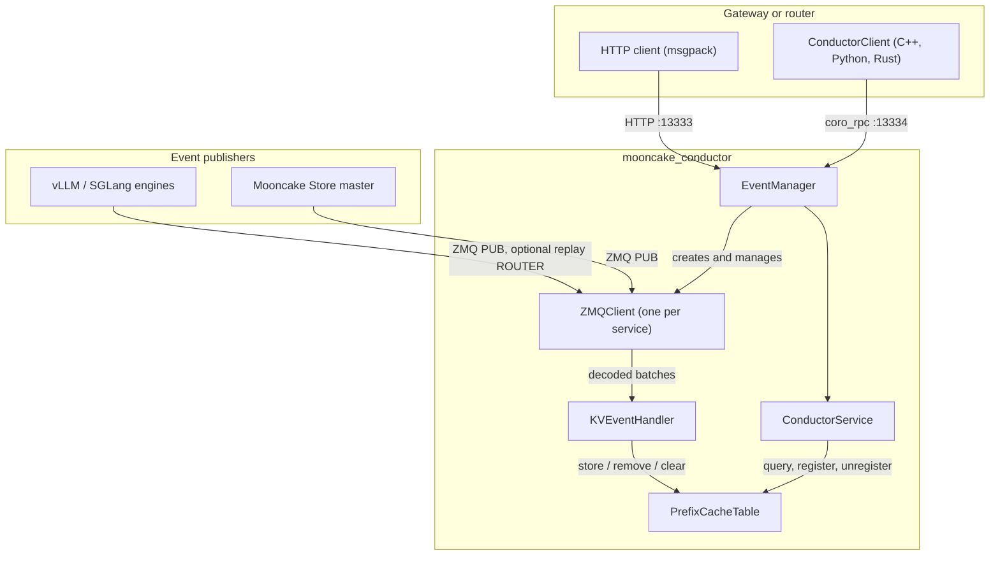

# Conductor Architecture

## Overview

Mooncake Conductor is the KV-cache indexer used by cache-aware routers. It
subscribes to KV cache events from inference engines (vLLM, SGLang) and from
the Mooncake Store master, recomputes those events into its own prefix hashes,
maintains a global prefix cache table, and answers cache-hit queries over HTTP
and RPC.

The design goal is to let routers answer a simple scheduling question:
for this request prefix, which registered instance has the best reusable KV
cache locality, and on which cache tiers is that prefix available?

## Architecture



## Components

| Component | Responsibility |
|---|---|
| `EventManager` | Owns the process lifecycle, the HTTP server, the RPC server, and the active service map. Creates one `ZMQClient` and `KVEventHandler` per registered service. |
| `ConductorService` | Implements `Query`, `Register`, `Unregister`, `GetGlobalView`, and `ListServices`. The HTTP routes and the RPC methods share one instance, so both channels behave the same. |
| `ZMQClient` | Subscribes to one publisher endpoint, validates frames, tracks sequence numbers, and recovers gaps through the replay endpoint when one is configured. |
| `KVEventHandler` | Applies decoded vLLM, SGLang, or Mooncake events to the prefix table using the service's registration metadata and hash profile. |
| `PrefixCacheTable` | Holds per-context prefix entries with per-tier owners, binds each context to one hash profile, and computes query-time hits. |
| `ConductorClient` | RPC client in C++ (`conductor/client`), with a C ABI used by the Python (`mooncake.conductor`) and Rust bindings. |

## Data model

The prefix index is scoped by a context key:

```text
(tenant_id, model_name, lora_name, block_size)
```

Each context is bound to exactly one hash profile. Registering a service whose
hash profile conflicts with an existing binding for the same context is
rejected. Each context records which instances and DP ranks are registered in
it, and holds at most 200000 prefix entries. When the cap is exceeded, the
oldest entries are evicted in a batch down to 90% of the cap.

A prefix entry records owners per storage tier:

| Tier | Owner | Fed by |
|---|---|---|
| `device` | engine `(source, instance_id, dp_rank)` | vLLM `gpu` medium; SGLang `gpu`  medium |
| `cpu_local` | engine | SGLang `cpu` / `cpu_pinned` medium |
| `cpu_share` | shared store object | Mooncake `cpu` / `cpu_pinned` medium |
| `disk` | engine or shared store object | Mooncake `disk` |

Mooncake events with a medium other than `cpu`, `cpu_pinned`, or `disk` are ignored.

## Hash profiles

Conductor never trusts a block hash it cannot reproduce. Every service registers
a `hash_profile` that tells Conductor how the publisher hashes token blocks, and
`/query` recomputes the same hashes from the request tokens.

| `strategy` | `algorithm` | `index_projection` | Block coverage |
|---|---|---|---|
| `vllm_v1` | `sha256` (pickle) or `sha256_cbor` | `low64_be` | Complete blocks only |
| `sglang` | `sha256_raw` | `first64_be` | Includes the final partial block |
| `sglang_bigram` | `sha256_raw` | `first64_be` | Includes the final partial block; hashes adjacent token pairs |

`vllm_v1` also requires `python_hash_seed` (decimal `0..4294967295`, or
`"random"`), from which Conductor derives the chain root `root_digest`.
SGLang strategies have no seed; their root depends only on the optional
`cache_salt`.

Engine block hashes are projected to the 64-bit index key with the profile's
projection. For Mooncake Store events, the key is derived from the object key or
`connector_block_hash`, not from `seq_hashes`, which the master always leaves
empty.

## Event flow

1. A service is registered statically from `conductor_config.json` or
   dynamically through `POST /register` or the RPC `Register` method. The
   service key is `instance_id|tenant_id|dp_rank`. Re-registering an identical
   configuration is a no-op.
2. `EventManager` starts a `ZMQClient` that connects a `SUB` socket to the
   publisher endpoint. Each live message must have exactly three frames:
   `[topic, sequence (u64 big-endian), payload]`.
3. The payload is a msgpack array `[timestamp, [event_map, ...], dp_rank]`.
   Events must be maps; array-encoded events are rejected. Decoders exist for:
   - vLLM: `type` = `BlockStored`, `BlockRemoved`, `AllBlocksCleared`;
   - SGLang: the same type tags, with signed 64-bit hashes and optional bigram
     token pairs;
   - Mooncake Store: `event_type` = `stored`, `removed`, `cleared`
     (see [subscriber-guide](subscriber-guide.md)).
4. `KVEventHandler` maps the medium to a tier and applies the event:
   - vLLM and SGLang events are applied to the registered context and must
     carry the registered `dp_rank`;
   - Mooncake events take their context from the event envelope (`tenant_id`,
     `model_name`, `lora_name`, `block_size`), which must match a context
     already registered with the same hash profile. The object key is parsed
     with the vLLM or SGLang key convention selected by the profile.
5. Clears are scoped to their owner: vLLM `AllBlocksCleared` clears that
   engine's `device` tier, SGLang `AllBlocksCleared` clears all of that engine's
   tiers, and Mooncake `cleared` drops every object bound to that
   `backend_id + tenant_id`.

## Sequence gaps and replay

`ZMQClient` treats a sequence number above `last + 1` as a gap.

- With a `replay_endpoint` (vLLM and SGLang only), the client buffers live
  messages, sends `["", from_seq]` on a `DEALER` socket, and applies the replayed
  range in order. The replay stream ends with sequence `UINT64_MAX` and an empty
  payload. Recovery is bounded to 30 seconds and to a 10000-message / 64 MiB
  buffer.
- Without a replay endpoint, and for every Mooncake publisher (the master has
  no replay service), a gap cannot be recovered.

When recovery is impossible, the source is marked stale: its entries are
removed from the index and further events from it are dropped until the
service is unregistered and registered again. On a dropped connection the
client reconnects after one second and, when replay is enabled, replays from
the last applied sequence.

## Query flow

1. A router obtains prompt token IDs, usually from an engine tokenizer endpoint.
2. The router calls `POST /query` (or RPC `Query`) with `model`, `block_size`,
   `token_ids`, and optional `tenant_id`, `lora_name`, `cache_salt`, and
   `instance_id`.
3. Conductor recomputes the prefix hash chain with the context's hash profile.
4. For each instance and DP rank, a cursor walks the chain through cumulative
   tier predicates. The first miss ends each predicate, so prefix continuity is
   preserved: `device <= cpu_local <= cpu_share <= disk`.
5. Instance-level tier counts are the maximum over that instance's ranks, and
   `longest_matched` equals `disk`. Counts are in tokens, clamped to the number
   of queried tokens (`n - 1` for `sglang_bigram`).
6. The router selects the best target instance and forwards the request.

## Configuration

Static configuration lists services under `kvevent_instance`, using the same
field names as `POST /register`. When `instance_id` is omitted, the entry key is
used. Invalid entries are logged and skipped.

```json
{
  "http_server_port": 13333,
  "rpc_server_port": 13334,
  "kvevent_instance": {
    "vllm-prefill-node1": {
      "endpoint": "tcp://127.0.0.1:5557",
      "replay_endpoint": "tcp://127.0.0.1:5558",
      "type": "vLLM",
      "modelname": "qwen2.5",
      "lora_name": "",
      "tenant_id": "default",
      "block_size": 16,
      "dp_rank": 0,
      "hash_profile": {
        "strategy": "vllm_v1",
        "algorithm": "sha256_cbor",
        "python_hash_seed": "0",
        "index_projection": "low64_be"
      }
    }
  }
}
```

| Key | Default | Description |
|---|---|---|
| `http_server_port` | `13333` without a config file | HTTP port. Set it explicitly. |
| `rpc_server_port` | `13334` | RPC port. `0` disables the RPC server. |
| `kvevent_instance` | none | Static services keyed by name. |

## Environment variables

| Variable | Default | Description |
|---|---|---|
| `CONDUCTOR_CONFIG_PATH` | `$HOME/.mooncake/conductor_config.json` | Path to the static configuration file. |
| `CONDUCTOR_LOG_LEVEL` | `info` | `debug`, `info`, `warn`, or `error` (case-insensitive). Logs go to stderr. |

## Build and run

Conductor is built as part of the Mooncake CMake project:

```bash
cmake -S . -B build -DWITH_CONDUCTOR=ON
cmake --build build --target mooncake_conductor
```

`-DWITH_CONDUCTOR_RUST=ON` additionally builds the Rust client. The Python
client (`mooncake.conductor`) is built with the Mooncake Python package when
`WITH_CONDUCTOR=ON`.

```bash
export CONDUCTOR_CONFIG_PATH=conductor_config.json
export CONDUCTOR_LOG_LEVEL=info
./build/mooncake-conductor/mooncake_conductor
```

The process stops on `SIGINT` or `SIGTERM`.

## Project structure

```text
mooncake-conductor/
+-- include/conductor/   # public headers
+-- src/
|   +-- client/          # ConductorClient and C ABI
|   +-- common/          # shared types and helpers
|   +-- kvevent/         # EventManager, KVEventHandler, ConductorService, config
|   +-- prefixindex/     # PrefixCacheTable and hash strategies
|   +-- zmq/             # ZMQ client, transport, msgpack decoding
|   +-- main.cpp         # mooncake_conductor entry point
+-- rust/                # Rust client crate
+-- tests/
+-- CMakeLists.txt
```

See [Indexer API](../../api-reference/http/conductor-indexer.md) for the HTTP
API and [Python API](../../api-reference/python/conductor.md) for the client.
