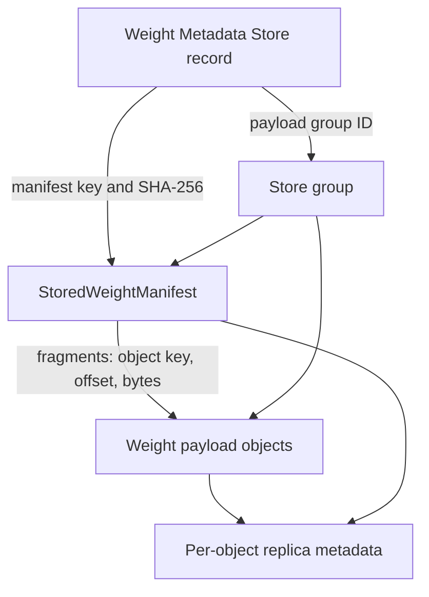

# Weight Management Architecture

Mooncake Store manages one immutable model-weight revision as a first-class
resource. A caller discovers the revision by its exact identity, acquires a
revision lease, resolves its immutable manifest, and then transfers the
manifest's payload ranges. Callers do not need to know the manifest object key
in advance.

This design adds revision-level discovery and lifecycle control without adding
independent tensor-level management metadata.

## Delivery Status

This stage provides Master RPC and C++ client access to revision management,
managed-group removal protection, lease-fenced deletion, and basic residency
operation reconciliation with HA recovery. This stage adds configurable
HOT/COLD/MIXED policies and explicit affinity-aware migration. MANUAL is the
default mode; PINNED preserves its requested residency. AUTO is recognized but
rejected by policy validation until its scheduler is delivered. Automatic
migration, generation replacement, and the managed Python `WeightStore` facade
remain follow-up work. The upload flow below describes the caller's responsibilities;
the Python facade is not required to use the C++ interfaces.

This development-stage change replaces the earlier persistence format directly.
Weight snapshots use schema 2; earlier snapshots and metadata-only OpLog
records are rejected. There is no migration or compatibility decoder. New
operation envelopes and snapshots retain atomic publication and replay.

Imports declare an affinity count and digest. Each payload object carries an
opaque residency-affinity ID, and all objects with that ID move as one unit.
The manifest remains in memory. Mixed planning chooses complete affinities;
it never splits an affinity to reach the requested hot-byte ratio. Observed
ratios count readable payload bytes, while availability separately reports
missing members. Background migration spends one work item per complete
affinity; deletion spends one per object and shares its remaining budget with
the following reconciliation pass.

## Authority Model

Three records have distinct authority:

| Authority | Location | Owns | Does not own |
| --- | --- | --- | --- |
| Weight Metadata Store | Store Master memory, HA OpLog, and standby-generated batch OpLog snapshot | exact revision discovery, availability, residency summary, operation progress, revision leases, manifest reference | tensor geometry, payload contents, physical replica addresses |
| `StoredWeightManifest` | immutable Store `METADATA` object | tensor descriptors and tensor-fragment-to-object-range mapping | lifecycle state, leases, live runtime addresses |
| Store object metadata | existing per-key Master metadata | replica placement and status in memory, local disk, DFS, or NoF | revision discovery, tensor meaning, serving activation |



The metadata record stays outside the payload group. It therefore remains
discoverable while the group is cold, degraded, deleting, or physically
absent. The manifest and every payload object share one `payload_group_id`.
Generic eviction and removal paths recognize that group as managed and cannot
independently reclaim one member.

`RemoveAll` removes eligible object metadata without issuing a whole-client
SSD wipe: a disk client may also hold managed weights or objects imported
concurrently. As with single-key removal, physical disk space is reclaimed by
the existing disk eviction path when eligible; successful metadata removal
does not promise immediate physical erasure.

Disk reclamation depends on the backend's eviction configuration and pressure
thresholds. With watermark eviction enabled, the client heartbeat selects
eligible disk records and asks the Master to release their replica metadata
before reclaiming storage. A record already removed by the Master is eligible;
a live managed-weight record is not. A physical bucket containing a live
protected record cannot be reclaimed as a whole. Disk occupancy below the
threshold may therefore remain after `RemoveAll`, and metadata accounting is
not a measurement of physical free disk space.

For independent files, a managed-weight rejection does not authorize deleting
that file or prevent reclaiming unrelated files in the same batch. Protected
files rotate behind other candidates so subsequent heartbeat passes can make
progress. Communication failures retain the pending files for retry.

New clients do not poll the legacy whole-client `PollRemoveAll` mailbox. Its
RPC remains for older clients, but the Master no longer produces wipe requests:
such a request cannot safely distinguish tenants, protected weights, or objects
written after the request was issued.

The group is a logical lifecycle boundary, not a distributed transaction.
Physical work may be partial while an operation is running. The metadata store keeps
the operation non-terminal until reconciliation observes the required state
for every member, or an explicit delete cancels the operation.

## Revision Identity and Manifest Location

A revision is addressed by:

```text
(tenant_id, namespace, resource_id, revision, weight_generation)
```

When multi-tenancy is disabled, the Master accepts only the `default` tenant
for weight imports. It rejects another tenant rather than silently changing
the revision identity while writing its OpLog entry. With multi-tenancy
enabled, the identity retains its tenant throughout publication and replay.

Its manifest object key is canonical:

```text
weights/<namespace>/<resource_id>/<revision>/<weight_generation>/manifest
```

`WeightMetadataStore` validates that the payload group ID and manifest key are
the canonical values derived from the revision identity. The Master integration
separately validates those references against physical Store object type,
membership, count, logical bytes, and payload-key digest.

The three textual path components are UTF-8 URL-encoded as individual path
segments. The manifest is hard-pinned during import and stored as
`ObjectDataType::METADATA`. Payload fragments are stored as
`ObjectDataType::WEIGHT` in the same group.

After publication, the manifest key, manifest SHA-256, payload group ID,
payload-key SHA-256, payload count, and logical byte count are immutable.
The Master validates object type, exact group membership, count, logical
bytes, and the digest of sorted payload keys. It deliberately does not parse
the tensor manifest body. A consumer must verify the stored manifest's identity
and SHA-256 before planning tensor ranges.

## State Model

Availability, physical residency, and an in-progress operation are separate:

| Dimension | Values | Meaning |
| --- | --- | --- |
| Availability | `IMPORTING`, `READY`, `DEGRADED`, `DELETING`, `DELETED` | whether the complete revision is safe to discover and load |
| Residency | `UNKNOWN`, `HOT`, `COLD`, `MIXED`, `ABSENT` | observed placement across required group members |
| Operation | optional operation ID, with `MIGRATING` or `REPAIRING` kind | durable non-terminal group work |

The current operation entry point starts `MIGRATING` toward HOT, COLD, or MIXED.
`REPAIRING` is reserved for a follow-up recovery workflow.

`READY` means the manifest and every required payload object have a readable
replica. DRAM eviction changes residency but does not by itself make a revision
unavailable. Missing required members produce `DEGRADED`; complete physical
removal produces the retained `DELETED`/`ABSENT` tombstone.

For an incomplete revision, residency describes the readable members still present;
`DEGRADED` reports the missing required members. Missing members alone do not
mean the remaining objects span multiple storage tiers.

Commit, abort, lease acquisition, operation start, and deletion check the
caller's `expected_metadata_generation`. Lease renewal and release use the
lease identity; reconciliation prepares mutations against the generation it
observes. A stale generation fails with `STALE_GENERATION`. A retry of an
uncertain import commit with the
same generation and immutable manifest reference is idempotent.

## Import and Publication

The managed upload sequence is:

1. `BeginWeightImport` creates or returns the `IMPORTING` metadata record and
   Store-issued canonical payload group ID.
2. The caller writes every payload object into that group.
3. The immutable `StoredWeightManifest` is committed last into the same group.
4. `CommitWeightImport` validates exact group membership and the manifest
   reference, then durably publishes `READY`.
5. `GetWeightRevision` or bounded `ListWeightRevisions` can discover it.

The import's policy overrides the Master's default policy. Commit publishes
READY with readable HOT payloads; it does not wait for preferred placement.
For COLD or MIXED preference, that same commit records an initial migration,
including under MANUAL or PINNED policy. The background worker finishes that
declared placement asynchronously. MANUAL does not subsequently choose targets
from memory pressure or access recency; later migrations require explicit
requests. Policy preference and observed residency are separate query fields.

`READY` is never inferred from key prefixes. An abandoned import is handled by
the explicit abort/reconciliation policy. `weight_import_idle_timeout_ms`
(default `300000`, must be positive) bounds inactivity since the last accepted
member `PutStart`/`UpsertStart` or write-progressing `PutEnd`/`UpsertEnd`.
Failed requests, repeated Begin, and already-completed End retries do not extend
the window. Activity remains local to the leader; recovery grants importing
revisions a fresh full window. The timeout claim excludes admitted End calls and
rejects new End calls once abandonment starts. Data-plane transfers between
master requests are not observable activity: set this timeout above the longest
expected interval between those requests, including a large single-object upload.

## Load and Revision Leases

A reader first resolves the exact metadata identity with `GetWeightRevision`
and acquires a revision lease against the returned metadata generation. It then
reads and validates the manifest, plans ranges, and executes Store-to-runtime
transfers. The caller renews short leases until all transfer work reaches a
terminal state and releases the lease on both success and failure.

Renewal never shortens an existing lease: the new expiry is the later of the
current expiry and the renewal time plus the requested TTL. An expired lease
cannot be renewed.

A live revision lease blocks deletion and residency operations that could
remove the last readable replica. Revision leases do not replace framework
allocation guards, runtime binding generations, or Store's per-object read
leases; those protect different ownership boundaries.

## Residency, Rehydration, and Deletion

`StartWeightResidencyOperation` durably records the operation ID, target,
fenced metadata generation, and progress. Reconciliation then uses existing
per-object primitives:

- cold migration removes memory replicas only after a readable cold replica exists
  for each affected member;
- hot migration queues promotion for every payload affinity and waits until all
  required members have readable memory replicas;
- busy or incomplete members keep the operation in progress;
- deletion blocks new leases, waits for live leases, removes payload objects,
  removes the manifest last, verifies absence, and retains a tombstone.

An explicit COLD or MIXED request may queue payload offloads before memory
eviction. Acceptance records pending work, not completion; missing cold copies
or offload capacity can leave it pending with observable error state. The
manifest stays in memory. An explicit delete may cancel a
pending residency operation, including one stalled by missing replicas or
promotion capacity. After the ordinary generation and lease checks, cancellation
and `DELETING` publish together in one durable record, before physical removal.
Operation queries retain the original target and progress with message
`cancelled`; they never report cancellation as successful convergence.

Bucket offload batches keep their initial coalescing opportunity. If no new
tasks arrive, the next heartbeat retries the carried tail and flushes it through
the existing replay path. This also applies to ordinary KV offloads: a small
tail no longer waits indefinitely for unrelated traffic. Fresh tasks for a
carried key take precedence over its old size and task; no new configuration
flag is required.

Generic `BatchEvict`, quota eviction, explicit remove, and cleanup paths skip
managed groups. Only the weight lifecycle path may change their aggregate
residency or availability.

Reconciliation runs on a dedicated Master worker, not the general task-cleanup
thread, and is not exposed as a client RPC. A background pass shares a bounded
number of affinity migration or member deletion actions across revisions. This bounds physical action attempts,
not the time required for a durable write or the cost of observing group metadata.
Clients use operation and revision queries to observe convergence. The operation
`cursor` reports progress; it is not a client-controlled resume token.

## Recovery and HA Rollout

Weight metadata, leases, and operation records use durable-before-visible
OpLog publication. Standby replay stores them in a separate weight-metadata
namespace rather than encoding them as fake object metadata. Batch OpLog
snapshots capture that namespace with object and segment metadata at the same
durable replay cursor. Derived group indexes are rebuilt from restored
metadata records.

OpLog replay accepts the current metadata-plus-operation envelope. Earlier
metadata-only payloads and invalid envelopes are rejected without advancing the
replay cursor. This development-stage replacement requires fresh weight state;
there is no rolling upgrade or old-format migration contract. Cancelled and
completed operations are terminal, including for late progress and error reports.

Batch-OpLog snapshots containing weight state use a version-2 manifest with a
checksummed weight-state artifact captured at the same replay cursor as object
and segment metadata. Clusters with no weight records or allocated weight IDs
continue to emit version-1 snapshots.
Recovery validates and restores that state before applying the remaining OpLog.
The snapshot validator, pruning coordinator, and garbage collector require the
artifact to be intact before allowing log reclamation. Version-1 snapshots
remain readable and restore empty weight state; they cannot recover weight
history that was already omitted and compacted.

Weight mutations wait for durable publication or a terminal writer error,
without a separate publication timeout. A terminal failure cannot be followed
by a late in-memory publication of the same request. A shutdown error does not
prove that an in-flight write is absent from the durable log; recovery may
still replay it, so callers must query the revision before retrying an
uncertain operation.

Clusters using HA plus the etcd batch OpLog fail closed for weight-management
mutations unless the operator sets
`weight_management_oplog_capability_confirmed=true`. Set it only after every
configured standby runs a version that understands all weight metadata and
lease OpLog entries, including the `cancelled` operation terminal. This is an
explicit rolling-upgrade capability assertion,
not automatic standby discovery. Reads and ordinary KV operations are not
gated by it.

The capability flag admits new mutations; it is not a rollback switch.
Disabling it does not remove existing weight state loaded through batch
snapshot restore or standby promotion. Such a cluster still requires readers
that support its weight OpLog and batch snapshot formats.

## Serving-System Boundary

Store owns durable revision discovery, readable-residency state, leases, and
safe reclamation. SGLang or another runtime owns live GPU addresses, runtime
bindings, allocation guards, and worker-local snapshot generations. Slime,
Kubernetes, Ray, or another serving control plane owns multi-worker activation,
traffic switching, and rollback. Store does not choose a globally active
serving revision.

## Integration Boundary

This layer exposes the native lifecycle primitives through the Master RPC and
C++ client surfaces. A follow-up change adds the managed `WeightStore` Python
facade that composes these primitives with manifest upload and load. A
framework adapter remains responsible for constructing and validating the
immutable tensor manifest, holding runtime allocation guards, and activating a
revision in the serving system. Manifest-only objects written without a Weight
metadata record are outside this lifecycle and are not discovered
automatically.
