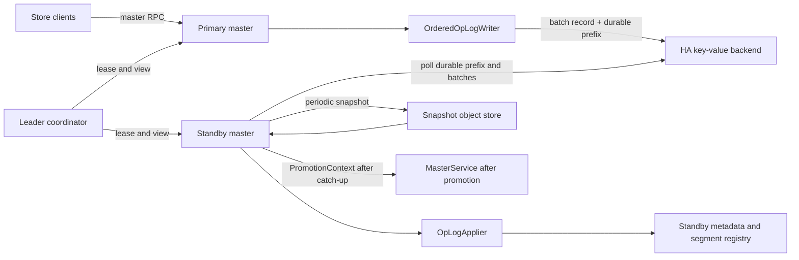
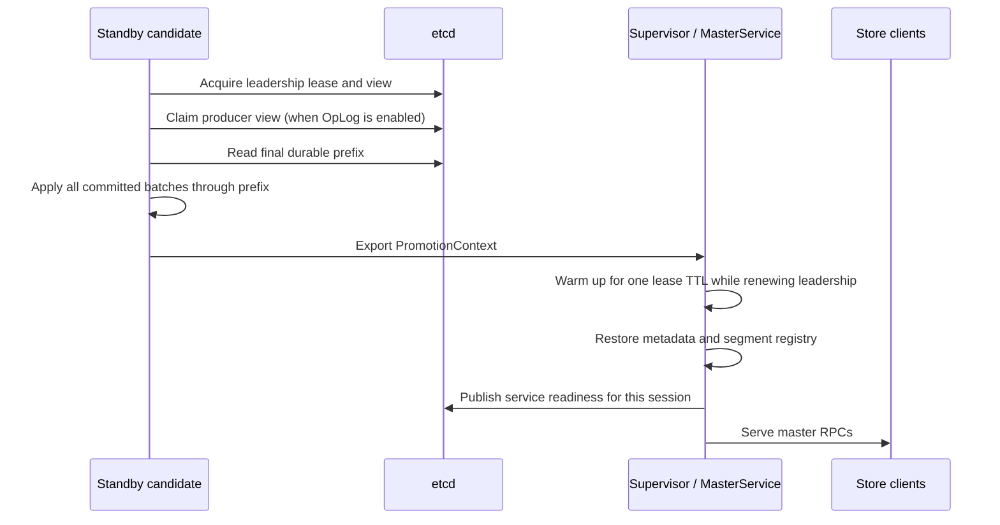

# Mooncake Store High Availability Design

## Overview

Mooncake Store High Availability (HA) supports recovery of the Store control plane after a master process fails. Multiple master processes coordinate through a leadership backend; one active Primary serves master RPCs. When batch OpLog is enabled, Standby processes maintain a local copy of the metadata state and can be promoted after leadership changes.

The etcd backend is the complete Primary-Standby path described here: with batch OpLog enabled, it provides leader coordination, log storage, and the durable cursor used for catch-up and promotion. Batch OpLog replication is opt-in. Redis leadership and OpLog are experimental, and the batch snapshot path currently requires etcd. The Kubernetes Lease backend coordinates leadership but does not provide this batch OpLog replication path. Deployment flags, TLS settings, and operational procedures are in the [Mooncake Store Deployment & Tuning Guide](../../deployment/mooncake-store-deployment-guide.md#high-availability-ha).

Leader election and metadata recovery are separate functions. `--enable_ha` selects one active master; `--enable_oplog=true` enables mutation replication to Standbys and is disabled by default. Without the OpLog, leadership can move to another master, but the previous master's metadata state is not replicated for recovery. The failover recovery flow below assumes batch OpLog is enabled.

To preserve metadata across leadership changes, enable batch OpLog on **every electable master**, with the same `cluster_id` and HA backend configuration. Enabling it only on the current Primary is insufficient: a node with OpLog disabled promotes with an empty `PromotionContext`. Once pruning starts, every candidate must also support snapshot bootstrap and compaction-floor rebootstrap, with batch snapshots enabled and access to the retained artifacts.

HA replicates Store metadata, not KV payload bytes. The payload remains in the memory or storage replicas owned by Store clients; etcd carries the mutation records and recovery cursor. On promotion, the master reconstructs the object-to-replica map and segment registry; it does not copy or recreate payload that is no longer available from a client or storage replica. Mooncake Store is a cache, and a recent metadata mutation that has not entered the durable OpLog prefix may be absent after failover.

## Components

| Component | Responsibility |
| --- | --- |
| `MasterServiceSupervisor` | Creates the leadership coordinator and standby controller, runs the role state machine, fences service readiness, and handles leadership loss or shutdown. |
| `LeaderCoordinator` | Acquires, renews, releases, and watches the backend leadership session. A session carries the advertised master address and a monotonically changing view version. |
| `OrderedOpLogWriter` | Reserves bounded admission slots, assigns ordered sequence IDs, groups entries into batch records, retries retryable writes, and advances the local durable cursor after backend commit. |
| `OpLogBatchStorage` | Stores immutable batch records and the durable prefix in the HA key-value backend. It also owns producer-view fencing and retention-floor checks. |
| `HotStandbyService` and `OpLogApplier` | Read batches through the durable prefix, validate ordering and checksums, and apply mutations to a local `StandbyMetadataStore` and segment registry. |
| Batch snapshot provider and writer | Capture standby state, publish verified snapshot artifacts, restore a baseline, and replay the OpLog suffix. |
| `BatchOpLogPruningWorker` | Runs on the Primary, recovers its deletion cursor, and deletes batches through the published compaction floor in bounded, paced chunks. |
| Admin server and serving gate | Expose role/readiness state and prevent a candidate from serving until recovery and backend readiness checks succeed. |

The HA coordination backend and the Transfer Engine metadata service have separate roles. The HA backend arbitrates master leadership and, for etcd batch OpLog mode, stores master-state history. The Transfer Engine metadata service supports peer discovery and data transfer. A deployment may share an etcd cluster between them or use separate services; see the deployment guide for endpoint configuration.

## Role and Serving Lifecycle

### Standby

With batch OpLog enabled, each non-leader master runs the standby controller. It observes the current leader and starts the hot-standby service, which initializes from a snapshot or the retained OpLog history and then polls for new durable batches. Standby metadata is local to the process and is not exposed through the normal serving RPC delegate.

The standby reports its runtime state through the admin service. Snapshot and OpLog metrics expose whether it is active, how far it has applied, and whether snapshot work is progressing; the metric definitions and alerting guidance remain in the {ref}`deployment guide <batch-oplog-snapshot-metrics>`.

### Primary acquisition and service gate

After acquiring a leadership session, a candidate keeps renewing its lease while it recovers. With batch OpLog enabled, it claims the session's view version as the current producer view, stops standby polling, reads the latest durable prefix, and applies every committed batch through that prefix. It then exports a `PromotionContext` containing the metadata store, segment registry, applied cursor, and related identifiers.

The candidate then warms up for one full leadership lease TTL while continuing to renew its lease. This wait follows final catch-up and precedes Master service restoration; electing a leader or finishing catch-up alone does not make it ready to serve.

The master service restores and validates that context before it becomes the RPC delegate. The supervisor publishes service readiness only after the backend confirms the session is ready and the serving gate still considers the session active. If catch-up, restoration, lease validation, or readiness publication fails, the candidate remains unavailable and releases leadership where possible. On this batch-OpLog path, a candidate is not intentionally exposed with an empty or partially restored metadata map.

When a session is fenced or lost, the supervisor disables service availability, removes the leader label where configured, and stops the listener. Producer-view comparisons on batch writes provide an additional fence: a master with an older view cannot continue appending to the current OpLog generation after a successor has claimed a newer view.

### Promotion sequence

The candidate renews its lease during recovery so a long catch-up does not silently outlive the session. The serving transition is gated against concurrent shutdown or lease-loss handling. Invalid replica endpoints whose segments are absent from the restored registry are filtered during restoration. Master serving readiness does not mean every restored memory replica is already readable: even when its segment is present in the registry, the owning client must successfully call `ReMountSegment` to refresh its segment and memory-handle state. Until then, replica lookup can return `REPLICA_IS_NOT_READY`.

(store-ha-client-failover)=
### Client failover and replica readiness

For etcd HA, clients use an `etcd://` master address and discover the ready leader in the namespace selected by `MC_STORE_CLUSTER_ID`, which must match the masters' `--cluster_id`. If unset or empty, discovery defaults to `mooncake_cluster`. See {ref}`Client addressing <store-ha-etcd-deployment>` for the setup fields and environment example.

After initial discovery, the client monitors leader view changes through a backend watch, with periodic resynchronization. Before switching to a new endpoint, its master RPC client calls `ServiceReady` and checks the RPC protocol version. The storage heartbeat also rereads the current view and attempts reconnection after repeated ping failures.

The storage-owning client triggers memory-segment recovery automatically: when the new master's heartbeat response reports `NEED_REMOUNT`, the client asynchronously calls `ReMountSegment` for its mounted segments. `LOCAL_DISK` SSD offload uses a separate `FileStorage` heartbeat path: if the master reports `SEGMENT_NOT_FOUND`, it registers the local-disk segment again and starts a metadata scan to re-register offloaded objects. Recovery still depends on the owning client and storage backend; see [SSD metadata recovery](ssd-offload.md#metadata-recovery-on-restart).

Requests can fail while election, recovery, or reconnection is in progress. Master readiness, client reconnection, and payload replica readability are separate milestones. End-to-end reads can require additional time after the master becomes ready while owners remount segments or scan disk metadata.

## Batch OpLog

### Record and cursor model

The ordered writer assigns each admitted mutation a sequence ID. Consecutive entries are grouped into a batch with a batch ID, a contiguous sequence range, schema version, and checksum. The backend transaction writes the immutable batch and advances the cluster's `durable_prefix` together. The prefix is the boundary Standbys may treat as committed; records beyond it are not part of a proven recovery history.

The writer bounds outstanding admission with `oplog_batch_max_entries`. It batches records to reduce backend writes, retries retryable storage errors, and stops accepting new entries after a terminal writer failure or producer fencing. Startup validates the durable prefix against its terminal batch instead of treating a missing batch as an empty history.

Currently replayed records are `PUT_END`, `PUT_REVOKE`, `REMOVE`, `SEGMENT_MOUNT`, `SEGMENT_UNMOUNT`, `SEGMENT_UPDATE`, `WEIGHT_METADATA_UPSERT`, `WEIGHT_METADATA_DELETE`, `WEIGHT_LEASE_UPSERT`, `WEIGHT_LEASE_DELETE`, and `OBJECT_STORAGE_MUTATION`. `LEASE_RENEW` remains in the enum but has no replay implementation and is unsupported. `OpLogApplier` checks sequence continuity and entry validity before applying records. A gap, invalid terminal prefix, or missing required retained batch prevents catch-up from being considered complete.

### Write acknowledgment and cache-loss semantics

The normal cache write path does not synchronously wait for each OpLog entry to become durable. For example, `PutEnd` finalizes the local master metadata and attempts to enqueue a `PUT_END`; if writer admission fails, it logs a warning and still returns success. A full writer admission window can report `TASK_PENDING_LIMIT_EXCEEDED` (`-1401`) in the log. After a failover, that latest cache entry can be missing from the restored metadata because it never entered the durable prefix. This is an intentional cache-availability trade-off, not a promise of lossless replicated writes; no fixed upper bound on the number of such entries is implied.

Removal uses a stricter sequence. The master reserves an OpLog slot before marking replicas removed. If reservation fails, `Remove` returns the error and leaves the object unremoved. After the `REMOVE` is queued, the durable finalizer completes replica cleanup. Thus the same admission error can have different API behavior for `PutEnd` and `Remove`.

These semantics apply to the cache-oriented metadata path and should not be described as synchronous durability. The distinction between API success, OpLog admission, and a mutation covered by the durable prefix is important when interpreting logs and operational metrics.

## Snapshot and Restore

The batch snapshot path is produced from standby state, rather than by asking the serving Primary to serialize its live index. A capture records an OpLog cursor with the segment registry and current metadata baseline. The writer stores segment information and optional metadata classes (such as object-storage and weight metadata), then emits object metadata in bounded chunks. Standby apply is paused while the snapshot capture is held, so the serialized metadata and cursor describe the same applied prefix.

Each snapshot has immutable artifact objects, a manifest describing their keys, sizes, and CRC32C values, and a descriptor that records the included batch/sequence cursor and producer view. The publisher verifies uploaded objects before publishing the snapshot control pointer. Two generations are retained as `latest` and `fallback`; a pointer alone does not prove that every referenced object remains readable.

Bootstrap validates the descriptor, manifest identity, artifact sizes, and checksums. It tries `latest`, then `fallback`; when neither provides a usable baseline, recovery can replay from the initial cursor only if the complete OpLog history is still retained. After pruning, that history may no longer exist. In either case, the master applies only a provable suffix through a newly observed durable prefix; if it cannot prove that the baseline and suffix form a complete state, the master fails closed and does not serve from partial metadata.

Snapshot publication, retention-floor advancement, and physical OpLog deletion are separate outcomes. Advancing the floor requires two distinct, independently validated snapshots and an etcd maintenance lease. After snapshot publication, the coordinator advances a monotonic `compaction_floor` to the fallback snapshot's batch ID using a compare-and-swap transaction. A standby whose cursor is behind the floor must rebootstrap from a surviving snapshot before it can catch up. The floor is an OpLog batch ID, not an etcd MVCC revision; etcd compaction and defragmentation remain separate operator tasks. See {ref}`Batch OpLog Capacity Operations <batch-oplog-capacity-operations>` for the operational procedure. After pruning starts, rollback binaries must understand the batch snapshot and compaction-floor protocol; an older version cannot recover history that has already been pruned. Validate rollback compatibility before enabling pruning.

With batch snapshots enabled, the Primary's `BatchOpLogPruningWorker` deletes covered batch keys asynchronously without holding the snapshot maintenance lease. It recovers its cursor from the oldest remaining batch on startup, bounds each delete request with `oplog_prune_chunk_batch_count`, and paces deletion with `oplog_prune_max_batches_per_second`. Both limits count batch ID positions rather than deleted bytes or existing keys. The worker polls for floor changes every 10 seconds while idle and retries backend failures without waiting for another snapshot publication. Leadership loss requests worker shutdown; the next leader resumes cleanup. Deletion through an already published floor can continue while snapshot storage is unavailable or no Standby is producing new snapshots.

The first published snapshot does not advance the floor because there is no second recovery baseline. A failed upload or validation leaves the previous published pointers intact; floor-publication or garbage-collection failure does not invalidate an already published snapshot. Physical deletion failures leave additional keys below the floor for the worker to retry. A missing or corrupt required artifact is treated as an invalid baseline so the provider can attempt fallback; backend connectivity and authorization failures remain infrastructure errors.

### Recovery scope and limitations

| State or backend | Current recovery boundary |
| --- | --- |
| `MEMORY` replicas | Restored metadata still needs a surviving payload owner and successful segment remount before its memory replicas become readable. |
| `LOCAL_DISK` SSD offload | The owning client's heartbeat can register a missing disk segment and rescan recoverable on-disk metadata. Availability depends on the owner and backend; see [SSD metadata recovery](ssd-offload.md#metadata-recovery-on-restart). |
| Filesystem descriptor-based DFS | The sharded filesystem allocator is not reconstructed. With this allocator enabled, standby restore returns `DFS_SERVICE_UNAVAILABLE`; it is incompatible with OpLog and batch snapshot recovery. See {ref}`DFS deployment limitations <store-descriptor-dfs>`. |
| Business `ObjectReplica` state | Object-storage records can be captured and replayed on a Standby, but promotion containing this state is rejected with `NOT_SUPPORTED`. It cannot yet be restored into a serving Master. |
| Soft pins and read leases | Soft-pin state and ordinary read leases are not retained. Reads establish fresh leases after restore; hard-pin metadata is retained. |
| Object groups | Group membership is rebuilt from object metadata, but the shared group TTL is unset until a member is read. See {ref}`Optional Object Groups <store-object-groups>`. |

Using S3 to **store snapshot artifacts** is separate from using business `ObjectReplica` state. An S3 snapshot backend alone does not trigger the `ObjectReplica` promotion restriction. For `local` snapshots, every recovery candidate must be able to access the same persistent artifacts; identically named directories on separate hosts do not share data.

## Behavior During Failures

| Failure | Effect on service and recovery |
| --- | --- |
| Primary process failure or leadership loss | Master requests can fail until a candidate acquires leadership, catches up, warms up, restores state, and becomes ready. Clients then reconnect and owners restore replica readiness. |
| etcd unavailable | Log commits and leader discovery may fail or retry. A failed or lost leadership renewal disables serving readiness and stops the RPC listener; an unavailable coordination backend cannot support promotion. |
| Standby failure | A healthy Primary can continue serving, but fewer recovery candidates remain. Without a usable snapshot-producing Standby, new snapshots and floor advancement stop; the Primary can continue deleting through an already published floor. |
| Snapshot storage unavailable | Upload failure leaves the previously published pointers intact. Running OpLog replication and deletion through an already published floor can continue, while new snapshots and floor advancement stall. A candidate that needs an inaccessible snapshot cannot finish bootstrap, especially once earlier log history has been pruned. |
| Terminal OpLog writer failure | The supervisor withdraws service readiness and stops the RPC listener. This stops master service, in addition to rejecting new log entries. |

## Graceful Shutdown

For an HA master, SIGTERM and SIGINT start an ordered shutdown. The serving gate rejects new work, readiness and the listener are stopped, admitted RPC handlers are drained, the leadership monitor and pruning worker are stopped, and the batch writer is stopped before the leadership lease is released. Standby replication and the remote metadata cleanup worker are stopped before release as well. A confirmed release lets a successor acquire leadership without waiting for the remainder of the old lease TTL. If release is not confirmed, the process reports a nonzero shutdown result; if the old lease is still held, it expires by TTL.

The etcd shutdown path has a 15-second overall bound. A second termination signal exits immediately and skips the remaining drain, including lease release. The Kubernetes Lease backend does not report the same confirmed-release result as etcd.

| Exit status | Meaning |
| --- | --- |
| `0` | The drain completed and release succeeded or was not needed. This does not claim every in-flight task completed or every accepted mutation became durable. |
| `2` | The drain completed, but lease release was not confirmed. A remaining lease expires by TTL; the result does not prove that the lease is still held. |
| `1` | The 15-second shutdown bound expired. |
| `130`, `143` | A second SIGINT or SIGTERM arrived during shutdown. |
| `255` | Shutdown was observed only after a fatal backend error made the supervisor return. |

For a planned Primary restart, a confirmed lease release removes the old leader key during shutdown. If an old lease remains after a crash or an unconfirmed release, the successor waits for its remaining TTL before it can acquire leadership; an unconfirmed result does not establish whether release took effect. The successor still performs OpLog catch-up, its configured warm-up, metadata restoration, and readiness transition. A confirmed release can shorten a planned restart by up to the TTL that would otherwise remain, but the realized saving depends on drain and release time; it does not remove recovery work or guarantee a fixed recovery time. Kubernetes `terminationGracePeriodSeconds` should cover any preStop delay, the 15-second bound, and a few additional seconds. The timings and confirmed-release semantics above describe the etcd backend; Kubernetes reports only that its cancel request was accepted. The default etcd lease TTL is five seconds (configurable from two to sixty seconds); the successor warms for one full lease TTL after catch-up. The local election-watch acquisition measurements are implementation tests, not a production recovery-time guarantee.

## Validation and Observability

(store-ha-process-readiness)=
### Process health and serving readiness

The master's `/health` endpoint reports HTTP 200 and `status="ok"` while the admin server is reachable, including Standby and recovery states. These values describe process health. `role="leader"` also includes the lease warmup phase, so it does not establish that the master is serving.

For business traffic admission, check the JSON field `service_ready` and require it to be `true`. Use `ha_state` to distinguish warmup, catch-up, recovery, and serving during diagnosis. Even `service_ready=true` describes the master service gate; payload replicas may still be waiting for client remount or disk metadata scans. See {ref}`Master health and readiness checks <store-master-health-readiness>` for an operational probe.

### Tests and replication metrics

The implementation has focused tests at several boundaries:

- Leadership acquisition, lease loss, backend availability, serving state, and leader-label reconciliation: `mooncake-store/tests/ha/leadership/` and `mooncake-store/tests/ha/master_service_ha_test.cpp`.
- Ordered writer admission, batching, retry, durable-prefix movement, standby reading, replay, and background pruning: `mooncake-store/tests/ha/oplog/`.
- Snapshot encoding, publication, restore, fallback, garbage collection, pruning, and floor rebootstrap: `mooncake-store/tests/ha/snapshot/batch_oplog/`.
- Multi-process batch OpLog and failure-path integration: `mooncake-store/tests/e2e/oplog_batch_e2e_test.cpp` and the scripts under `mooncake-store/tests/e2e/`.

For runtime diagnosis, compare `ha_writer_durable_sequence` on the current Primary with `ha_oplog_applied_sequence_id` on its Standby. Match both samples to the same `cluster_id` and verify the processes' current roles before interpreting the difference. Do not use `ha_oplog_last_sequence_id` or `ha_oplog_standby_lag` to judge production replication: they are initialized to zero, and the production path does not update them. Writer pending and terminal-state metrics provide additional local health information. Snapshot mode exposes the `ha_snapshot_*` family, including activity, pointer ages, applied and durable cursors, floor, upload/restore outcomes, and skip reasons. Physical deletion has separate `mooncake_ha_batch_oplog_pruner_*` metrics; check the active worker's floor lag and errors on the Primary to assess the cleanup backlog. See {ref}`Batch OpLog Snapshot Metrics <batch-oplog-snapshot-metrics>` for definitions and PromQL examples.

## Code Map

| Area | Source |
| --- | --- |
| Leadership supervision and serving transitions | `mooncake-store/src/ha/leadership/master_service_supervisor.cpp` |
| Backend leader coordination | `mooncake-store/src/ha/leadership/backends/` |
| Ordered writer and batch storage | `mooncake-store/src/ha/oplog/ordered_oplog_writer.cpp`; `oplog_batch_storage.cpp` |
| Standby reader and mutation application | `mooncake-store/src/ha/oplog/oplog_batch_standby_reader.cpp`; `oplog_applier.cpp`; `mooncake-store/src/ha/standby_metadata_store.cpp` |
| Promotion context and standby lifecycle | `mooncake-store/src/ha/standby_controller.cpp` |
| Snapshot writer, provider, and pruning | `mooncake-store/src/ha/snapshot/batch_oplog/` |
| Background batch deletion | `mooncake-store/src/ha/oplog/batch_oplog_pruning_worker.cpp` |
| API-specific mutation ordering | `mooncake-store/src/master_service.cpp` (`PutEnd`, `MarkRemovedAndPersist`) |
