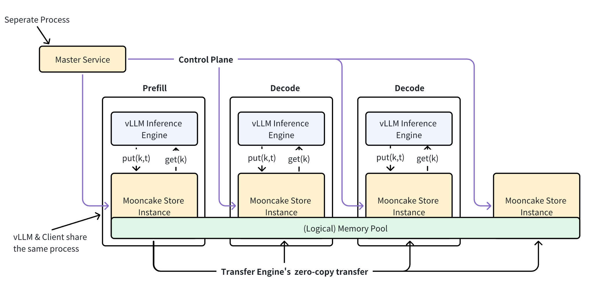

# Mooncake Store

## Introduction

Mooncake Store is a high-performance **distributed key-value (KV) cache storage engine** designed specifically for LLM inference scenarios.

Unlike traditional caching systems such as Redis or Memcached, Mooncake Store is positioned as **a distributed KV cache rather than a generic caching system**. The key difference is that in the latter, the key is derived from the value through hashing, so value is immutable after inserting (although the key/value pair may be evicted).

Mooncake Store provides low-level object storage and management capabilities, including configurable caching and eviction strategies that offer high memory efficiency and is specifically designed to accelerate LLM inference performance.

Key features of Mooncake Store include:
- **Object-level storage operations**: Mooncake Store provides simple and easy-to-use object-level APIs, including `Put`, `Get`, and `Remove` operations.
- **Optional object grouping**: Related objects can carry an optional group ID so that the Master applies best-effort shared lifecycle behavior. Object routing stays decoupled from groups (always `hash(tenant, key)`); grouping only carries a shared group TTL.
- **Multi-replica support**. Mooncake Store can place complete copies of an object on multiple segments to spread read traffic. The requested storage tiers and replica counts determine the {ref}`store-put-start-replica-allocation`.
- **Strong consistency**: Mooncake Store guarantees that `Get` operations always return correct and complete data. Once an object has been successfully `Put`, it remains immutable until removal, ensuring that all subsequent `Get` requests retrieve the most recent value.
- **Zero-copy, bandwidth-saturating transfers**: Powered by the Transfer Engine, Mooncake Store eliminates redundant memory copies and exploits multi-NIC GPUDirect RDMA pooling to drive data across the network at full line rate while keeping CPU overhead negligible.
- **High bandwidth utilization**: Mooncake Store supports striping and parallel I/O transfer of large objects, fully utilizing multi-NIC aggregated bandwidth for high-speed data reads and writes.
- **Dynamic resource scaling**: Mooncake Store supports dynamically adding and removing nodes to flexibly handle changes in system load, achieving elastic resource management.
- **Fault tolerance**: With HA metadata replication configured, Mooncake Store can recover from master failures when the coordination backend and complete recovery history remain available. Reading a cached object also requires an accessible payload replica. Requests may fail during election, recovery, and client reconnection; see [High Availability Design](high-availability.md) for the prerequisites and recovery boundaries.
- **Multi-layer storage support**​​: Mooncake Store supports offloading cached data from RAM to SSD, further balancing cost and performance to improve storage system efficiency.

## Architecture



As shown in the figure above, there are two key components in Mooncake Store: **Master Service** and **Client**.

**Master Service**: The `Master Service` orchestrates the logical storage space pool across the entire cluster, managing node join and leave events. It is responsible for object space allocation and metadata maintenance. Its memory allocation and eviction strategies are specifically designed and optimized to meet the demands of LLM inference workloads.

The `Master Service` runs as an independent process and exposes RPC services to external components. Note that the `metadata service` required by the `Transfer Engine` (via etcd, Redis, or HTTP, etc.) is not included in the `Master Service` and needs to be deployed separately.

**Client**: In Mooncake Store, the `Client` class is the only class defined to represent the client-side logic, but it serves **two distinct roles**:
1. As a **client**, it is invoked by upper-layer applications to issue `Put`, `Get` and other requests.
2. As a **store server**, it hosts a segment of contiguous memory that contributes to the distributed KV cache, making its memory available to other `Clients`. Data transfer is actually from one `Client` to another, bypassing the `Master Service`.

It is possible to configure a `Client` instance to act in only one of its two roles:
* If `global_segment_size` is set to zero, the instance functions as a **pure client**, issuing requests but not contributing memory to the system.
* If `local_buffer_size` is set to zero, it acts as a **pure server**, providing memory for storage. In this case, request operations such as `Get` or `Put` are not permitted from this instance.

The `Client` can be used in three ways:
1. **Embedded mode**: Runs in the same process as the LLM inference program (e.g., a vLLM instance), by being imported as a shared library. Embedded clients issue requests directly, and when configured with `global_segment_size > 0` they also contribute memory resources to the cluster.
2. **Embedded mode with dummy-real clients**: Each LLM inference **rank** holds an embedded **dummy** client (which holds no resources). Each LLM inference **instance** has one resource-owning **real** client (for example, with TP=8 there can be 8 dummy clients and 1 real client). All dummy clients of the same inference instance forward requests to that one real client. The real client owns the global segment (optionally) and is responsible for RPC handling, memory management, and data transfer. Dummy and real clients communicate via RPC, and use shared memory/zero-copy mechanisms for data transfer, so that the data path remains efficient.
3. **Standalone store service**: A standalone store service (e.g., `python -m mooncake.mooncake_store_service`) wraps a client and provides the global memory/SSD resource pool. With this service, embedded clients can be configured with `global_segment_size = 0` so they contribute network/NIC resources only, while the standalone store service owns memory and storage management. This service can be deployed on the same server as the inference engine or on separate servers.

Mooncake store supports two deployment methods to accommodate different availability requirements:
1. **Default mode**: In this mode, the master service consists of a single master node, which simplifies deployment but introduces a single point of failure. If the master crashes or becomes unreachable, the system cannot continue to serve requests until it is restored.
2. **High availability mode**: This mode enhances fault tolerance by running the master service as a cluster of multiple master nodes coordinated through an etcd cluster. The master nodes use etcd to elect a leader, which is responsible for handling client requests.
If the current leader fails or becomes partitioned from the network, the remaining master nodes automatically perform a new leader election. Election alone does not make a node ready to serve: the elected node must complete standby catch-up, export and validate the complete promotion context, restore that context (including a valid empty context), and revalidate leadership. If any step fails, the node remains unavailable rather than serving from unverified or partial metadata.

In both modes, the leader monitors the health of all client nodes through periodic heartbeats. If a client crashes or becomes unreachable, the leader quickly detects the failure and takes appropriate action. When a client node recovers or reconnects, it can automatically rejoin the cluster without manual intervention.

## Master Service

The cluster's available resources are viewed as a large resource pool, managed centrally by a Master process for space allocation and guiding data replication

**Note: The Master Service does not take over any data flow, only providing corresponding metadata information.**

### Snapshot & Restore

With batch OpLog recovery enabled, the standby captures
object metadata, segment state, and weight metadata at a durable OpLog cursor,
writes immutable chunk and manifest artifacts to the configured object store,
and publishes `latest` and `fallback` control pointers. A standby or a newly
elected Master restores the newest valid baseline and replays the remaining
batch OpLog suffix before serving.

### Tenant Quota

The Master Service can optionally enforce strict multi-tenant memory quota admission. This feature is disabled by default. When `enable_multi_tenants=false`, request tenant IDs are ignored for object placement, all objects use the `default` namespace, and tenant quota management requests return `UNAVAILABLE_IN_CURRENT_MODE`.

See [Multi-Tenant Deployment](../../deployment/multi-tenancy.md) for configuration details.

Effective quota is recomputed from the current registered memory capacity:

- If explicit tenant requests fit within the registered memory capacity, tenants receive their requested quotas and remaining capacity stays unallocated.
- If explicit tenant requests exceed registered memory capacity, explicit tenants receive quota scaled proportionally by request size.
- Remainders are assigned deterministically by tenant ID, so repeated recomputes produce stable results.
- Tenants present in restored metadata but missing from the connector policy become in-memory orphans with requested quota `0`, effective quota `0`, and `over_quota=true` while they still own metadata. Reads and removals are allowed so operators can clean them up; writes remain blocked until the tenant is re-registered or emptied.

`PutStart` and size-changing `UpsertStart` charge quota before memory is allocated. If the first reservation fails, the master performs tenant-scoped memory eviction for the target tenant and retries the reservation. The retry is bounded to two eviction attempts. Tenant quota eviction scans only the target tenant, skips hard-pinned objects, honors soft-pin eviction configuration, and preserves grouped-object lease safety checks.

Admin policy changes are persisted before the final in-memory policy is applied. `PUT` writes the connector first and then applies the policy in memory. `DELETE` first marks the tenant unregistered in memory to block concurrent writes, verifies the tenant is empty, writes the connector, and rolls back the in-memory mark if the connector write fails.

Snapshots restore object runtime state only. Tenant quota policy is always loaded from the connector after metadata restore, then usage and effective quota are rebuilt from restored metadata and current registered capacity. If the connector cannot be loaded in strict multi-tenant mode, startup fails.

### Object Information Maintenance

The Master tracks registered segments, their allocators, and the replica state of
each object. A storage client registers memory with the Transfer Engine before
mounting the segment on the Master. For writes, the client obtains replica
locations from the Master, transfers the bytes, then completes or revokes the
write. Readers query the Master for readable replica descriptors and use those
descriptors to fetch the object.

See {ref}`store-master-rpc` for the RPC signatures and
operation semantics.

(store-object-groups)=
### Optional Object Groups

Object groups are intended for workloads where one logical cache entry is split into multiple Mooncake Store objects, such as separate K/V tensors, parallel shards, or auxiliary index objects. Without grouping, these objects are managed independently, so lease refresh and memory eviction may affect different parts of the same logical entry at different times.

Mooncake Store remains an object-oriented KV cache: objects are still put, queried, and removed by key. For workloads where one logical cache unit is represented by multiple physical objects, callers may attach optional group metadata through `ReplicateConfig::group_ids` during `Put`, `BatchPut`, `Upsert`, or `BatchUpsert`.

For single-object writes, `group_ids` contains one entry. For batch writes, it must have the same length as the key list, and entry `i` is the group ID for key `i`. An empty string stores that key as ungrouped, and leaving the field unset preserves the legacy ungrouped behavior. For an existing object, group membership is immutable: `Upsert` may preserve the existing group, but it cannot move the object to another group or clear its group while the object exists.

The Master locates an object by key in its tenant's `ObjectRoute`. Each route
keeps a separate group index keyed by `group_id`, with the current member keys
and one shared lease per group. Publishing or removing an object updates its
group membership.

Group metadata affects lifecycle behavior on a best-effort basis:

- `ExistKey` and `GetReplicaList` extend the shared read lease when any member is found readable. Each object's soft-pin deadline is independent of the shared lease.
- Memory eviction visits the group as one entry and checks each member under its own key lock. The shared lease protects all members while it is active. Members can also survive because of individual pins, ongoing work, or replica state. The eviction target is checked between groups, so processing a group can exceed the target.
- Object removal APIs, copy/move tasks, and NoF eviction keep their existing object-level semantics. Group membership metadata is cleaned up when objects are removed.
- On standby restore, the Master rebuilds membership from each object's stored group ID. It constructs fresh leases for the restored objects.

This design is intentionally lightweight and backward compatible. Grouping should be treated as a lifecycle hint for related objects, not as a transactional guarantee that all members are created, made visible, or evicted atomically.

## Buffer Allocator

The buffer allocator serves as a low-level memory management component within the Mooncake Store system, primarily responsible for efficient memory allocation and deallocation. It builds upon underlying memory allocators to perform its functions.

The allocator manages memory contributed by clients. On a `MountSegment`
request, the Master creates an allocator for the registered segment and adds it
to the allocator manager.

Mooncake Store provides two concrete implementations of `BufferAllocatorBase`:

**OffsetBufferAllocator (default and recommended)**: This allocator is derived from [OffsetAllocator](https://github.com/sebbbi/OffsetAllocator), which uses a custom bin-based allocation strategy that supports fast hard realtime `O(1)` offset allocation with minimal fragmentation. Mooncake Store optimizes this allocator based on the specific memory usage characteristics of LLM inference workloads, thereby enhancing memory utilization in LLM scenarios.

For measured utilization and allocation latency across LLM-style workloads, see [Allocator Performance](../../performance/mooncake/allocator-benchmark-result.md).

**CachelibBufferAllocator (deprecated)**: This allocator leverages Facebook's [CacheLib](https://github.com/facebook/CacheLib) to manage memory using a slab-based allocation strategy. It provides efficient memory allocation with good fragmentation resistance and is well-suited for high-performance scenarios. However, in our modified version, it does not handle workloads with highly variable object sizes effectively, so it is currently marked as deprecated.

Set `--memory_allocator=offset` or `--memory_allocator=cachelib` when starting
`mooncake_master`. The default is `offset`.

Both allocators implement the same interface as `BufferAllocatorBase`. The main interfaces of the `BufferAllocatorBase` class are as follows:

```C++
class BufferAllocatorBase {
public:
    virtual ~BufferAllocatorBase() = default;
    virtual std::unique_ptr<AllocatedBuffer> allocate(size_t size) = 0;
    virtual void deallocate(AllocatedBuffer* handle) = 0;
};
```

The segment's base address and size define the region managed by the allocator.
`allocate` returns an `AllocatedBuffer` that owns the reservation and can
describe its address, size, and transport. The `AllocatedBuffer` destructor
calls `deallocate` while its allocator is still available. The owning
`Replica` tracks the write lifecycle and is created in `PROCESSING` state by
the allocation strategy.

### Client Local Buffer and Python BufferPool

Each Store client can also create a setup-time local buffer through `local_buffer_size`. This memory is registered once with the Transfer Engine and managed by `ClientBufferAllocator` for short-lived client-side staging work.

The Python `BufferPool` reuses this existing local buffer instead of allocating a second registered arena. A pool lease is a sub-allocation from `client_buffer_allocator_`, so the common path avoids per-lease `register_buffer()` and `unregister_buffer()` calls. The pool still keeps the Python-facing lease API, memoryview lifetime checks, blocking acquire semantics, and optional `max_regions` concurrency limiting.

This is a soft-isolation policy: internal Store paths and external Python leases share the local registered buffer, allowing bursty external usage when memory is available rather than reserving a hard partition. If the local buffer is temporarily exhausted, `BufferPool` can allocate and register a short-lived overflow buffer so bursts do not immediately surface as upper-layer errors; that overflow region is unregistered as soon as the lease is released. If callers need to cap long-lived external pressure, they should use pool-level controls such as `max_regions`, `max_bytes`, or acquire timeouts.

## AllocationStrategy
AllocationStrategy is a strategy class for efficiently managing memory resource allocation and replica storage location selection in a distributed environment. It is mainly used in the following scenarios:
- Determining the allocation locations for object storage replicas.
- Selecting suitable read/write paths among multiple replicas.
- Providing decision support for resource load balancing between nodes in distributed storage.

AllocationStrategy is used in conjunction with the Master Service and the underlying buffer allocator:
- Master Service: Determines the target locations for replica allocation via `AllocationStrategy`.
- Buffer Allocator: Executes the actual memory allocation and release tasks.

### APIs

`Allocate` reserves space for replicas on distinct segments within the selected
storage tier. It may return a partial allocation. The Master applies the
{ref}`store-put-start-replica-allocation` to decide whether it can proceed with
the write.

```C++
virtual tl::expected<std::vector<Replica>, ErrorCode> Allocate(
        const AllocatorManager& allocator_manager, const size_t slice_length,
        const size_t replica_num = 1,
        const std::vector<std::string>& preferred_segments = std::vector<std::string>(),
        const std::set<std::string>& excluded_segments = std::set<std::string>(),
        const ReplicaType replica_type = ReplicaType::MEMORY) = 0;
```

- **Input Parameters**:
  - `allocator_manager`: The allocator manager that manages the allocators to use
  - `slice_length`: Bytes to reserve per replica. `PutStart` passes the total object size.
  - `replica_num`: Number of replicas to allocate (default: 1)
  - `preferred_segments`: Preferred segments to allocate buffers from (default: empty vector)
  - `excluded_segments`: Excluded segments that should not allocate buffers from (default: empty set)
  - `replica_type`: Storage tier of the returned replicas (default: `ReplicaType::MEMORY`)
- **Output**: Returns tl::expected containing either:
  - On success: vector of allocated replicas (may be fewer than requested due to resource constraints, but at least 1)
  - On failure: ErrorCode::NO_AVAILABLE_HANDLE if no replicas can be allocated, ErrorCode::INVALID_PARAMS for invalid configuration

### Allocation Strategies

Mooncake Store provides multiple built-in allocation strategies to control how storage space is distributed across segments. Users can select a strategy via the `--allocation_strategy` flag when starting the master service:

```bash
./build/mooncake-store/src/mooncake_master --allocation_strategy=free_ratio_first
```

Valid values are: `random` (default), `free_ratio_first`, `ssd_free_ratio_first`, `cxl`, `local_first` (case-sensitive).

#### How to Choose

| Strategy | Best For | Trade-off |
|---|---|---|
| `random` | Maximum throughput, stable clusters | Limited load balancing; slow convergence when new segments join |
| `free_ratio_first` | Balanced utilization, dynamic scaling | Slightly lower throughput due to sampling and sorting overhead |
| `ssd_free_ratio_first` | SSD-aware memory allocation when SSD offloading is enabled | Depends on SSD usage metrics; falls back to random allocation when needed |
| `cxl` | CXL memory hardware | CXL-specific; single-replica only |
| `local_first` | Colocated inference workers and memory store segments | Requires stable host identity from `MOONCAKE_HOST_ID` or `local_hostname`; single memory replica only |

**Use `random`** (default) when your cluster is relatively stable (segments rarely join or leave) and you want the highest possible allocation throughput.

**Use `free_ratio_first`** when you need better load balancing across segments, especially in scenarios where:
- Segments have different capacities and you want even utilization ratios.
- New segments are dynamically added at runtime and you need them to absorb load quickly. With `random`, convergence to a well-balanced state can be slow on large or dynamic clusters; `free_ratio_first` accelerates this by preferentially filling emptier segments, substantially increasing the likelihood that newly joined segments are selected for allocations (see details below).

**Use `ssd_free_ratio_first`** when SSD offloading is enabled and you want memory allocation to prefer segments whose backing SSD still has more free capacity.

**Use `cxl`** only when your hardware includes CXL (Compute Express Link) memory devices and you want to allocate data exclusively on CXL segments.

**Use `local_first`** when inference workers and Mooncake Store memory segments are colocated and you want writes to prefer the writer's host before falling back to other hosts. For this strategy to work correctly, all writer and store processes on the same physical or logical host must use the same stable, globally unique `MOONCAKE_HOST_ID`. When the variable is unset or empty, Mooncake derives the host identity from `local_hostname` by removing the port.

For benchmark data comparing `random` and `free_ratio_first` across segment counts, replica counts, and skewed capacities, see [AllocationStrategy Performance](../../performance/mooncake/allocation-strategy-benchmark-result.md).

#### Strategy Details

**`random` — RandomAllocationStrategy**

Pure random allocation with preferred segment support. The allocation process for N replicas is:

1. **Preferred segment phase**: If preferred segments are specified in the `ReplicateConfig`, they are tried first in order. Each successful allocation consumes one replica slot. If all replicas are satisfied, the process finishes early.
2. **Random phase**: For any remaining replicas, a random starting index is chosen among all available segments. The strategy then iterates consecutively from that index, attempting to allocate from each segment. It skips segments already used for a replica of the object and any explicitly excluded segments.
3. **Retry limit**: The random phase visits at most 100 serving candidates. Non-serving segments are skipped before counting against that budget.
4. **Best-effort result**: If fewer than N replicas are allocated but at least one succeeds, the partial result is returned. The call fails only if zero replicas can be allocated.

Random draws use the shared random helpers with a thread-local `std::mt19937_64` engine.

**`free_ratio_first` — FreeRatioFirstAllocationStrategy (Best-of-N)**

An improved strategy built on top of `RandomAllocationStrategy`. Instead of picking segments purely at random, it samples a small pool of candidates and selects the ones with the most free space. The allocation process for N replicas is:

1. **Preferred segment phase**: Same as `random` — preferred segments are tried first in order.
2. **Sampling phase**: Randomly picks a starting index and takes `min(6*remaining_replicas, total_segments)` consecutive segments as candidates. For each candidate, queries its free space ratio: `free_bytes / total_capacity`.
3. **Sorting phase**: Sorts the candidates in descending order by free space ratio (most free first).
4. **Allocation phase**: Iterates through the sorted candidates from top to bottom, attempting to allocate from each. Excluded and already-used segments are skipped.
5. **Fallback phase**: If insufficient replicas are allocated from the sorted candidates, falls back to the base `RandomAllocationStrategy` random iteration logic for the remaining replicas.

The overhead is minimal: sampling is `O(K)` and sorting is `O(K log K)`, where K is the candidate count (at most `6*N`) — both small since `replica_num` is typically 1–3. The strategy is thread-safe, using `thread_local` random state with no shared mutable data.

The key insight behind Best-of-N is that if a new/empty segment is sampled, it will almost certainly be ranked first due to having the highest free ratio, which naturally accelerates convergence when new segments join the cluster.

**`ssd_free_ratio_first` — SsdFreeRatioFirstAllocationStrategy**

An SSD-aware variant of the free-ratio-first strategy. It first tries preferred segments, then samples candidate segment names and sorts them by SSD free ratio reported by the local disk segment metrics provider. If it cannot satisfy all replicas from the sorted candidates, it falls back to random allocation for the remaining replicas.

**`local_first` — Local-first allocation**

Host-aware local-first allocation reuses the normal preferred-segment flow. The master derives the writer host id from the request's client host identity and builds an ordered preferred segment list: active hosts are visited in cyclic lexicographic host-id order, starting from the writer host when it has active segments, or otherwise from the next greater active host id. Within the same host, segment names are sorted and rotated by key hash so multiple local segments do not always receive the first allocation attempt.

The C++ client reads `MOONCAKE_HOST_ID` as an explicit deployment override for the client identity carried in allocation requests and the identity recorded for mounted segments. This lets containerized deployments keep `local_hostname` as a routable per-pod transfer endpoint while using a shared node-level placement identity. Loopback and wildcard overrides are rejected; an empty override preserves the derived-hostname behavior.

This strategy currently applies to memory allocation with `replica_num == 1`. Explicit `preferred_segment` or `preferred_segments` in `ReplicateConfig` are still tried first; if they are unavailable or full, allocation continues with the local-first ordered fallback list.

**HCA-local NUMA placement**

This Store feature is experimental and disabled by default. Enable it on the master, storage
clients and RL workers before startup; unset, `0`, `false` or invalid values
keep the existing allocation, memory layout and read-selection behavior.
Transfer Engine's existing affinity setting alone does not enable this feature.
Enabled-path small-object overhead has been observed; an end-to-end RL speedup
has not been demonstrated.

RDMA Store ranges bound to one NUMA node report receiver-local NUMA/HCA metadata to the
master. Within a selected segment, allocation tries matching HCA-local ranges,
unknown locality, then known mismatches. Existing host/segment preferences,
capacity policies and replica separation remain in effect. NUMA IDs are never
compared across hosts.

Enable request-local inference together with classic Transfer Engine's
same-name peer-device selection before starting the client:

```bash
export MC_ENABLE_DEST_DEVICE_AFFINITY=1
export MC_STORE_HCA_AFFINITY=1
```

Affinity alone preserves the existing Store memory layout and maximum contiguous
object capacity. To create separate NUMA-bound ranges automatically, also set
`MC_STORE_HCA_NUMA_SEGMENTS=1` on storage clients before startup. The ranges share
the existing logical segment name and endpoint. This separate option partitions
the pool across NIC-local NUMA nodes: each object must fit entirely within one
range. Leave it unset for workloads that need the original large-object capacity,
or mount explicitly bound ranges using the existing mount APIs. Compound
`segments:...` ranges retain their original layout and advertise unknown locality.

Put/Upsert infer preferred HCA names from the current registered source;
batches infer per key, supporting different GPUs or NUMA nodes in one batch.
All source slices in an object must share the same HCA set, and a matching
receiver range must be local to every named HCA. Mixed, unknown or unregistered
sources use ordinary placement. Transfer Engine still selects transfer devices.

For RL workers, Get/BatchGet rank complete existing memory copies against the
current registered transfer destination. Cached queries and read sessions
retain candidates and reselect at read time; ranged reads can select per
fragment without another Master RPC. Host/medium priorities, leases and
checksum checks still apply. Single-copy objects are read directly, without
read-triggered replication or migration; unknown destinations keep the original
winner.

Explicit hints override inference (`None` allows inference; an empty shared
list or per-key entry means no preference). Per-key hints follow input key order and remain
aligned with session and group IDs when a batch is filtered, retried or expanded
into tensor-parallel shards:

```python
from mooncake.store import ReplicateConfig

config = ReplicateConfig()
config.preferred_hca_names = ["mlx5_0"]
config.per_key_preferred_hca_names = [["mlx5_0"], ["mlx5_1"]]
```

Put-session start receives sizes without source buffers, so use explicit hints
when placement must follow the writer's topology. Hints are best effort and old
clients remain usable. Low-level mounts should register each bound
range separately with `cpu:N`; compound `segments:...` locations are unknown
to master placement.

**`cxl` — CxlAllocationStrategy**

Specialized for CXL (Compute Express Link) memory hardware. Unlike the other strategies, this one does not perform random or load-balanced selection — it always allocates from a specific CXL segment:

1. Requires `preferred_segments` to be non-empty; the first element is used as the target CXL segment name.
2. Allocates a single replica from the specified CXL segment's allocator.
3. Marks the allocated buffer as CXL type via `change_to_cxl()`, so downstream components can distinguish CXL-backed data from regular DRAM.

Limitations: This strategy only supports single-replica allocation (does not distribute across multiple segments) and does not support the `AllocateFrom()` interface.

## Eviction Policy

When a `PutStart` request fails due to insufficient memory, or when the eviction thread detects that space usage has reached the configured high watermark (90% by default, configurable via `-eviction_high_watermark_ratio`), an eviction task is triggered to free up space by evicting a portion of objects (5% by default, configurable via `-eviction_ratio`). Similar to `Remove`, evicted objects are simply marked as deleted, with no data transfer required.

Memory eviction uses a sharded lease-bucket index (`LeaseEvictionIndex`); there is no index-selection switch. It partitions keys across cacheline-aligned shards using intrusive list hooks on each route slot, filing lease deadlines in 100 ms buckets so eviction visits the oldest expired buckets first without scanning the entire keyspace. Reads can extend the authoritative lease without eagerly updating the filed bucket. Every candidate is revalidated under its key lock; active leases and hard pins remain protected, and incomplete memory replicas are not eviction candidates.

Workers claim disjoint shard-bucket ranges in ascending deadline order and reclaim their own candidates rather than receiving per-key tasks from a central producer. The embedded `MasterServiceConfig::eviction_worker_threads` setting defaults to `0`: automatic sizing selects `ceil(filed keys / 16,000,000)` per namespace, clamped to 1–64. The count is recomputed before each namespace scan, and the pool is resized when it changes. Explicit values `1`–`64` override automatic sizing for testing or diagnostics. This is not a master command-line flag. Policies, reclaimers and observers must explicitly support concurrent callbacks. Otherwise, including for OpLog and offloading reclaimers, the same index is traversed serially, preserving the shared run report and budgets.

For grouped objects, memory eviction resolves the current group membership and attempts to reclaim eligible members together. A target does not deliberately stop halfway through a group, but this is not an atomic all-or-nothing operation: busy, renewed or failed members may survive. Groups and already-in-flight work can exceed the requested target. Detached buffers are released outside key locks, and all workers finish before soft-pin fallback runs.

## Lease

A readable hit from `ExistKey` or `GetReplicaList` extends the object's read
lease. Grouped objects share a lease, so a hit on one member extends protection
for the group. `PutEnd` updates the lease deadline with a zero TTL and preserves
any later deadline already in effect.

Active leases protect objects during Master-managed memory eviction and
ordinary removal. Passing `force=true` to `Remove`, `RemoveByRegex`, or
`RemoveAll` bypasses the lease check. These operations still enforce replica
completion and replication-task checks.

The client checks the lease after the transfer and reports `LEASE_EXPIRED`
when a `Get` outlasts it.

The default read lease TTL is 10 seconds. Set `--default_kv_lease_ttl` on
`mooncake_master` to change it.

## Soft Pin

For important and frequently used objects, such as system prompts, Mooncake Store provides a soft pin mechanism. When putting an object, it can be configured to enable soft pin. During eviction, objects that are not soft pinned are prioritized for eviction. Soft pinned objects are only evicted when memory is insufficient and no other objects are eligible for eviction.

The soft-pin lifetime starts when the first replica becomes readable. When its deadline is reached, the object becomes ordinary cache; later reads grant only an ordinary read lease and do not reactivate soft pinning. A later write can explicitly enable it again.

Soft pin is runtime-only eviction-priority state. It is not persisted in snapshots or the HA OpLog, so recovery and Standby promotion downgrade restored objects to ordinary cache. Existing snapshot fields are retained only for format compatibility and ignored during recovery.

An explicitly started drain job can move a soft-pinned object's replicas to other segments. The job copies the data to the destination before retiring the source replica. The object retains its soft pin and TTL throughout the move.

There are three startup parameters in `master_service` related to the soft pin mechanism:

- `default_kv_soft_pin_ttl`: The fixed soft-pin lifetime (in milliseconds) used when an `ENABLE` request omits `soft_pin_ttl_ms`. The default value is `30 minutes`; reads do not extend it.

- `max_kv_soft_pin_ttl`: The largest request-level soft-pin TTL accepted by the Master. The default value is `7 days`.

- `allow_evict_soft_pinned_objects`: Whether soft pinned objects are allowed to be evicted. The default value is `true`.

An explicit `ENABLE` TTL of zero commits the object as ordinary cache. TTL
overrides are rejected for `PRESERVE` and `DISABLE`.

Notably, soft pinned objects can still be removed using APIs such as `Remove` or `RemoveAll`.

### Updating soft pins through the master RPC

`MasterClient::BatchUpdateSoftPin(keys, ttl_ms)` changes the soft-pin deadline
of existing objects in the client's tenant without reading or rewriting their
payloads. A positive TTL sets the deadline relative to the call; `ttl_ms = 0`
unpins the objects. The TTL must not exceed `max_kv_soft_pin_ttl`.

```cpp
auto pinned = master_client.BatchUpdateSoftPin(keys, 60000);
auto unpinned = master_client.BatchUpdateSoftPin(keys, 0);
```

Results follow input key order, and batches are not atomic. Missing objects,
empty keys, and objects with unfinished writes return per-key errors. This RPC
uses the existing runtime-only soft-pin behavior: it changes eviction priority,
does not create session membership, and does not prevent explicit removal.
Both the client and master must support `BatchUpdateSoftPin`.

## Hard Pin

The Master skips hard-pinned objects during capacity-driven memory eviction.
Set `ReplicateConfig::with_hard_pin` when creating an object. An in-place
`Upsert` keeps the current pin. An `Upsert` that allocates a replacement
preserves an existing pin and can enable one through `with_hard_pin`.

A hard pin has no expiry. Explicit removal of a hard-pinned object follows the
normal removal rules, including the lease and replica-state checks.

An explicitly started drain job can move a hard-pinned object's replicas to other segments. The job copies the data to the destination before retiring the source replica. The object retains its hard pin throughout the move.

## Zombie Object Cleanup

If a Client crashes or experiences a network failure after sending a `PutStart` request but before it can send the corresponding `PutEnd` or `PutRevoke` request to the Master, the object initiated by `PutStart` enters a "zombie" state—rendering it neither usable nor deletable. The existence of such "zombie objects" not only consumes storage space but also prevents subsequent `Put` operations on the same keys. To mitigate these issues, the Master records the start time of each `PutStart` request and employs two timeout thresholds—`put_start_discard_timeout` and `put_start_release_timeout`—to clean up zombie objects.

### `PutStart` Preemption

If an object receives neither a `PutEnd` nor a `PutRevoke` request within `put_start_discard_timeout` (default: 30 seconds) after its `PutStart`, any subsequent `PutStart` request for the same object will be allowed to "preempt" the previous `PutStart`. This enables the new request to proceed with writing the object, thereby preventing a single faulty Client from permanently blocking access to that object. Note that during such preemption, the storage space allocated by the old `PutStart` is not reused; instead, new space is allocated for the preempting `PutStart`. The space previously allocated by the old `PutStart` will be reclaimed via the mechanism described below.

### Space Reclaim

Replica space allocated during a `PutStart` is considered releasable by the Master if the write operation is neither completed (via `PutEnd`) nor canceled (via `PutRevoke`) within `put_start_release_timeout` (default: 10 minutes) after the `PutStart`. When object eviction is triggered—either due to allocation failures or because storage utilization exceeds the configured threshold—these releasable replica spaces are prioritized for release to reclaim storage capacity.

## Preferred Segment Allocation

Mooncake Store provides a **preferred segment allocation** feature that allows users to specify a preferred storage segment (node) for object allocation. This feature is particularly useful for optimizing data locality and reducing network overhead in distributed scenarios.

`ReplicateConfig::preferred_segments` lists preferred memory segments in order.
The legacy `preferred_segment` field takes precedence if it is nonempty.
`preferred_nof_segments` supplies the preferences for NoF replicas.

```cpp
struct ReplicateConfig {
    size_t replica_num{1};                    // Number of memory replicas
    std::vector<std::string> preferred_segments{};
    std::string preferred_segment{};         // Legacy single-segment preference
    std::vector<std::string> preferred_nof_segments{};
    // Other fields are omitted.
};
```

Successful preferred allocations fill replica slots. The selected strategy
determines how to place the remaining replicas. `random` uses its random
candidate scan, and the free-ratio strategies rank candidates first. For a
single memory replica, `local_first` adds a host-ordered list after the
explicit preferences.
`cxl` uses the first preferred segment as its allocation target.

## Multi-layer Storage Support

Mooncake Store supports three file-backed storage models in addition to memory
and NoF replicas:

- `DISK` is the legacy shared-filesystem persistence path enabled by the
  master's `--root_fs_dir` flag.
- `LOCAL_DISK` replicas are owned by a real client and use the asynchronous SSD
  offload and heartbeat protocol.
- `DFS` replicas occupy globally allocated ranges in shard files on a shared
  distributed filesystem. Any correctly configured client can access them.

These models have independent placement, metadata, and lifecycle rules.

### Legacy shared-filesystem `DISK` replicas

When the master starts with `--root_fs_dir=/shared/path`, it adds a legacy
`DISK` replica to each new object. Clients write that replica asynchronously to
the per-cluster directory `<root_fs_dir>/<cluster_id>` and can read it when the
normal replica-selection path chooses `DISK`. The path must identify the same
shared filesystem location on every participating client.

`--global_file_segment_size` declares the legacy file capacity used by master
metrics; its default is unlimited. It does not configure or limit the
descriptor-based DFS shard allocator. Do not combine the legacy path with the
client-owned SSD-offload mode; see the deployment guide for the corresponding
flags and restrictions.

### Descriptor-based DFS replicas

```{warning}
**Work in progress.** Descriptor-based DFS is not production-ready and is not
covered by the general fault-tolerance, HA continuity, durability, or
multi-tenant guarantees described elsewhere in this design document.
```

The master owns DFS placement metadata and an allocator for the shared shard
files. During `PutStart` or `UpsertStart`, it allocates an aligned range and
returns a descriptor containing the shard path, shard index, offset, object
size, and aligned size. The replica remains `PROCESSING` until the request is
finalized. Removal, revocation, replacement, and allocator eviction release
the range, with a configurable deferred-free interval preventing immediate
offset reuse.

The shard set can grow online through the master admin API. Expansion prepares
new shard files and allocator state, then atomically publishes the complete
ready set; existing shard paths and ranges remain unchanged. Allocation tries
the hash-selected shard first and falls back to other ready shards, so added
capacity can relieve full shards. Startup discovers the existing contiguous
layout to retain the expanded capacity; it does not recover allocation or key
metadata.

The client owns the DFS data plane. `DistributedStorageBackend` validates the
descriptor and delegates positional I/O to either `PosixFsAdapter` or
`Hf3fsAdapter`. The master and clients must use the same DFS root and shard
layout so that a descriptor identifies the same physical file everywhere.
Clients do not open or create shard files during initialization. They open a
shard only when first using its published descriptor, validating the path,
shard index, and file capacity before caching the file handle. This prevents
clients from retaining files that an unsuccessful expansion rolls back.

For a write, the client first completes the requested memory and NoF transfers,
then writes the DFS replica. `Put`, `BatchPut`, `Upsert`, and `BatchUpsert`
acknowledge success only after the requested DFS `WriteAt` operations return
successfully. This is request-synchronous acknowledgement, not an `fsync`
durability guarantee. If either an existing object or an incoming same-size
`Upsert` has a DFS replica, the requested memory, NoF, and DFS replica counts
must match the existing topology.

For a read, the master returns the readable replica list through the normal
query path. The client selects the first complete replica; if that replica is a
DFS replica, it uses the descriptor to read the requested range directly from
the shared shard file.

See the {ref}`Mooncake Store deployment guide <dfs-storage>` for
configuration, usage, and current limitations.

### HF3FS USRBIO Adapter (Experimental)

```{note}
This integration is **experimental** and incomplete; see the plugin page for details before relying on it.
```

The descriptor-based DFS data plane can use the native HF3FS USRBIO API instead
of POSIX I/O. Select it with `MOONCAKE_DFS_FS_ADAPTER=hf3fs`; the legacy
`--root_fs_dir` option does not enable this path, and there is no automatic
fallback to POSIX. See the [HF3FS USRBIO adapter guide](../../getting_started/plugin-usage/3FS-USRBIO-Plugin.md)
for build prerequisites and configuration.

## Builtin Metadata Server

The built-in HTTP metadata server provides a key-value endpoint for Transfer
Engine peer discovery and connection metadata. It can replace an external
etcd or Redis service used for that purpose. The Master keeps Store object
metadata in its tenant routes and configures any HA election and OpLog backend
separately.

### Configuration Parameters
The HTTP metadata server can be configured using the following parameters:
- **`enable_http_metadata_server`** (boolean, default `false`) starts the embedded Transfer Engine metadata endpoint.
- **`http_metadata_server_port`** (integer, default: `8080`): Specifies the TCP port on which the HTTP metadata server will listen for incoming connections. This port must be available and not conflict with other services.
- **`http_metadata_server_host`** (string, default: `"0.0.0.0"`): Specifies the host address for the HTTP metadata server to bind to. Use `"0.0.0.0"` to listen on all available network interfaces, or specify a specific IP address for security purposes.
### Environment Variables
- `MC_STORE_CLUSTER_ID`: Selects the client's HA leader-discovery namespace and labels client metrics. Discovery defaults to `mooncake_cluster` when unset or empty; it must match the masters' `--cluster_id`. See {ref}`HA client addressing <store-ha-etcd-deployment>`.
- MC_STORE_MEMCPY: Enables or disables local memcpy optimization, set to 1/true to enable, 0/false to disable.
- MC_STORE_CLIENT_METRIC: Enables client metric reporting, enabled by default; set to 0/false to disable.
- MC_STORE_CLIENT_METRIC_INTERVAL: Reporting interval in seconds, default 0 (collects but does not report).
- MC_STORE_CLIENT_MIN_PORT: Minimum local port for client connections (default 12300). Must be in range 1024–32767 or 61000–65535; falls back to default on invalid input.
- MC_STORE_CLIENT_MAX_PORT: Maximum local port for client connections (default 14300). Same range constraints; must be ≥ MC_STORE_CLIENT_MIN_PORT.
- MC_STORE_USE_HUGEPAGE: Enables huge page support, disabled by default.
- MC_STORE_HUGEPAGE_SIZE: Specifies the page size of the huge page to use, default 2M.
- MC_MMAP_ARENA_POOL_SIZE: Size of the pre-allocated arena pool for mmap buffer allocations. Accepts human-readable sizes (e.g., `"8gb"`, `"20gb"`). Providing this variable explicitly enables the arena; when enabled via gflag without an env override, the default pool size is `8gb`. The arena is allocated once at first use and serves subsequent allocations via lock-free atomic bump pointer (~50ns per allocation vs ~1000ns for direct mmap).
- MC_DISABLE_MMAP_ARENA: Set to `1` to disable the arena allocator and fall back to per-call `mmap()`, even if the arena was explicitly requested. Also accepts `true`, `yes`, or `on`. This must be set before the first Mooncake mmap-buffer allocation in the process. Useful for debugging or memory-constrained environments where pre-allocating a pool is not desirable.
### Usage Example
To start the master service with the HTTP metadata server enabled:
```bash
./build/mooncake-store/src/mooncake_master \
    --enable_http_metadata_server=true \
    --http_metadata_server_port=8080 \
    --http_metadata_server_host=0.0.0.0
```
Point each client's Transfer Engine `metadata_server` at
`http://<master-host>:8080/metadata`. For Master HA, configure
`--enable_ha` and the `--ha_backend_type` and `--ha_backend_connstring`
settings as described in the
[deployment guide](../../deployment/mooncake-store-deployment-guide.md).

For detailed guidance on monitoring master metrics, Prometheus endpoints, and health checks, see the [Observability guide](../../getting_started/observability.md).

## Version Management Policy

The current version of Mooncake Store is defined in [`CMakeLists.txt`](gh-file:mooncake-store/CMakeLists.txt) as `project(MooncakeStore VERSION 2.0.0)`.

When to bump the version:

* **Major version (X.0.0)**: For breaking API changes, major architectural changes, or significant new features that affect backward compatibility
* **Minor version (0.X.0)**: For new features, API additions, or notable improvements that maintain backward compatibility
* **Patch version (0.0.X)**: For bug fixes, performance optimizations, or minor improvements that don't affect the API

## Mooncake Store API

Mooncake Store can be accessed through Python, C++, HTTP, and Master RPC APIs.

For Python, C++, and HTTP API signatures, parameter details, and usage examples, see:

- [Mooncake Store Python API](../../api-reference/python/mooncake-store.md)
- [Mooncake Store C++ API Reference](../../api-reference/cpp/mooncake-store.md)
- [Mooncake Store HTTP Service](../../api-reference/http/http-service.md)

(store-master-rpc)=
### Master Service APIs

The C++ Store client calls `WrappedMasterService` handlers over YLT
`coro_rpc`, with arguments and results serialized by `struct_pack`.
The signatures below are selected control-plane handlers. The full handler set
is in [`rpc_service.h`](gh-file:mooncake-store/include/rpc_service.h) and
[`RegisterRpcService`](gh-file:mooncake-store/src/rpc_service.cpp).
Data transfers happen separately through the locations returned by the Master.

A handler returning `tl::expected<T, ErrorCode>` returns either a value or a
Store error. Batch query, Put, and Upsert handlers return one result per input
in input order. For handlers that take a tenant, the default is `"default"`.
When multi-tenancy is disabled, the Master resolves requests to that namespace.

#### Replica queries

```cpp
tl::expected<
    std::unordered_map<std::string, std::vector<Replica::Descriptor>>,
    ErrorCode>
GetReplicaListByRegex(const std::string& str,
                      const std::string& tenant_id = "default");

tl::expected<GetReplicaListResponse, ErrorCode> GetReplicaList(
    const std::string& key, const std::string& tenant_id = "default");

std::vector<tl::expected<GetReplicaListResponse, ErrorCode>>
BatchGetReplicaList(const std::vector<std::string>& keys,
                    const std::string& tenant_id = "default");
```

`GetReplicaList` returns readable replicas and grants a read lease.
[`GetReplicaListResponse`](gh-file:mooncake-store/include/rpc_types.h)
contains `replicas`, `lease_ttl_ms`, an optional `object_checksum`, and the
compatible `resolved_tenant_id` field used to verify local-disk replicas under
the correct tenant. Each
[`Replica::Descriptor`](gh-file:mooncake-store/include/replica.h)
contains a replica ID, status, and a location variant for memory, NoF, legacy
disk, local disk, or DFS. `BatchGetReplicaList` returns the same response type
per key.

`GetReplicaListByRegex` searches keys in the resolved tenant using an
ECMAScript regular expression. It returns a map of keys to readable replica
descriptors and grants a lease for each returned key. The read-only
`GetReplicaListForAdmin` and `BatchGetReplicaListForAdmin` variants query
replicas without granting leases or triggering promotion.

#### Put and Upsert

```cpp
tl::expected<std::vector<Replica::Descriptor>, ErrorCode> PutStart(
    const UUID& client_id, const std::string& key,
    const uint64_t slice_length, const ReplicateConfig& config,
    const std::string& tenant_id = "default");

tl::expected<void, ErrorCode> PutEnd(
    const UUID& client_id, const ObjectMeta& object_meta,
    ReplicaType replica_type = ReplicaType::ALL,
    const std::string& tenant_id = "default");

tl::expected<void, ErrorCode> PutRevoke(
    const UUID& client_id, const std::string& key,
    ReplicaType replica_type = ReplicaType::ALL,
    const std::string& tenant_id = "default");

std::vector<tl::expected<std::vector<Replica::Descriptor>, ErrorCode>>
BatchPutStart(const UUID& client_id, const std::vector<std::string>& keys,
              const std::vector<uint64_t>& slice_lengths,
              const ReplicateConfig& config,
              const std::string& tenant_id = "default");

std::vector<tl::expected<void, ErrorCode>> BatchPutEnd(
    const UUID& client_id, const std::vector<ObjectMeta>& object_metas,
    ReplicaType replica_type = ReplicaType::ALL,
    const std::string& tenant_id = "default");

std::vector<tl::expected<void, ErrorCode>> BatchPutRevoke(
    const UUID& client_id, const std::vector<std::string>& keys,
    ReplicaType replica_type = ReplicaType::ALL,
    const std::string& tenant_id = "default");

tl::expected<std::vector<Replica::Descriptor>, ErrorCode> UpsertStart(
    const UUID& client_id, const std::string& key,
    const uint64_t slice_length, const ReplicateConfig& config,
    const std::string& tenant_id = "default");

tl::expected<void, ErrorCode> UpsertEnd(
    const UUID& client_id, const ObjectMeta& object_meta,
    ReplicaType replica_type = ReplicaType::ALL,
    const std::string& tenant_id = "default");

tl::expected<void, ErrorCode> UpsertRevoke(
    const UUID& client_id, const std::string& key,
    ReplicaType replica_type = ReplicaType::ALL,
    const std::string& tenant_id = "default");

std::vector<tl::expected<std::vector<Replica::Descriptor>, ErrorCode>>
BatchUpsertStart(const UUID& client_id,
                 const std::vector<std::string>& keys,
                 const std::vector<uint64_t>& slice_lengths,
                 const ReplicateConfig& config,
                 const std::string& tenant_id = "default");

std::vector<tl::expected<void, ErrorCode>> BatchUpsertEnd(
    const UUID& client_id, const std::vector<ObjectMeta>& object_metas,
    const std::string& tenant_id = "default");

std::vector<tl::expected<void, ErrorCode>> BatchUpsertRevoke(
    const UUID& client_id, const std::vector<std::string>& keys,
    const std::string& tenant_id = "default");
```

(store-put-start-replica-allocation)=
##### PutStart replica allocation rules

The client sums the sizes of an object's input slices before calling
`PutStart`. The RPC's `slice_length` is that total in bytes. `BatchPutStart`
carries one total length per key. Each allocated replica holds the complete
object, and segment placement applies to replicas within each tier.

| Requested replicas | Allocation required to proceed |
|---|---|
| Memory only (`nof_replica_num=0`, `dfs_replica_num=0`) | At least one memory replica. A request for three memory replicas can proceed with one or two. |
| Flexible dual replica (`replica_num=1`, `nof_replica_num=1`, `dfs_replica_num=0`) | At least one of the two replicas. Either memory or NoF alone is sufficient. |
| All other requests involving NoF or DFS | The exact requested memory and NoF counts, plus a DFS allocation if requested. |

If the required memory or NoF allocation falls short, `PutStart` returns
`NO_AVAILABLE_HANDLE`. A DFS allocation failure also fails the request if it
persists after any applicable retry. If allocation proceeds with fewer memory
or NoF replicas than requested, the Master logs
`action=put_start_partial_allocation` and increments
`master_put_start_partial_allocations_total`.

##### Write completion

The client writes to the descriptors returned by `PutStart`. For ordinary
`Put` and `BatchPut` operations, all allocated memory, NoF, and DFS replicas
must be written successfully, including when a memory-only request was
allocated fewer replicas than requested. In flexible dual-replica mode, the
client can complete the write with one successful replica and revoke a failed
replica on the other tier.

After transferring the data, the writer calls `PutEnd` with the key and optional
checksum in [`ObjectMeta`](gh-file:mooncake-store/include/rpc_types.h).
`replica_type` selects which replicas to complete. The `ALL` selector targets
memory, NoF, and DFS write replicas. On failure, the writer can call
`PutRevoke` to cancel pending replicas.

Upsert uses the same start, transfer, and completion sequence. A missing key
follows the insert path. An existing object can reuse its allocation when it
is eligible for an in-place update. The Master can also allocate a replacement
when the write needs a new allocation. `BatchUpsertEnd` and
`BatchUpsertRevoke` use the `ALL` selector internally.

#### Removal

```cpp
tl::expected<void, ErrorCode> Remove(
    const std::string& key, bool force = false,
    const std::string& tenant_id = "default");

tl::expected<long, ErrorCode> RemoveByRegex(
    const std::string& str, bool force = false,
    const std::string& tenant_id = "default");
```

`Remove` removes the specified object and its replicas. `RemoveByRegex`
searches keys in the resolved tenant and returns the number of objects removed.
Setting `force=true` bypasses the lease check. Both operations still check
replica completion and in-flight replication tasks.

#### Segment registration

```cpp
tl::expected<void, ErrorCode> MountSegment(
    const Segment& segment, const UUID& client_id);

tl::expected<void, ErrorCode> UnmountSegment(
    const UUID& segment_id, const UUID& client_id);
```

After registering a memory region with the Transfer Engine, the storage client
calls `MountSegment` with its client ID and a
[`Segment`](gh-file:mooncake-store/include/types.h). The segment
includes its UUID, logical name, base address, size, transport endpoint,
protocol, host ID, and optional locality. `UnmountSegment` identifies the
mounted resource by its segment UUID and client ID.

#### Batch maintenance

```cpp
tl::expected<
    std::unordered_map<UUID, std::vector<std::string>, boost::hash<UUID>>,
    ErrorCode>
BatchQueryIp(const std::vector<UUID>& client_ids);

tl::expected<std::vector<std::string>, ErrorCode> BatchReplicaClear(
    const std::vector<std::string>& object_keys, const UUID& client_id,
    const std::string& segment_name,
    const std::string& tenant_id = "default");
```

`BatchQueryIp` returns the distinct IP addresses derived from each client's
mounted segments. The response omits clients without matching segments.

`BatchReplicaClear` returns the keys for which replica clearing succeeded.
It checks that the client owns the object and that its lease has expired.
An empty `segment_name` clears the entire object if all its replicas are
complete. A nonempty name clears completed replicas on that segment.

---

:::{toctree}
:caption: Related Design Docs
:maxdepth: 1

metadata-management
ssd-offload
immutable-dfs-bucket-allocator
ssd-free-ratio-first-allocation
nvme-kv-backend
oss-backend
engram

:::
