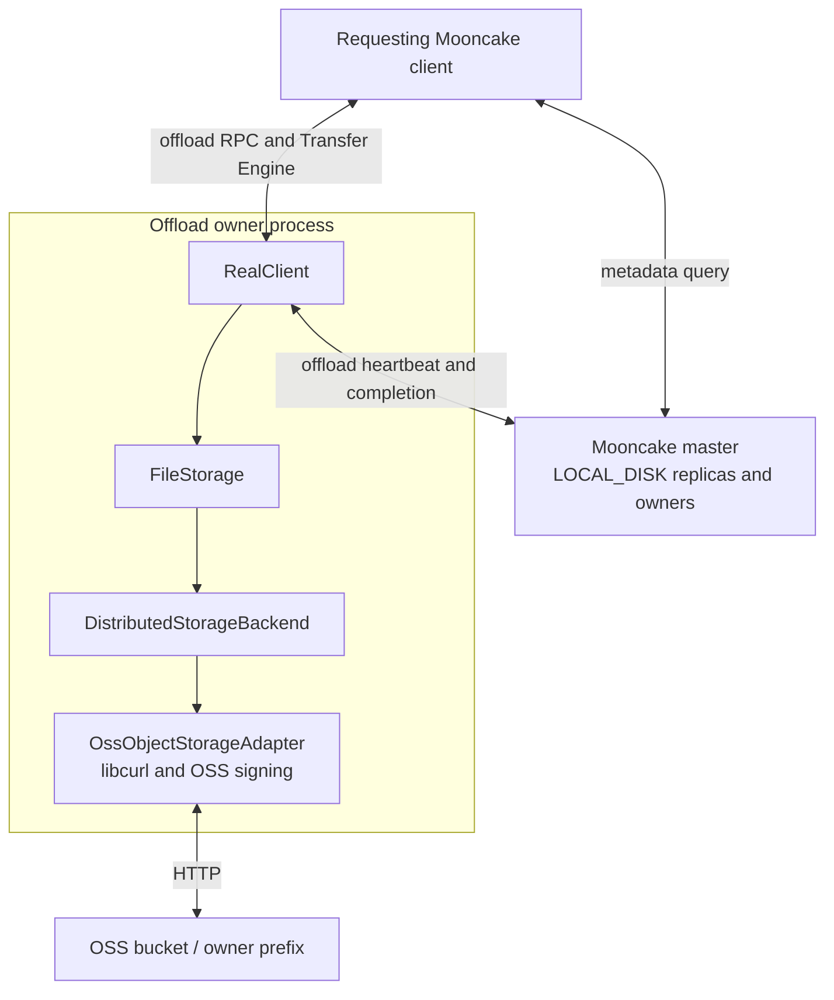
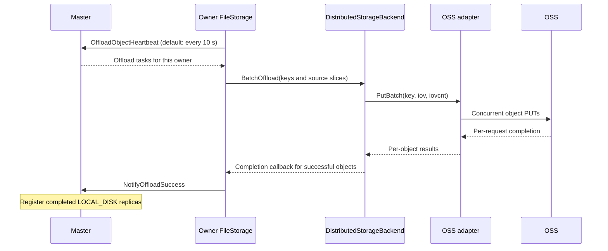
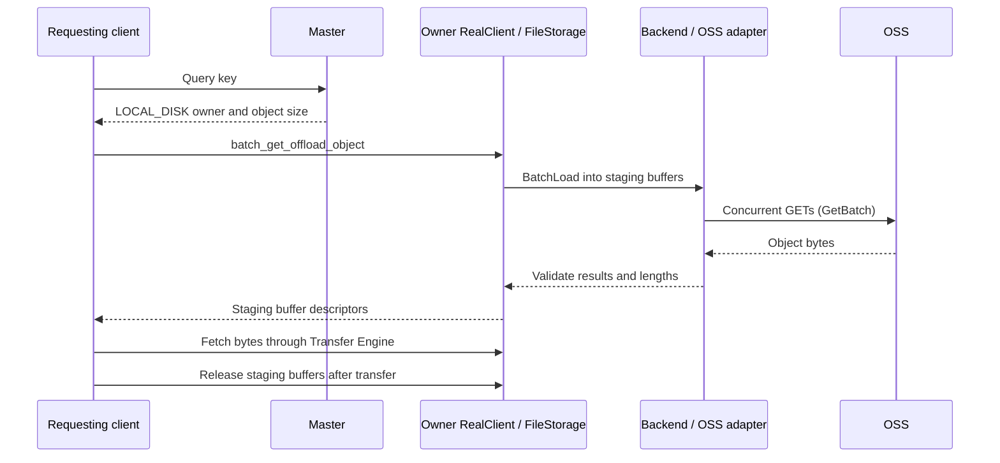

# OSS Backend Design

## Overview

The object-storage backend extends Mooncake Store's client-owned offload path
to key-based storage services, such as OSS and S3, through service-specific
adapters. It uses the same `LOCAL_DISK` replica model as local-file and NVMe KV
backends: the master records an owner and the requesting client reads through
that owner. Object storage is not a separate first-class replica type here.

This document describes the OSS adapter implementation. Its signing protocol
is OSS-specific. S3-compatible services use the separate S3 adapter
(`S3ObjectStorageAdapter`, AWS Signature V4); see "S3-compatible
configuration" in
[Object Storage Offload](../../deployment/object-storage-offload.md).

For prerequisites, configuration, and startup examples, see
[Object Storage Offload](../../deployment/object-storage-offload.md).

## Design Goals

- Reuse `FileStorage` offload coordination and existing Store APIs.
- Issue concurrent object GETs and PUTs within a synchronous batch.
- Give each batch its own libcurl multi handle, without a shared batch lock.
- Avoid a full-object intermediate string on the direct GET path and avoid
  concatenating upload slices into a full-object buffer.

## Architecture



## Layer Responsibilities

| Layer | Responsibilities |
|-------|------------------|
| Master | Schedule offload tasks and track completed `LOCAL_DISK` replicas and their owners. |
| `FileStorage` | Obtain source slices, call the selected backend, report successful writes, and manage read staging buffers. |
| `DistributedStorageBackend` | Convert `BatchOffload` / `BatchLoad` into object batches and check per-object results and read lengths. |
| `OssObjectStorageAdapter` | Map keys, sign HTTP requests, run libcurl transfers, and implement GET/PUT/HEAD/LIST/DELETE. |
| OSS | Store object payloads under the configured bucket and prefix. |

One `FileStorage` instance selects one backend. Selecting OSS does not also
enable the local-file or NVMe KV backend, or create an SSD-to-OSS cache hierarchy.

## Physical Keys and Object Layout

The adapter maps each storage key supplied by `FileStorage` to one OSS object:

```text
physical_key = owner_prefix + "/" + URIEncode(storage_key)
object_body  = concatenated payload slices
```

The prefix separator is omitted when the prefix is empty. LIST decodes matching
object keys back into logical storage keys; `ScanMeta` uses these keys and object
sizes for metadata registration.

There is no shard/offset allocation, per-object UUID descriptor, root manifest,
or adapter-level checksum envelope. A PUT targets the mapped key, not a
store-if-not-exists operation. Separate owner prefixes prevent owners from
overwriting each other's objects.

## Write Path



The application's memory `Put` is not a synchronous OSS write. Offload is
scheduled separately; only successful uploads are reported as completed
replicas. A batch is not a transaction: successful objects remain in OSS when
another upload fails.

## Read Path



The RPC coroutine posts blocking work to the existing blocking pool. It can
yield while a worker executes `BatchLoad`; the worker waits until the HTTP batch
finishes. No dedicated OSS worker pool is introduced.

`Get`, `GetRange`, and `GetBatch` copy incoming libcurl chunks directly into the
destination buffer. This removes the full-object response string and its final
copy, not all copies. `GetV` still reads into a contiguous temporary buffer and
then scatters. `PutV` / `PutBatch` consume iovec arrays through the upload
callback; copies into libcurl's upload buffer remain.

## Batch Execution

Each `GetBatch` or `PutBatch` call creates a temporary `CURLM` and one easy handle
per prepared request. It admits up to `MOONCAKE_OSS_MAX_CONNECTIONS` requests
(default: 64), advances them together, and admits more as requests complete.
Requests waiting for admission stay outside `CURLM` so that their transfer
timeout is not consumed in libcurl's connection queue.

Connections are reused within a batch, not across batches. Different caller
threads can execute separate batches concurrently; the limit is per batch,
not per adapter or process. Completion order may differ from input order, but
the returned result vector preserves input order and cardinality.

## Concurrency and Ownership

- Adapter APIs are synchronous: they return after batch processing and cleanup.
- Each batch owns its request contexts and libcurl handles; there is no shared
  `CURLM` or adapter-wide lock serializing complete batches.
- **Download buffers, upload iovec arrays, and upload payloads must remain alive
  until the call returns. Upload descriptors and payloads must not be modified
  while in use.**
- **A failed read may have partially modified its destination; do not consume
  that buffer as valid data.** A failed `BatchLoad` does not expose the batch as
  a successful Store read, even if some underlying GETs completed.

## Failure Semantics

| Condition | Behavior |
|-----------|----------|
| Invalid buffer or iovec arguments detected before batch setup | Return `INVALID_PARAMS` for that entry; other valid entries can proceed. |
| GET reports a missing object | Return `FILE_NOT_FOUND`. |
| GET returns an unexpected status or length | Return a read failure; a nonempty range GET requires HTTP 206 and the requested length. |
| PUT returns a non-success HTTP status | Return a write failure; do not report that object as successfully offloaded. |
| Transport error or timeout | Return a request error; a timed-out PUT does not prove that OSS stored nothing. |
| Request setup or multi-handle failure | Return errors for requests that could not complete; do not roll back successful cloud writes. |
| One object fails in a batch | Preserve per-object results; successful uploads are not automatically deleted. |

## Bounded Object I/O Component

`ObjectStorageBackend` provides synchronous I/O for caller-selected object names,
independently of the client-owned offload path above. Construct it with an
initialized `ObjectStorageAdapter` and `ObjectStorageBackendConfig`:

- `max_object_bytes` defaults to 256 MiB and limits the declared object size.
- `max_staging_bytes` defaults to 1 GiB and bounds concurrent host staging
  allocations within one backend instance. It does not include caller buffers
  or the adapter's own HTTP buffers.

`Write` validates and gathers all slices into a full-object host buffer, then
invokes the adapter's `Put` once. It requires enough staging budget for the
entire object. The adapter must advertise `SupportsSinglePutAttempt()`; otherwise
writes return `NOT_SUPPORTED` before staging or issuing PUT. OSS supports this
contract. The REST/S3 adapter automatically retries ambiguous uploads and is
rejected for these immutable-attempt writes; its legacy offload API is unchanged.
The optional `upload_started` output becomes true immediately
before the adapter call; an error with this flag set can have an ambiguous
remote outcome. The backend does not retry PUT.

`Read` validates the requested range against the caller-supplied object size,
then scatters exact range GETs into destination slices. Each staging allocation
is at most 4 MiB, or the configured staging limit if smaller. Reads fail on a
short response. OSS and the REST adapter used by S3 also validate `Content-Range`
against the requested offset and length, for both individual and batch reads.
Adapters that do not implement
the optional generic `GetRange` method return `NOT_SUPPORTED`.

Copy callbacks allow callers to stage device buffers. They must finish copying
before returning, and report failure with `false`. Invalid arguments return
`INVALID_PARAMS`; staging exhaustion returns `NO_AVAILABLE_HANDLE`; copy
failure returns `TRANSFER_FAIL`. Reservations are released on return or stack
unwinding. A failed read can leave destination buffers partially written.

This component does not allocate immutable names, manage read leases, publish
replicas, or decide when deletion is safe. Those responsibilities remain with
the caller, which can use the adapter's existing `Delete` operation. Sharing an
adapter across concurrent operations requires a thread-safe adapter.

## Durable Object Lifecycle Component (Draft)

This extracted component is under design review for
[RFC #4296](https://github.com/kvcache-ai/Mooncake/issues/4296#issuecomment-6393757368).
It is not wired into Master/Client operations. The implementation below still
maintains independent logical heads and commit flags; this is not an agreed
recovery authority for first-class replicas.

The integration proposal assigns logical visibility, current-value identity,
replica commit and lease/pin state to the Master's common metadata paths.
Object-specific durable records track immutable upload attempts, uncertain
outcomes and retirement/cleanup obligations. Extending the existing ordered
log, standby materialization and snapshots is the preferred direction to review;
the current catalog has not implemented that integration. Existing `PutEnd`
and DFS recovery cannot provide these guarantees unchanged.

Before integration, the review must settle durable acknowledgement and fencing,
consistent snapshot/replay of both logical state and pending obligations,
reconciliation of discrepancies and unfinished operations, and failover read
lease protection. A backend object must never become readable merely because it
exists, and an unfinished attempt must not be discarded merely because its
logical key was removed. The existing component tests do not verify these
Master/HA boundaries.

`ObjectStorageCatalog` pairs with the I/O component above. Production persistence
currently requires an initialized `EtcdHaKvBackend` and transactional etcd, even
without Master HA. The injected `HaKvBackend` interface also permits component
testing. Transaction support alone is insufficient: the backend must support
the catalog's keyspace and finite range operations. The existing Redis HA
backend accepts only oplog keys and is unsupported; catalog startup with it
returns `INVALID_PARAMS`.

The catalog stores Base64-encoded records under
`/mooncake/object-storage/<cluster_id>/`; cluster IDs must be nonempty and contain
neither `/` nor NUL. `ObjectStorageCatalogConfig.storage_namespace` binds the
catalog to the full provider, endpoint, bucket, region, prefix and path style.
Provider, endpoint, bucket and prefix must be nonempty. Credentials stay local
to the adapter. A changed target fails catalog startup.
If the durable catalog is lost or independently rebuilt, use a distinct cluster
ID and object prefix; generations must not restart against an old namespace.

The lifecycle is explicit:

1. `Open` acquires a strictly increasing epoch with a fresh owner identity and
   restores records and heads.
   Zero selects the next epoch automatically. Every mutation compares this
   durable fence, so an older catalog cannot authorize another upload.
2. `Prepare` durably allocates a bounded name from a SHA-256 digest of the
   cluster, tenant and logical key, followed by the generation. A logical key
   can be prepared again after its current attempt
   is retired. Names are never reused, including after physical reclamation.
3. `Claim` authorizes one physical PUT. Repeating the claim fails. The caller
   then calls the I/O backend and reports `COMPLETE`, `NOT_STARTED` or `UNKNOWN`
   through `Finish`. Completion notifications may be repeated; contradictory
   terminal outcomes are rejected. A new physical upload requires a new name.
4. `Commit` records foreground success and an optional checksum independently
   of upload completion. The integration must require both for a readable
   synchronous object replica. The catalog itself does not grant read leases
   or publish replicas.
5. `Retire` makes the attempt permanently ineligible for commit. The caller
   must first stop issuing new read leases and supply the latest outstanding
   lease deadline as absolute Unix time in milliseconds. Deadlines can be
   extended until reclamation is admitted;
   extending one after that point fails explicitly.
6. `Reclaim` waits for that deadline, performs provider DELETE outside the
   catalog mutex, and retains uncertain upload attempts for repeated deletion.
   An upload may materialize after a successful DELETE. Its tombstone remains
   until the uploader supplies a terminal outcome, followed by another cleanup
   round. A missing uploader can leave a tombstone indefinitely.

The defaults are 256 MiB per new object, 1 GiB of pending bytes, 10,000 pending
objects, and 32 inspected reclamation records per call. Each call rotates
through retired records so a persistent tombstone or future deadline cannot
starve later cleanup. DELETE requests are sequential and use the adapter's request
timeout; there is no separate wall-clock deadline for a reclamation call.
Upload intents, uncommitted uploads and retirement obligations consume pending
capacity. Retirement can increase backlog beyond admission limits; subsequent
admission applies backpressure. A known-not-started attempt can be replaced
atomically with the next generation, even with one pending slot.

Lost transaction replies are checked against all intended records and the
durable fence. If the outcome cannot be confirmed, operations fail closed until
`Open` succeeds again. Recovery retains pending obligations even when configured
admission limits are lower than the restored backlog. Logical heads remain
after physical GC to prevent older generations being reused or revived; heads
are not currently compacted.

`Find`, `Head` and `Records` read this catalog instance's recovered cache.
Master integration must enforce current leadership before using cached state
to grant leases or serve metadata.

This draft preserves the extracted catalog and its component regression tests
for focused review. The bounded I/O component is reviewed separately in
[PR #4727](https://github.com/kvcache-ai/Mooncake/pull/4727). Master/Client RPCs,
replica selection, source ownership and snapshot/HA reconciliation remain
unimplemented here; the first synchronous-replica feature requires those
correctness guarantees before it can be enabled.

## Current Limitations

- Readers depend on a reachable owner and valid Master metadata, not just the
  existence of an OSS object. This is different from a first-class DFS replica.
- Master capacity accounting uses each owner's configured capacity and live
  replica sizes. It neither queries OSS free space nor enforces a bucket quota.
- The backend does not implement capacity eviction or automatic cloud-object
  garbage collection. Removing Master metadata does not issue an OSS DELETE;
  metadata usage can therefore differ from actual bucket usage.
- Multipart uploads, automatic parallel range splitting, and automatic
  credential refresh are not implemented.
