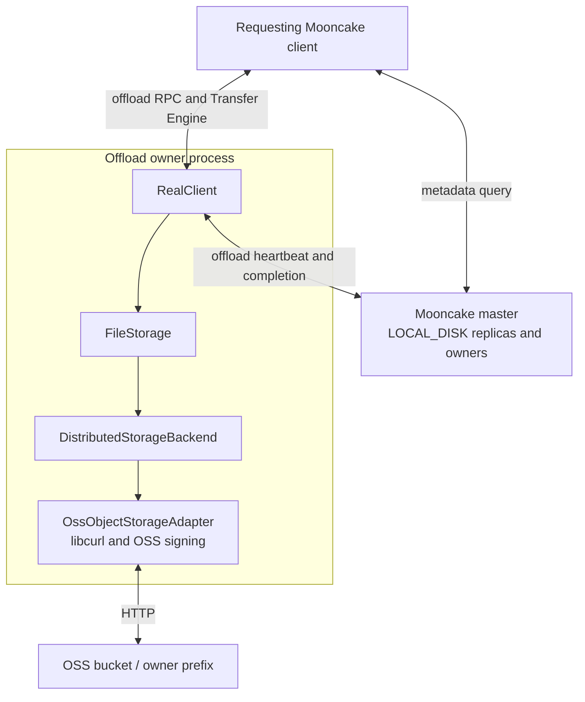
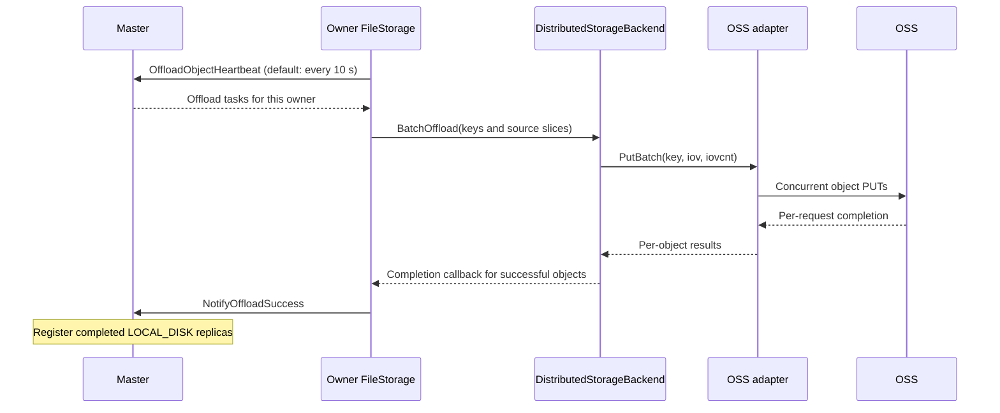
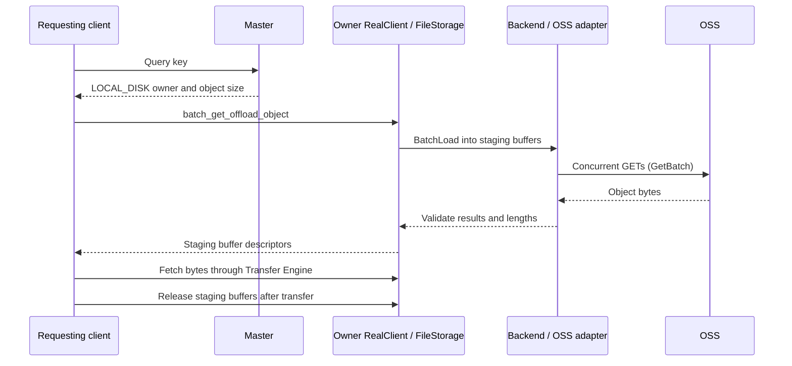

# OSS Backend Design

## Overview

The object-storage backend extends Mooncake Store's client-owned offload path
to key-based storage services, such as OSS and S3, through service-specific
adapters. It uses the same `LOCAL_DISK` replica model as local-file and NVMe KV
backends: the master records an owner and the requesting client reads through
that owner. This client-owned path remains available. The separate `OBJECT_STORAGE` tier described below supports direct reads without that owner.

This document describes the OSS adapter implementation. Its signing protocol
is OSS-specific; S3 requires a compatible adapter, not just a different endpoint.

For prerequisites, configuration, and startup examples, see
[OSS Local-Disk Backend](../../deployment/oss-offload.md).

## Design Goals

- Reuse `FileStorage` offload coordination and existing Store APIs.
- Issue concurrent object GETs and PUTs within a synchronous batch.
- Give each batch its own libcurl multi handle, without a shared batch lock.
- Avoid a full-object intermediate string on the direct GET path and avoid
  concatenating upload slices into a full-object buffer.

## Architecture



## Layer Responsibilities

| Layer | Responsibilities |
|-------|------------------|
| Master | Schedule offload tasks and track completed `LOCAL_DISK` replicas and their owners. |
| `FileStorage` | Obtain source slices, call the selected backend, report successful writes, and manage read staging buffers. |
| `DistributedStorageBackend` | Convert `BatchOffload` / `BatchLoad` into object batches and check per-object results and read lengths. |
| `OssObjectStorageAdapter` | Map keys, sign HTTP requests, run libcurl transfers, and implement GET/PUT/HEAD/LIST/DELETE. |
| OSS | Store object payloads under the configured bucket and prefix. |

One `FileStorage` instance selects one backend. Selecting OSS does not also
enable the local-file or NVMe KV backend, or create an SSD-to-OSS cache hierarchy.

## Physical Keys and Object Layout

The adapter maps each storage key supplied by `FileStorage` to one OSS object:

```text
physical_key = owner_prefix + "/" + URIEncode(storage_key)
object_body  = concatenated payload slices
```

The prefix separator is omitted when the prefix is empty. LIST decodes matching
object keys back into logical storage keys; `ScanMeta` uses these keys and object
sizes for metadata registration.

There is no shard/offset allocation, per-object UUID descriptor, root manifest,
or adapter-level checksum envelope. A PUT targets the mapped key, not a
store-if-not-exists operation. Separate owner prefixes prevent owners from
overwriting each other's objects.

## Write Path



The application's memory `Put` is not a synchronous OSS write. Offload is
scheduled separately; only successful uploads are reported as completed
replicas. A batch is not a transaction: successful objects remain in OSS when
another upload fails.

## Read Path



The RPC coroutine posts blocking work to the existing blocking pool. It can
yield while a worker executes `BatchLoad`; the worker waits until the HTTP batch
finishes. No dedicated OSS worker pool is introduced.

`Get`, `GetRange`, and `GetBatch` copy incoming libcurl chunks directly into the
destination buffer. This removes the full-object response string and its final
copy, not all copies. `GetV` still reads into a contiguous temporary buffer and
then scatters. `PutV` / `PutBatch` consume iovec arrays through the upload
callback; copies into libcurl's upload buffer remain.

## Batch Execution

Each `GetBatch` or `PutBatch` call creates a temporary `CURLM` and one easy handle
per prepared request. It admits up to `MOONCAKE_OSS_MAX_CONNECTIONS` requests
(default: 64), advances them together, and admits more as requests complete.
Requests waiting for admission stay outside `CURLM` so that their transfer
timeout is not consumed in libcurl's connection queue.

Connections are reused within a batch, not across batches. Different caller
threads can execute separate batches concurrently; the limit is per batch,
not per adapter or process. Completion order may differ from input order, but
the returned result vector preserves input order and cardinality.

## Concurrency and Ownership

- Adapter APIs are synchronous: they return after batch processing and cleanup.
- Each batch owns its request contexts and libcurl handles; there is no shared
  `CURLM` or adapter-wide lock serializing complete batches.
- **Download buffers, upload iovec arrays, and upload payloads must remain alive
  until the call returns. Upload descriptors and payloads must not be modified
  while in use.**
- **A failed read may have partially modified its destination; do not consume
  that buffer as valid data.** A failed `BatchLoad` does not expose the batch as
  a successful Store read, even if some underlying GETs completed.

## Failure Semantics

| Condition | Behavior |
|-----------|----------|
| Invalid buffer or iovec arguments detected before batch setup | Return `INVALID_PARAMS` for that entry; other valid entries can proceed. |
| GET reports a missing object | Return `FILE_NOT_FOUND`. |
| GET returns an unexpected status or length | Return a read failure; a nonempty range GET requires HTTP 206 and the requested length. |
| PUT returns a non-success HTTP status | Return a write failure; do not report that object as successfully offloaded. |
| Transport error or timeout | Return a request error; a timed-out PUT does not prove that OSS stored nothing. |
| Request setup or multi-handle failure | Return errors for requests that could not complete; do not roll back successful cloud writes. |
| One object fails in a batch | Preserve per-object results; successful uploads are not automatically deleted. |

## Current Limitations

- Readers depend on a reachable owner and valid Master metadata, not just the
  existence of an OSS object. This is different from a first-class DFS replica.
- Master capacity accounting uses each owner's configured capacity and live
  replica sizes. It neither queries OSS free space nor enforces a bucket quota.
- The backend does not implement capacity eviction or automatic cloud-object
  garbage collection. Removing Master metadata does not issue an OSS DELETE;
  metadata usage can therefore differ from actual bucket usage.
- Multipart uploads, automatic parallel range splitting, and automatic
  credential refresh are not implemented.


## First-class object replicas

Set `ReplicateConfig.os_replica_num = 1` to request one shared object replica
alongside at least one MEMORY replica. The default is zero. Enable the tier on
all participating processes with a build containing the OSS adapter and
`STORE_USE_ETCD`. Mixed-version clusters are not supported for this protocol.
A local SSD mount is not required.

The Master publishes the non-secret target configuration. Every Client uses its
own OSS credential environment variables from the deployment guide; the Master
needs DELETE access. Credentials are not included in descriptors or RPC config.
For example:

```bash
mooncake_master --port=50051 \
  --object_storage_enabled=true \
  --object_storage_endpoint=https://oss-cn-hangzhou.aliyuncs.com \
  --object_storage_bucket=my-bucket \
  --object_storage_region=cn-hangzhou \
  --object_storage_prefix=my-cluster/ \
  --object_storage_write_mode=sync \
  --ha_backend_connstring=http://127.0.0.1:2379 \
  --cluster_id=my-cluster
```

The same `object_storage_*` names are accepted in the Master config file.
`object_storage_provider` currently accepts `oss`. Endpoint path style is
controlled by `object_storage_path_style`; `object_storage_anonymous` is intended
for services which explicitly allow unauthenticated access, including isolated
HTTP tests. Normal OSS deployments supply credentials.

| Mode | Foreground success | Background behavior |
| --- | --- | --- |
| `sync` | Every requested foreground replica, including the object PUT, has completed and the Master commits the write. | MEMORY can subsequently be evicted. |
| `async` | Foreground transfers complete, the durable upload intent is recorded, and the source MEMORY replica is protected. | Its owner uploads and reports completion. |
| `offload_on_evict` | Foreground transfers complete and the deferred policy is recorded. | Eviction schedules upload; no MEMORY replica is evicted until the object completes. |

An owner must register object-upload capability before a background-mode write
is admitted. Uploads run on the Client's existing task executor. Only COMPLETE
objects are readable; MEMORY remains preferred. Ordinary reads, batch reads,
Python buffers and get-session ranges can use the shared object directly after
the memory owner exits. Range-only put sessions remain memory-only and reject
`os_replica_num > 0`; ordinary and batch Put/Upsert support the tier.

### Durability and reclamation

Enabling this tier requires the existing transactional etcd backend even when
Master HA is disabled. The namespace-fenced catalog lives under
`/mooncake/object-storage/<cluster_id>/`. It durably records foreground commits,
upload claims, source identities and pending deletions. Its binary payloads are
Base64 encoded for the existing JSON-based range interface. A restart restores
completed objects without requiring their former owner; HA reconciliation runs
after standby metadata restoration. Losing every MEMORY replica before a
background upload completes can still lose that object. The catalog keeps one
logical head per key after physical GC, so a lagging HA snapshot cannot revive
an older generation. These heads are not currently compacted; metadata usage
grows with the number of distinct logical keys ever written to this tier.

Endpoint, bucket, region and prefix must remain fixed for a catalog. Reusing a
cluster ID with a different target fails startup. Use a distinct cluster ID and
prefix for a rebuilt independent cluster.

Each write generation and retry after a failed upload gets a new object name.
An upload claim permits one PUT. This deliberately avoids retrying an ambiguous
PUT into a name whose DELETE may already have run. Completion notifications
are idempotent and release only their own source protection. Deletion retires
all attempts of the logical object durably before removing metadata. An active
background uploader prevents Remove/Upsert from freeing its source until its
completion notification arrives (`OBJECT_HAS_REPLICATION_TASK`); Move and
segment clearing also honor source references. If retirement cannot be
confirmed because the durable KV is unavailable, the operation returns an
error and stops granting new read leases; retry the deletion after KV recovery.
Reclamation waits until the
outstanding read lease has ended. Existing background maintenance issues
bounded DELETE requests without listing the bucket.

A timed-out PUT can materialize after a DELETE. Such an uncertain attempt keeps
a durable tombstone and is deleted again on later maintenance rounds. The
record is retained until the uploader confirms it has finished; an uploader
which permanently disappears can therefore leave a persistent tombstone.
Admission applies backpressure rather than discarding that uncertainty.
When the uploader confirms that no PUT was started, the catalog atomically
transfers the old attempt's reservation to a fresh name. This permits retries
with a single pending slot without dropping the durable retry intent.

Defaults: `object_storage_max_object_bytes=268435456` (256 MiB),
`object_storage_max_pending_bytes=1073741824` (1 GiB),
`object_storage_max_pending_objects=10000`,
`object_storage_maintenance_batch_size=32`, and
`object_storage_request_timeout_ms=30000`. Deferred policies do not consume the
pending upload budget until scheduled. Retired names also count against the
backlog budget. Client staging is bounded by the byte budget; reads use chunks
of at most 4 MiB. The first implementation processes object entries in batch
Put/Upsert sequentially; it does not claim HTTP batch throughput improvements.
Existing checksum metadata is used, never provider ETags.
A read which outlasts its lease returns `LEASE_EXPIRED`.

### Verification

`object_storage_test` exercises catalog fencing, lost transaction replies,
retirement/late PUT, admission limits, range validation, Master commit and
restart behavior, and eviction ordering. `object_storage_integration.py` starts
isolated etcd and Master processes plus an HTTP object fixture, then drives the
compiled Python SDK. Its HTTP fixture exercises the protocol and lifecycle; it
does not replace a live OSS signing/credential acceptance test. The existing
`oss_adapter_test` contains adapter fault-injection and opt-in live OSS tests.

With a CUDA build, add `--gpu` to the integration test to exercise device-memory
Put/Upsert, direct Get and get-session ranges. For example (set the build's
shared-library directories in `LD_LIBRARY_PATH` when not installed):

```bash
python mooncake-store/tests/object_storage_integration.py \
  --build build --etcd /path/to/etcd --gpu
```
