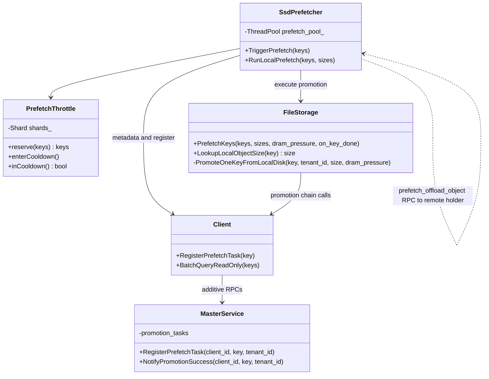
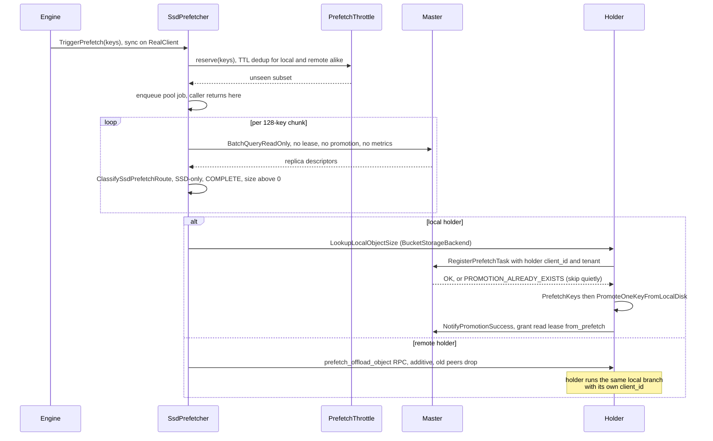
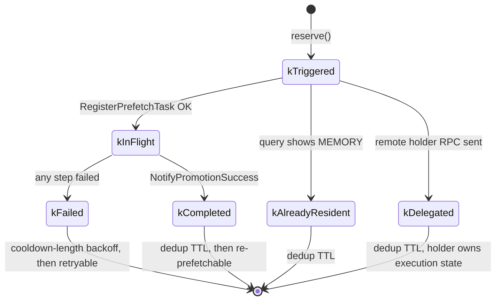
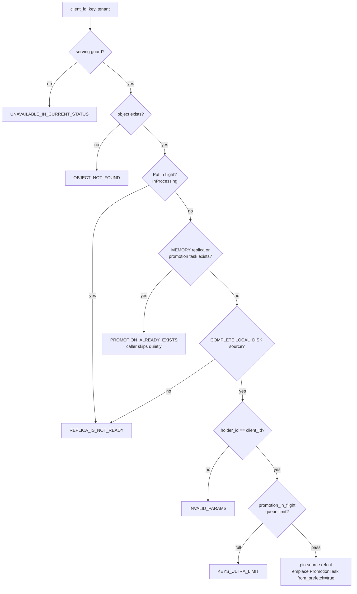
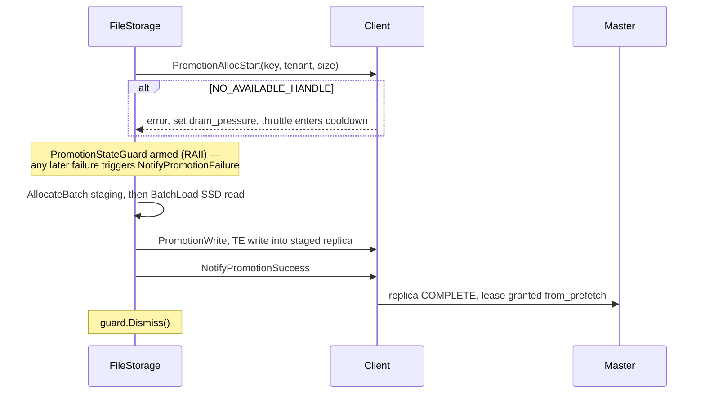

# SSD Prefetch-on-Exist

Related: RFC #2213, promotion-on-hit (PR #2071).

## Goal

`is_exist` / `batch_is_exist` with `ExistOptions.prefetch_to_memory = true`
triggers a best-effort SSD→DRAM promotion for keys that only have a
`LOCAL_DISK` replica so a follow-up `get()` can hit DRAM. Prefetch never blocks
the caller, does not alter exist/get semantics, and may be dropped on failure.
For a remote disk replica, the holder reads its local SSD and writes into a
cluster DRAM segment allocated by the master (`PromotionAllocStart` passes an
empty `preferred_segments` list, not necessarily the holder's own DRAM).

Off by default (`enable_ssd_prefetch = false`).

> **Backend scope:** On the disk holder, client prefetch queries on-disk size
> via `StorageBackendInterface::GetObjectDataSize()`, currently implemented
> **only by `BucketStorageBackend`**. Other backends return empty and skip
> prefetch. (Master `promotion-on-hit` uses the task's `size` directly and is
> unaffected.)

---

## Architecture & Trigger Flow

### Component architecture



### End-to-end trigger flow (exist probe)

On an embedded `RealClient`, `TriggerPrefetch` adds **no synchronous RPC** on
the caller's thread — it deduplicates via `PrefetchThrottle` and enqueues onto
a 4-worker pool. (`DummyClient` forwards `ExistOptions.prefetch_to_memory` to
its standalone `mooncake_client` via additive RPCs.) Metadata classification
uses read-only admin RPCs (`GetReplicaListForAdmin` /
`BatchGetReplicaListForAdmin`), so it grants no lease, never triggers
promotion-on-hit, and does not increment `valid_get`.



During client teardown, `SsdPrefetcher::Shutdown()` rejects new jobs, drains
queued and in-flight work, and joins the 4 workers before releasing client or
segment resources.

---

## PrefetchThrottle

16-shard per-key state machine (`reserve()` locks the target shard; cooldown
and disabled-TTL checks are lock-free atomics) with lazy per-entry expiry and
amortized per-shard sweeps (`O(batch)` per probe):



- **`ssd_prefetch_dedup_ttl_sec` (default 30 s)**: Suppresses re-triggering for
  healthy states (`kCompleted`, `kAlreadyResident`, `kDelegated`) at trigger
  time, preventing metadata-query storms on DRAM-resident keys.
- **`ssd_prefetch_cooldown_sec` (default 5 s)**: Shorter retry window for
  `kFailed` keys, and global backoff when `PromotionAllocStart` returns
  `NO_AVAILABLE_HANDLE` so prefetch yields DRAM to eviction/offload (`0`
  disables).

---

## Master: RegisterPrefetchTask

Additive RPC (older masters reject it and prefetch degrades to a no-op):



- Skips promotion-on-hit's frequency sketch, DRAM watermark gate, and heartbeat
  mailbox, but **shares** `promotion_in_flight_` / `promotion_queue_limit_` and
  per-key `promotion_tasks` so the two paths cannot double-promote a key.
- `NotifyPromotionSuccess` on a `from_prefetch` task grants the standard
  `default_kv_lease_ttl` read lease so the promoted replica survives until the
  follow-up `get()`.

---

## FileStorage Execution

`PromoteOneKeyFromLocalDisk` is shared verbatim by `ProcessPromotionTasks`
(promotion-on-hit) and `PrefetchKeys` (prefetch):



Failures past `PromotionAllocStart` release staged master state immediately via
`NotifyPromotionFailure` (RAII guard). Per-key errors never propagate; they
update `SsdMetric.prefetch_complete/fail_total` and `PrefetchThrottle`.

---

## exist / get Wiring

- **`exist`**: `is_exist` / `batch_is_exist` with
  `ExistOptions.prefetch_to_memory = true` and `enable_ssd_prefetch = true`
  calls `TriggerPrefetch` (or forwards via `DummyClient`).
- **`get` demand-side kick**: Supported read entrypoints whose best replica is
  `LOCAL_DISK` fire `TriggerPrefetch(disk_keys, ignore_cooldown=true)` before
  starting the SSD transfer, never blocking or waiting on promotions. The
  bypass applies only to the requester's client-side cooldown (master gates,
  dedup TTL, and remote holder cooldown still apply).

| Read API family | Client demand-side kick | Master `promotion-on-hit` |
|---|---|---|
| `get_buffer` (Python `get`, `get_tensor`; `DummyClient::get_buffer` shared-buffer fallback) | Yes (prefetch-enabled `RealClient`) | Yes |
| `batch_get_into_multi_buffers` (C / Python / `DummyClient` wrappers) | Yes (prefetch-enabled `RealClient`) | Yes |
| `batch_get_buffer` (Python `get_batch`, `batch_get_tensor`), `batch_get_into`, single-object `get_into` (`get_tensor_into`, `mooncake_store_get_into`), `batch_get_into_cuda_ipc`, `get_into_ranges*`, `batch_get_into_multi_buffer_ranges` | No | Yes |

---

## Compatibility & Configuration

- **Rolling-upgrade compatibility**: No existing RPC signature changes.
  `RegisterPrefetchTask`, `prefetch_offload_object`, and `DummyClient`
  exist-with-options RPCs are additive (older peers reject or fall back to
  ordinary exist queries). Read-only queries reuse existing admin RPCs.

| Key | Default | Meaning |
|---|---|---|
| `enable_ssd_prefetch` | `false` | Master switch (client config) |
| `ssd_prefetch_cooldown_sec` | `5` | DRAM-pressure backoff in seconds; `0` disables |
| `ssd_prefetch_dedup_ttl_sec` | `30` | Per-key trigger dedup TTL in seconds; `0` disables |

- **Requester vs. Holder**: Both sides must enable prefetch. The SSD holder
  needs `enable_ssd_offload` and a `BucketStorageBackend` storage directory; a
  requesting `RealClient` can enable `enable_ssd_prefetch=true` via
  `setup(dict)` without local offload or a DRAM segment.
- **Standalone `mooncake_client` & `DummyClient`**: Set
  `MOONCAKE_OFFLOAD_FILE_STORAGE_PATH` and enable `--enable_ssd_prefetch=true`
  (replace `192.168.1.10` with your addresses). Keep
  `--start_offload_rpc_server=true` for the dedicated offload RPC listener
  (when `false`, the main client RPC listener serves remote disk reads and
  prefetch). `DummyClient` (`setup_dummy()`) forwards
  `ExistOptions.prefetch_to_memory=true` to its `mooncake_client`.

```bash
mooncake_client \
  --host="192.168.1.10" \
  --master_server_address="192.168.1.10:50051" \
  --metadata_server="P2PHANDSHAKE" \
  --enable_offload=true \
  --enable_ssd_prefetch=true \
  --ssd_prefetch_cooldown_sec=5 \
  --ssd_prefetch_dedup_ttl_sec=30
```

---

## Code Map

- `prefetch_throttle.h` — sharded throttle state machine.
- `master_service.*` / `object_runtime_state.h` — `RegisterPrefetchTask`,
  `PromotionTask::from_prefetch`, prefetch lease in `NotifyPromotionSuccess`.
- `rpc_service.*` / `master_client.*` / `client_service.*` — RPC wiring.
- `file_storage.*` — `PrefetchKeys`, `PromoteOneKeyFromLocalDisk`,
  `LookupLocalObjectSize`.
- `storage_backend.*` — `GetObjectDataSize` (`BucketStorageBackend`).
- `ssd_prefetcher.*` — trigger/dedup/classify/delegate and worker pool.
- `real_client.*` — exist-path trigger, get-side kick.
- `replica.h` (`ExistOptions`), `store_c`, `store_py`, `dummy_client` — API
  plumbing.
