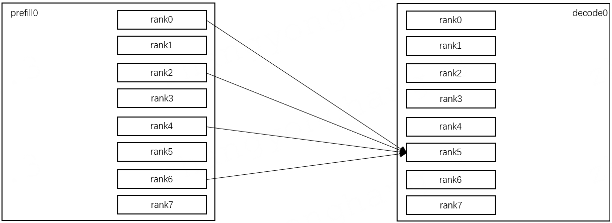
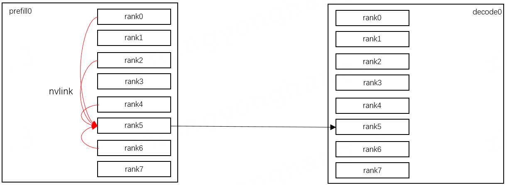

# RDMA Transport PXN Design: Keep KV-Cache Traffic on the Same Rail

## **Design Background**

Several prefill-decode (PD) disaggregated inference frameworks are widely deployed in production. During inference, each `tp_rank` on the prefill replica must transfer KV cache data to the corresponding `tp_rank` on the decode replica. The exact source-destination mapping is determined by the parallelism configuration (PP, TP, DP) of both the prefill and decode replicas.

A common hardware topology pairs each `tp_rank` with a dedicated NIC placed under the same PCIe switch as its GPU, so KV cache transfers can go over RDMA without traversing the CPU (i.e., GPU-Direct RDMA). This same-rail pairing makes cross-rail traffic unavoidable in the general case: when the source and destination `tp_rank` live on different rails, the RDMA traffic must traverse the spine-layer switches.

Spine switches are usually shared across tenants and workloads. Cross-rail RDMA bursts on these shared links can trigger excessive Priority Flow Control (PFC) pause frames. The pause frames propagate beyond the originating flow and interfere with every co-located RDMA workload that shares the same spine fabric. The resulting PFC storms directly degrade Time-To-First-Token (TTFT) latency and overall network stability of the inference service.

## **Core Design**

Each rank owns a dedicated proxy buffer on every other rank on the same host.

Example: prefill with pp_size=4, tp_size=2, dp_size=2; decode with pp_size=1, tp_size=8, dp_size=8; NIC bandwidth 400 Gbps.

Without PXN: RDMA traffic crosses rails in a 4-to-1 fan-in pattern; the bottleneck bandwidth is 400 Gbps.

With PXN: RDMA traffic stays on the same rail in a 1-to-1 pattern; the bottleneck bandwidth is still 400 Gbps, but the cross-rail spine traffic is eliminated.

TTFT performance comparison, benchmarked with the `sglang.bench_serving` tool.

|                                          | unit            | mooncake without pxn | mooncake with pxn    | (pxn-npxn/npxn) %    |
| ---------------------------------------- | --------------- | -------------------- | -------------------- | -------------------- |
| Serving Benchmark Result                 |                 |                      |                      |                      |
| Backend                                  |                 | sglang               | sglang               |                      |
| Traffic  request rate                 | reqs/s          | 10                   | 10                   | 0.00%                |
| Max  request concurrency              | reqs            | 64                   | 64                   | 0.00%                |
| Successful  requests                  | reqs            | 100                  | 100                  | 0.00%                |
| Benchmark  duration (s)               | s               | 11.92                | 11.87                | -0.42%               |
| Total  input tokens                   | toks            | 37302                | 37302                | 0.00%                |
| Total  input text tokens              | toks            | 37302                | 37302                | 0.00%                |
| Total  generated tokens               | toks            | 25600                | 25600                | 0.00%                |
| Total  generated tokens (retokenized) | toks            | 25473                | 25473                | 0.00%                |
| Request  throughput                   | req/s           | 8.39                 | 8.43                 | 0.48%                |
| Input  token throughput (tok/s)       | tok/s           | 3129.68              | 3143.13              | 0.43%                |
| Output  token throughput (tok/s)      | tok/s           | 2147.87              | 2157.1               | 0.43%                |
| Peak  output token throughput (tok/s) | tok/s           | 3152                 | 3169                 | 0.54%                |
| Peak  concurrent requests             | reqs            | 52                   | 50                   | -3.85%               |
| Total  token throughput (tok/s)       | tok/s           | 5277.54              | 5300.23              | 0.43%                |
| Concurrency                              | reqs            | 28.26                | 26.79                | -5.20%               |
| End-to-End Latency                       |                 |                      |                      |                      |
| Mean E2E Latency                         | ms              | 3368.68              | 3179.52              | -5.62%               |
| Median E2E Latency                       | ms              | 3428.55              | 3212.32              | -6.31%               |
| P90 E2E Latency                          | ms              | 3502.67              | 3372.4               | -3.72%               |
| P95 E2E Latency                          | ms              | 3516.5               | 3384.8               | -3.75%               |
| P99 E2E Latency                          | ms              | 3545.48              | 3470.62              | -2.11%               |
| Time to First Token                      |                 |                      |                      |                      |
| Mean TTFT                                | ms              | 1365.68              | 1184.27              | -13.28%              |
| Median TTFT                              | ms              | 1418.06              | 1209.52              | -14.71%              |
| <mark>P90 TTFT</mark>                    | <mark>ms</mark> | <mark>1502.48</mark> | <mark>1373.1</mark>  | <mark>-8.61%</mark>  |
| <mark>P95 TTFT</mark>                    | <mark>ms</mark> | <mark>1506.82</mark> | <mark>1399.61</mark> | <mark>-7.11%</mark>  |
| <mark>P99 TTFT</mark>                    | <mark>ms</mark> | <mark>1529.34</mark> | <mark>1454.31</mark> | <mark>-4.91%</mark>  |
| Time per Output Token                    |                 |                      |                      |                      |
| Mean TPOT                                | ms              | 7.85                 | 7.82                 | -0.38%               |
| Median TPOT                              | ms              | 7.87                 | 7.86                 | -0.13%               |
| <mark>P90 TPOT</mark>                    | <mark>ms</mark> | <mark>8.01</mark>    | <mark>7.98</mark>    | <mark>-0.37%</mark>  |
| <mark>P95 TPOT</mark>                    | <mark>ms</mark> | <mark>8.07</mark>    | <mark>8.01</mark>    | <mark>-0.74%</mark>  |
| <mark>P99 TPOT</mark>                    | <mark>ms</mark> | <mark>8.15</mark>    | <mark>8.04</mark>    | <mark>-1.35%</mark>  |
| Inter-Token Latency                      |                 |                      |                      |                      |
| Mean ITL                                 | ms              | 7.85                 | 7.82                 | -0.38%               |
| Median ITL                               | ms              | 7.87                 | 7.86                 | -0.13%               |
| P90 ITL                                  | ms              | 8.85                 | 8.37                 | -5.42%               |
| <mark>P95 ITL</mark>                     | <mark>ms</mark> | <mark>10.26</mark>   | <mark>8.91</mark>    | <mark>-13.16%</mark> |
| <mark>P99 ITL</mark>                     | <mark>ms</mark> | <mark>13.43</mark>   | <mark>11.8</mark>    | <mark>-12.14%</mark> |
| <mark>Max ITL</mark>                     | <mark>ms</mark> | <mark>40.46</mark>   | <mark>35.43</mark>   | <mark>-12.43%</mark> |

## **New Build Options and Environment Variables**

| Build option | Default | Description                                                                                                           |
| ------------ | -------:| --------------------------------------------------------------------------------------------------------------------- |
| `USE_PXN`    | `OFF`   | OFF: all PXN feature code is excluded from compilation. ON: PXN feature code is compiled and linked into the library. |

| Environment variable           | Default   | Description                                                                                                                            |
| ------------------------------ | ---------:| -------------------------------------------------------------------------------------------------------------------------------------- |
| `MC_PXN_SLOT_SIZE_KB`          | `1024`    | Size, in KB, of each GPU-memory slot on the proxy GPU. Slots are used as staging buffers that relay KV-cache data in transit.          |
| `MC_PXN_SLOT_COUNT_PER_WORKER` | `16`      | Number of slots per worker in the proxy GPU staging array.                                                                             |
| `MC_WITHOUT_PXN`               | *(unset)* | When set to `1`, the PXN runtime path is bypassed even if PXN code has been compiled into the build. Leave unset to enable PXN at run time. |
