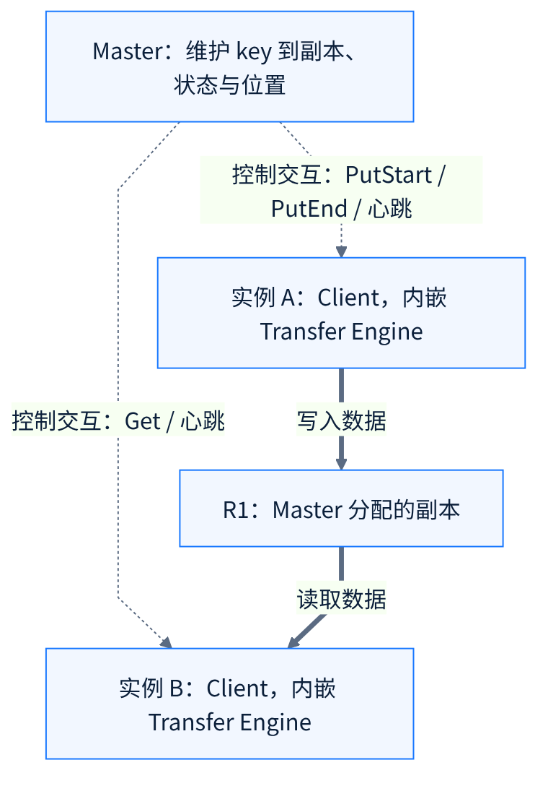
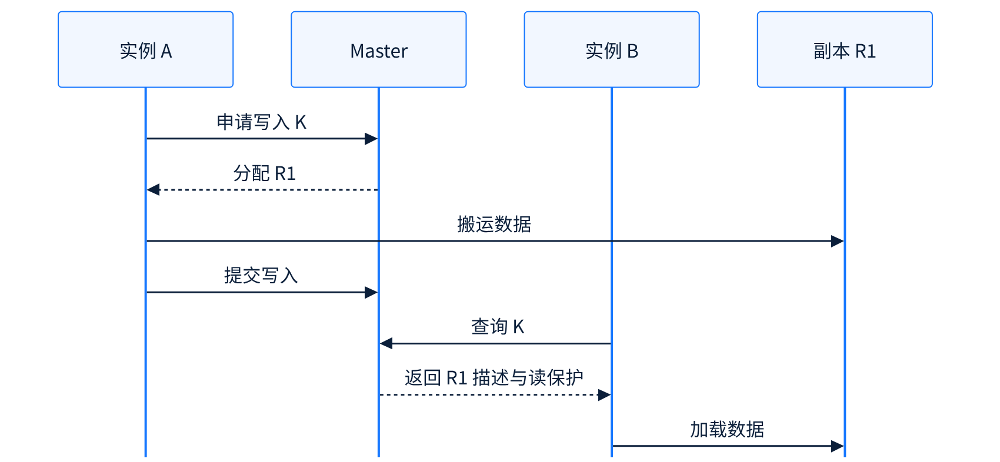

# 第1篇｜两台推理实例，怎么复用同一段 KV Cache？

**摘要：**实例 A 算过的前缀 KV 写进共享缓存后，实例 B 怎样找到并读取它？先从两台实例、三个角色看清控制流与数据流。

实例 A 收到一个长请求，算出了前缀的 KV Cache。

过了一会儿，实例 B 收到另一个请求，前缀与 A 处理过的内容高度相似。如果 B 重新做一次 Prefill，这部分计算就白费了。

即使 A 在自己的进程里保留了前缀缓存，B 也未必能访问这份缓存：它们可能在不同的进程、不同的机器上，显存与内存都不共享。

Mooncake 要解决的，就是让这段 KV 从"某个推理实例的私有状态"变成"其他实例也能找到并读取的共享数据"。

## A 算过的 KV，B 为什么可能用不上？

问题不在计算本身，而在**所有权与可见性**。

A 算出的 KV 默认属于 A 的推理进程。请求结束后，它可以被释放，也可以留在 A 的本地前缀缓存里。但无论哪种情况，B 都没有一个入口去访问它。

要让 B 复用，至少需要三件事：

1. A 把这段 KV 写入一个双方都能访问的位置。
2. B 用同一个 key 找到它。
3. 数据被真正搬进 B 的 KV cache，而不是只拿到一个地址。

Mooncake 提供了前两件事的基础设施：Mooncake Store 管理共享缓存，Transfer Engine 负责搬运数据。第三件事取决于推理框架如何接入。

## Master 管位置，Client 持有数据

可以把 Mooncake Store 想成一个分布式仓库。

**Master 维护目录**：某个 key 对应哪些副本，副本位于哪个节点，是否已经写完，什么时候可以回收。

**Client 有两个角色**：它既可以代表应用发起读写，也可以贡献一段本地内存，供其他 Client 存储对象。

因此，"客户端"不一定只是消费者。一个推理进程可以一边访问共享缓存，一边向资源池贡献容量；也可以只发请求，不提供存储。

实际搬运字节的是嵌入进程中的 Transfer Engine。它根据配置和运行条件，使用 TCP、RDMA 等后端完成传输。

图注：虚线表示控制交互，不表示单一方向；粗实线表示对象数据搬运，字节不经过 Master。R1 是 Master 为 key K 分配的目标副本。
**Master 维护的是数据的位置与状态，对象数据在 Client 之间传输。**

## 一次写、一次读：申请、搬运、提交、查询、加载

把 A 写、B 读串起来，一次复用可以分成五个动作：

1. **申请**：A 向 Master 发起 `PutStart`，申请写入 key `K`。
2. **搬运**：Master 分配副本 R1，A 通过 Transfer Engine 把数据写到 R1。
3. **提交**：A 调用 `PutEnd`，告诉 Master 这份副本已经写完、可以读。
4. **查询**：B 向 Master 查询 `K`，拿到 R1 的描述与读保护。
5. **加载**：B 从 R1 搬运数据，加载进自己的 KV cache。

这个顺序解决了一个关键问题：**空间已经分配，不代表里面的数据已经完整；数据已经搬完，也不代表读方可以使用。**

第3篇会把"搬运完成"与"提交可见"这两个时刻拆开；第4篇会解释读保护到期后，为什么读回字节仍可能被拒绝。

图注：复用成立的前提是同一 key、缓存格式兼容，且推理框架把数据真正加载进自己的 KV cache。图为普通成功路径，不展开失败与重试。
## 两类元数据，各管一层

Mooncake 里有两类元数据，容易混在一起：

- **Store Master** 管业务层：key 对应哪些副本、副本状态、位置与读保护。
- **Transfer Engine** 管传输层：连接信息与地址空间信息。

传输层的元数据可以由独立的 metadata service 管理，例如 etcd 或 HTTP 服务；也可以使用 `P2PHANDSHAKE` 这类配置直接握手，不必额外部署独立服务。

两类元数据服务于不同问题。看到"元数据服务"时，要先确认它指的是哪一层。

## 本篇范围

本系列聚焦 Mooncake Store 如何管理共享缓存，以及 Transfer Engine 如何搬运数据。

历史行号与完整调用链放在篇末的源码延伸里，正文只保留理解机制所需的函数名。`PutRevoke`、同 key 重试、lease 的完整语义分别留给第3、4篇；部署拓扑与 SSD 分层留给后续篇目。

把 KV Cache 放进共享池，并不自动等于数据库式的持久化保证。内存副本、SSD 副本、Master 高可用分别解决不同问题，需要分别配置、分别验证。

从成本上看，B 选择外部加载，是用一次网络搬运换掉一次 Prefill 计算。是否划算，取决于前缀长度、传输带宽、命中率与并发，不能只凭一个带宽数字推导端到端收益。

B 查到的是 key `K`。真正读取的，究竟是哪一份数据？

**源码延伸：**原系列篇0；`mooncake-store`、`mooncake-transfer-engine`。版本基线为 `v0.3.13.post1`。

- [Client 初始化参数](https://github.com/kvcache-ai/Mooncake/blob/719735896c86b56fabec6cf3e825fb2ea640597a/mooncake-store/include/real_client.h#L85)
- [Store 设计：Master 不接管数据流](https://github.com/kvcache-ai/Mooncake/blob/719735896c86b56fabec6cf3e825fb2ea640597a/docs/source/design/store/mooncake-store.md#L76)
- [Transfer Engine 设计：Segment 抽象](https://github.com/kvcache-ai/Mooncake/blob/719735896c86b56fabec6cf3e825fb2ea640597a/docs/source/design/transfer-engine/index.md#L21)

[源码解析版](../../00-architecture-overview.md) · [系列目录与排版说明](README.md)

[下一篇](02-objects-and-replicas.md)
