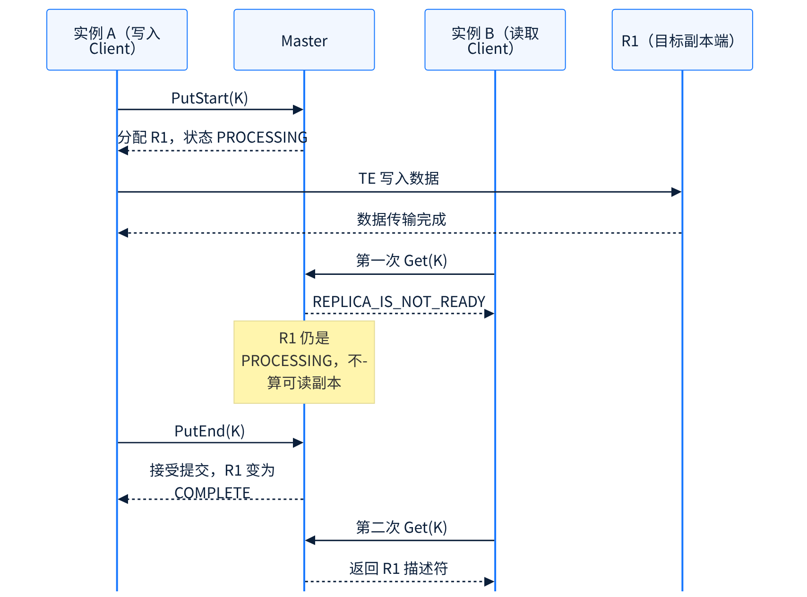

# 第3篇｜字节已经写完，为什么另一个 Client 还读不到？

**摘要：**A 的字节已经写完，B 仍可能查不到可读副本。数据搬完与副本提交，为什么是两个时刻？

实例 A 正在把前缀 KV 写入共享缓存，key 是 `K`。

数据已经开始通过网络搬运，另一台机器上的实例 B 恰好查询同一个 key。此时 B 应该读到什么？

如果系统只看"空间已经分配"，就可能把一份尚未写完的数据交出去。如果只看"字节已经到达"，又可能忽略提交这一步。

本篇讨论**普通新对象 Put**，不混入覆盖写。沿着 `Client::Put` 走一遍，看清数据搬完、副本提交、读方可见这三个时刻为什么不能合并。

## 先申请，再搬运，最后提交

一次 Put 可以拆成三个动作：

1. `PutStart`：向 Master 申请副本空间。
2. 数据传输：把字节写入目标地址。
3. `PutEnd`：提交写入结果，让副本变得可读。

`PutStart` 返回的不是"稍后告诉你"，而是**已经分配好的副本描述**：地址、长度、传输端点。此时副本已经进入 Master 的元数据表，但状态是 `PROCESSING`。

接下来，A 通过 Transfer Engine 把切片写到目标副本。传输返回成功，只说明字节到了远端内存段，**不说明这份副本可以被读**。

真正打开可见性的是 `PutEnd`。Master 把目标副本从 `PROCESSING` 翻成 `COMPLETE`，`Client::Put` 才返回成功。

图注：这是普通成功路径。数据流只发生在 A 与 R1 之间；指向 Master 的箭头只表示申请、查询或提交。B 第二次拿到的是读取候选，后续读取仍可能失败。
## 可读副本是过滤出来的

B 第一次查询时，对象其实已经存在——`PutStart` 就把它插进了元数据表。但 Master 返回的不是"对象不存在"，而是 `REPLICA_IS_NOT_READY`。

原因在 `GetReplicaList`：它遍历副本，只把通过 `IsReplicaReadable` 的副本放进返回列表。

`IsReplicaReadable` 要求三件事：

- 副本状态是 `COMPLETE`；
- 内存或 NoF 句柄仍然有效；
- 传输端点没有被标记为失效。

`PROCESSING` 在第一步就被排除。所以"对象查得到"和"副本读得到"是两件事。

如果整个副本列表为空，Master 还会再分一次：

- 所有副本都是 `REMOVED`：返回 `OBJECT_NOT_FOUND`，让调用方放弃；
- 仍有未完成或不可用副本：返回 `REPLICA_IS_NOT_READY`，值得短暂重试。

**分析：**这两个错误码的区别，直接决定上层该不该重试。把 `REPLICA_IS_NOT_READY` 当成对象不存在而放弃，会错过马上就能读到的数据。

## 失败时，提交与撤销如何分工

空间申请成功，后续传输仍可能失败。客户端不能把所有申请过的位置都标记为成功，也不能把已完成的一侧一起撤销。

`Client::Put` 在传输结束后调用 `DetermineFinalizeDecision`，由它决定 `PutEnd` 与 `PutRevoke` 分别作用于哪一类副本。

默认可靠模式下，条件是严格的：

- 分配到的副本数量满足配置；
- **已分配副本的传输全部成功**。

两者都满足才 `PutEnd(ALL)`；否则 `PutRevoke(ALL)`，本次 Put 失败。

双副本模式 `FLEXIBLE_DUAL_REPLICA` 放宽了要求：

- 内存与 NoF 两侧都成功：`PutEnd(ALL)`；
- 只有内存成功：`PutEnd(MEMORY)` + `PutRevoke(NOF_SSD)`；
- 只有 NoF 成功：`PutEnd(NOF_SSD)` + `PutRevoke(MEMORY)`；
- 两侧都失败：`PutRevoke(ALL)`。

所以同一条"Put 成功"，在不同配置下强度不同。默认路径要求分配到的副本全部成功；双副本模式只要求一侧成功。调用方若依赖副本数，应当读配置或指标，而不是假设。

`PutRevoke` 本身也有限制：它只撤销仍处于 `PROCESSING` 的目标副本。如果目标类别里已经有非 `PROCESSING` 的副本（例如 `COMPLETE`），Master 返回 `INVALID_WRITE`，而不是误删已完成的数据。这正好要求调用方"提交成功的那一类，撤销失败的那一类"。

## 三种异常

### 传输失败

按上一节的提交条件处理：能提交的提交，不能提交的撤销，最终是否成功由 `DetermineFinalizeDecision` 决定。不要笼统地说"Put 失败了"，要区分是空间不足、部分副本失败，还是全部失败。

### Client 在提交前退出

A 完成了 `PutStart`，却在 `PutEnd` 或 `PutRevoke` 之前崩溃。对象停在 `PROCESSING`，既不可读，也挡住后续同 key 写入。

Master 用两个超时收尾：

| 参数 | 默认 | 作用 |
|---|---|---|
| `put_start_discard_timeout_sec` | 30 秒 | 超时后允许同 key 的新 `PutStart` 顶替旧对象 |
| `put_start_release_timeout_sec` | 600 秒 | 超时后旧对象占用的空间才可被回收 |

**关键细节**：顶替不是复用旧空间，而是重新分配。旧的 `PROCESSING` 副本被移入 `discarded_replicas_`，等第二个超时到期后才释放。所以客户端消失后，资源不会立刻恢复，30 秒内它仍是故障源。

### Master 已接受 PutEnd，但响应丢失

A 发出 `PutEnd`，Master 执行成功，响应却在网络中丢失。

对 A 来说，这次调用超时了；对 Master 来说，对象已经 `COMPLETE`。

**超时只能说明客户端没拿到结果，不能证明服务端没有执行。**

此时如果 A 重试同一个 key 的 Put：`PutStart` 发现已有 `COMPLETE` 副本，返回 `OBJECT_ALREADY_EXISTS`；`Client::Put` 把这个错误当成功返回，已有内容不变。

这带来一个必须理解的结果：重试是幂等的，但不是覆盖。

## 同 key 再写：重试、幂等与覆盖

普通 Put 遇到已存在的 key，语义是"保留已有内容 + 幂等成功"，不是"用新数据替换旧数据"。

- 已有 `COMPLETE` 副本：`OBJECT_ALREADY_EXISTS`，`Client::Put` 返回成功，内容不变。
- 仍是 `PROCESSING` 且未超过 discard 超时：同样返回 `OBJECT_ALREADY_EXISTS`。
- 超过 discard 超时：允许新 `PutStart` 顶替，重新分配空间。

如果业务需要替换内容，应使用 `Upsert`，并核对它在并发写入下的语义。把 Put 重试当成覆盖写，是这里最容易犯的错。

字节已经写完，B 也终于从 R1 读回了数据。但读回来的字节，这次 Get 为什么还可能失败？

**源码延伸：**原系列篇2；`Client::Put`、`PutStart`、`PutEnd`、`PutRevoke`、`IsReplicaReadable`。版本基线为 `v0.3.13.post1`。

- [Client::Put](https://github.com/kvcache-ai/Mooncake/blob/719735896c86b56fabec6cf3e825fb2ea640597a/mooncake-store/src/client_service.cpp#L1853)
- [PutStart](https://github.com/kvcache-ai/Mooncake/blob/719735896c86b56fabec6cf3e825fb2ea640597a/mooncake-store/src/master_service.cpp#L4292) · [PutEnd](https://github.com/kvcache-ai/Mooncake/blob/719735896c86b56fabec6cf3e825fb2ea640597a/mooncake-store/src/master_service.cpp#L4509) · [PutRevoke](https://github.com/kvcache-ai/Mooncake/blob/719735896c86b56fabec6cf3e825fb2ea640597a/mooncake-store/src/master_service.cpp#L4776)
- [IsReplicaReadable](https://github.com/kvcache-ai/Mooncake/blob/719735896c86b56fabec6cf3e825fb2ea640597a/mooncake-store/src/master_service.cpp#L3546)

[源码解析版](../../02-put-path.md) · [系列目录与排版说明](README.md)

[上一篇](02-objects-and-replicas.md) · [下一篇](04-get-and-lease.md)
