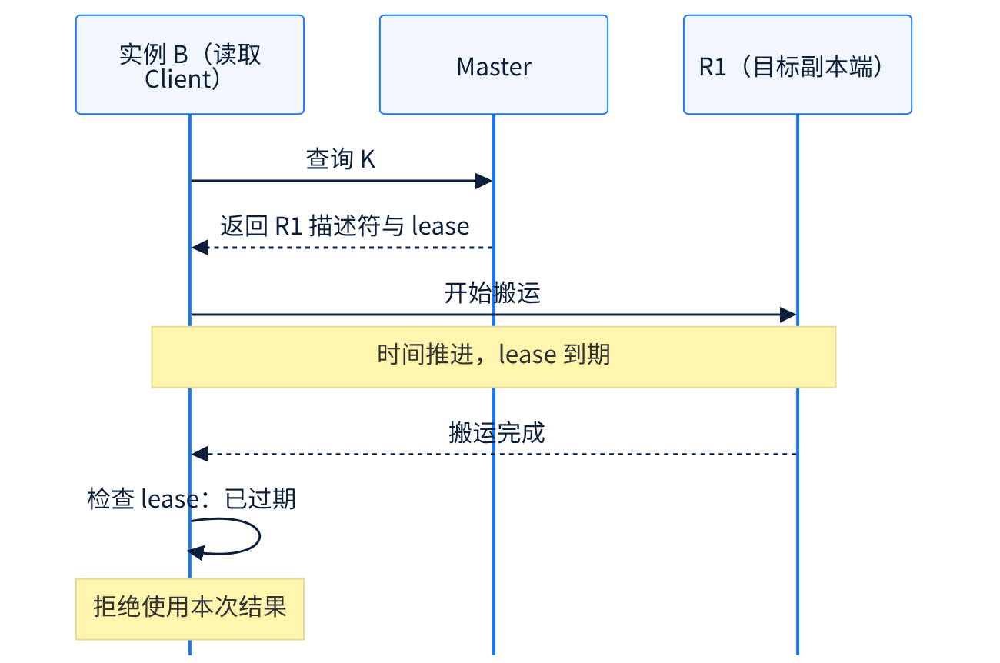
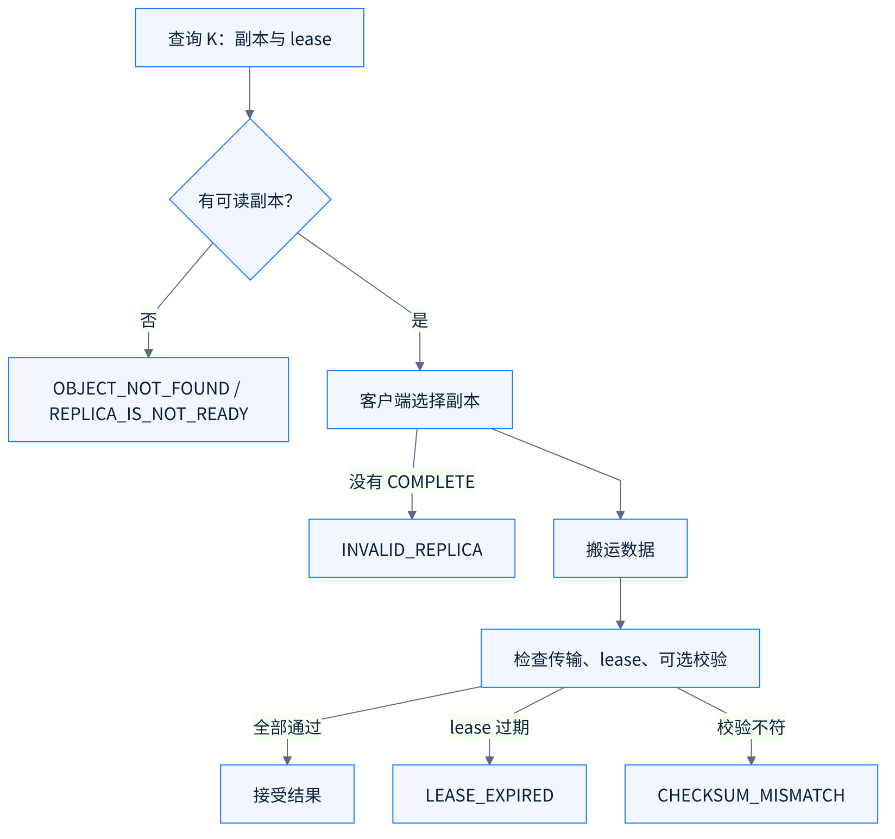

# 第4篇｜字节读回来了，这次 Get 为什么还可能失败？

**摘要：**B 从 R1 读回了字节，这次 Get 仍可能失败。定位、搬完、可接受，是三个不同时刻。

实例 B 查询 key `K`，Master 返回 R1 的副本描述与一段读保护。

B 开始从 R1 搬运数据。传输很慢，跨过了 lease 的截止时间。字节最终全部到达本地 buffer。

这时候，这次 Get 算成功吗？

答案取决于一个容易被忽略的顺序：**数据搬完在前，结果检查在后。** 本篇把一次 Get 拆成"已定位、已搬完、可接受"三个时刻，说明为什么读回字节不等于可以接受结果。

## 先看一次跨过 lease 到期的读取

读方拿到副本描述后，系统不能马上把对应空间用于其他对象，否则读方可能访问到已被复用的数据。

Lease 提供的正是这个有边界的读取窗口。它保护的不只是地址，而是"在这段时间内，这份数据不会被正常删除或淘汰"。

Master 在返回可读副本列表时授予 lease，并在响应里带上 TTL。客户端不是直接使用 Master 的时间，而是用本地单调时钟的起点加 TTL，算出自己的截止时间。

图注：时间线是「获得描述与读保护 → 开始搬运 → lease 到期 → 搬运完成 → 检查结果」。事后复查发生在 `Client::Get` 的 `TransferRead` 与可选 checksum 之后，条件是本地 `steady_clock` 到达截止点，结果为 `LEASE_EXPIRED`。该复查适用于经 `Client::Get` 的路径；`v0.3.13.post1` 的 LOCAL_DISK 全量 offload 路径直接返回，不经过它。
这里体现的是"尽力读 + 事后否决"：先完成传输，再判断这次读取是否仍在承诺窗口内。

**分析：**好处是实现简单，不需要在传输前阻塞等待；代价是 lease 过期时已经浪费了一次带宽。对 KV Cache 这种"读失败可以重算"的场景，这个取舍是成立的。

## 已定位、已搬完、可接受

把一次 Get 压缩成四个阶段，会更容易定位问题出在哪：

1. **查询**：从 Master 拿到可读副本列表与 lease。
2. **选择**：客户端在列表里挑一个副本。
3. **搬运**：按副本介质和目标 buffer 选择传输方式。
4. **检查**：传输结果、lease、可选校验全部通过，才接受结果。

图注：图把一次 Get 压成四个阶段，分支只标错误类别；具体搬运路径取决于副本介质和目标 buffer。
有两个细节需要说清楚。

第一，**Master 只过滤并返回可读副本列表，不替客户端选副本。** 选择发生在客户端：

- `Client::Get` 内部调用 `FindFirstCompleteReplica`，取列表中第一个 `COMPLETE` 副本；
- `RealClient` 的 ranged 路径在进入 `Client::Get` 之前，用 `SelectBestReplica` 先选一次，再把副本列表裁成只剩选中的那一个。

`SelectBestReplica` 会跳过非 `COMPLETE` 副本，优先级是：本地 MEMORY → 本地 NOF_SSD → 远端 MEMORY（可评分）→ 远端 NOF_SSD → LOCAL_DISK → DFS → DISK。

第二，搬运方式取决于介质和目标：

| 副本类型 | 目标 buffer | 路径 |
|---|---|---|
| MEMORY | 主机且可直读 | 交给 Transfer Engine 读到目标 buffer |
| MEMORY | GPU 等设备 | 主机暂存后再复制到目标 |
| LOCAL_DISK | 任意 | 存储节点执行 offload 读取 |
| DISK / DFS | 任意 | 临时 buffer 后再 scatter |

"直读目标 buffer"通常表示避免额外的应用层中转，**不是对所有后端、所有设备的零拷贝承诺**。TCP、RDMA、GPU 路径内部是否拷贝，要按实际后端判断。

## lease 到期，不等于空间立即回收

有效期内的 lease 会阻止普通 `Remove` 与淘汰路径回收这份对象；删除侧遇到的 `OBJECT_HAS_LEASE` 就是这一保护的证据。

但 lease 到期只代表**保护窗口结束**，不代表对象立刻被删除。实际回收还要经过淘汰、引用计数、后台任务等一系列判断。

所以不要把两件事混为一谈：

- `LEASE_EXPIRED`：这次读取的结果不再受承诺保护，客户端应拒绝使用；
- 空间已回收：对象真的被删除或复用了。

前者是读方看到的错误，后者是资源侧的动作。中间隔着完整的回收判断。

## 错误分三段保留

把错误按阶段分开，上层才能决定是重试、换副本，还是重算。

**查询阶段**

- `OBJECT_NOT_FOUND`：对象不存在，或所有副本都已 `REMOVED`。应当放弃。
- `REPLICA_IS_NOT_READY`：对象存在，但暂时没有可用副本。值得短暂重试。

**选择阶段**

- `INVALID_REPLICA`：列表里没有选到 `COMPLETE` 副本。

**搬运与完成检查**

- `INVALID_PARAMS`：目标 buffer 小于对象大小。系统不会截断读取，避免调用方误以为读全了。
- 传输错误：保留后端返回的具体错误，不要统一成"Get 失败"。
- `LEASE_EXPIRED`：字节可能已经读到，但结果不再受保护。按可重试错误处理，而不是数据损坏。
- `CHECKSUM_MISMATCH`：仅在启用 checksum 且期望值不符时出现。该校验默认关闭，不要写成默认路径。

错误分类越准确，越容易判断问题发生在查询、选择、搬运还是完成检查阶段。

回到开头那条主线：A 算出前缀 KV，以 key `K` 写入共享缓存；Master 先分配 R1 并置为 `PROCESSING`，A 搬运完成后用 `PutEnd` 把 R1 发布为可读；B 查询到 R1 与 lease，搬运数据，再检查传输、校验与 lease，全部通过才接受结果。

下一篇回到源码入口，看看怎样用这套思路追一条读写链路。

**源码延伸：**原系列篇3；`Client::Get`、`QueryResult::IsLeaseExpired`、`SelectBestReplica`、`GetReplicaList`。版本基线为 `v0.3.13.post1`。

- [Client::Get](https://github.com/kvcache-ai/Mooncake/blob/719735896c86b56fabec6cf3e825fb2ea640597a/mooncake-store/src/client_service.cpp#L1352) · [IsLeaseExpired](https://github.com/kvcache-ai/Mooncake/blob/719735896c86b56fabec6cf3e825fb2ea640597a/mooncake-store/include/client_service.h#L60)
- [SelectBestReplica](https://github.com/kvcache-ai/Mooncake/blob/719735896c86b56fabec6cf3e825fb2ea640597a/mooncake-store/include/replica_selection.h#L123)
- [GetReplicaList](https://github.com/kvcache-ai/Mooncake/blob/719735896c86b56fabec6cf3e825fb2ea640597a/mooncake-store/src/master_service.cpp#L3626)

[源码解析版](../../03-get-path.md) · [系列目录与排版说明](README.md)

[上一篇](03-put-visibility.md) · [下一篇](../05-source-reading.md)
