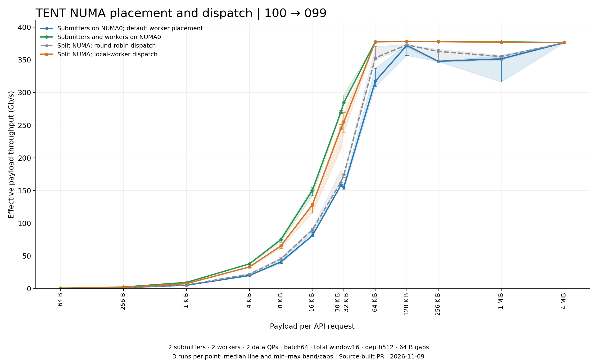

# RDMA worker NUMA placement and dispatch

The default placement and submission policy remain unchanged. The following
options under `transports/rdma/workers` are opt-in:

| Option | Default | Meaning |
| --- | --- | --- |
| `numa_nodes` | `[]` | Keep legacy placement. `[0]` places every worker on node 0; a list with exactly `num_lanes` entries assigns one node per worker. Repeated node IDs are allowed. |
| `prefer_local` | `false` | Prefer successfully bound workers on the submitting thread's current NUMA node. |

For two workers on node 0:

```json
{
  "transports": {
    "rdma": {
      "num_lanes": 2,
      "workers": {"numa_nodes": [0], "prefer_local": true}
    }
  }
}
```

For one worker on each of nodes 0 and 1, use `"numa_nodes": [0, 1]` instead.
Choose nodes for the application's topology; node 0 is only an example.
These settings do not change the data QP count, request slicing, completion
semantics, batch size, in-flight window, or QP depth.

Locality is sampled once per API submission. Slices are distributed round-robin
among eligible local workers. If none is local or the current node cannot be
queried, the existing global round-robin distribution is used. Migrating
submitters are re-evaluated on the next submission. Internal retry and ownership
paths retain their explicit worker destinations.

Explicit placement accepts a single nonnegative node ID or one per worker;
malformed lists and unavailable nodes fail initialization. Opt-in binding
intersects the node's CPUs with each worker's inherited CPU affinity. It never
widens a user's taskset restriction. A binding failure logs a warning and keeps
the worker's inherited affinity; that worker is excluded from local preference
but remains available to the global fallback. During startup, workers whose
binding has not yet been published are also excluded from local preference.

NUMA configuration is read at transport initialization; changing a live Config
object does not rebind workers. Local preference can concentrate traffic on
fewer lanes if submitters are unevenly distributed. Benchmark the actual
submitter, memory, and NIC topology before enabling it. The runtime prototype
results in RFC #5307 are motivation, not performance guarantees for this source
implementation.

## Tests

Build from the repository root with `USE_TENT=ON`, `USE_CUDA=OFF`, and
`BUILD_UNIT_TESTS=ON`, then run:

```sh
ctest --test-dir build --output-on-failure -R '^(worker_numa_test|tent_rdma_transport_test)$'
```

`worker_numa_test` exercises configuration validation, local subset selection,
global fallback, and preservation of inherited CPU affinity. The transport test
also checks the published binding state used by submission. RDMA hardware tests
may skip when no device is available; CPU-only results do not validate bandwidth.

## Measured throughput



A source-built RDMA WRITE sweep on node pair 100 to 099 covers 13 request sizes
from 64 B to 4 MiB. Each point has three runs; lines show medians and bands/caps
show the measured minimum and maximum. The [summary CSV](figures/numa-throughput.csv)
contains the values used in the figure.

All four configurations use two submitters, two workers, two data QPs, API
batch64, a total in-flight batch window of 16, per-QP depth512, 64 KiB slicing,
and 64 B gaps between requests. The NIC and payload buffers are on NUMA0.
Each run warms up for one second and measures for approximately five seconds,
including drain time. Payload contents, gaps, guard regions, completed bytes,
and payload page placement are checked. Servers are shared with other workloads.

Compare `disabled` with `same` for worker placement (submitters stay on NUMA0),
and `split` with `local` for dispatch (submitters and workers span NUMA0/1).
The full sweep was measured on November 9, 2026, using this patch on base commit
`5afbe8aaeeef195916d86b553d9d8a6489b8c888`.
